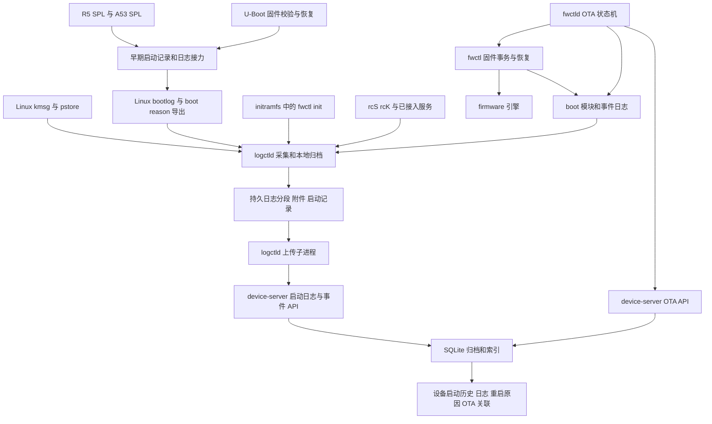

# AM625 固件恢复与启动日志软件架构及开发计划

更新日期：2026-11-03。本文是后续开发与验收基线；文中的拟新增接口、目录和指标不代表当前已经实现。

当前应在现有 A/B 固件、initramfs 和 SOL 基础上，补齐启动事件、重启原因、崩溃附件上传和可靠保留策略。首先完成设备本地保存与故障恢复，再完善服务器归档和检索；日志服务和网络故障不能阻断正常启动、看门狗接管或已有有效固件的回退。

## 1 需求与边界

实际设备关系为 `卫星平台 ↔ AM625 ↔ 载荷服务器 Linux 与 BMC`。BMC 属于载荷服务器，不能假定它能复位、供电控制或接收 AM625 的物理串口。Device Manager 是本计划使用的管理服务，其部署位置与上传链路由配置决定，不作为 AM625 本地启动的前提。

本期覆盖：

- AM625 固件的内容身份、分区校验、更新、回退、恢复和结果记录。
- R5 SPL、A53 SPL、U-Boot、Linux、initramfs、启动脚本及已接入服务的日志采集。
- 日志在设备上持久化、断网保留、恢复联网后补传和服务器历史归档。
- 每次启动的硬件复位源、软件重启意图、崩溃证据和恢复动作。
- AM625 的 SD 与 eMMC 存储适配；两种介质分别验收。

本期不开发遥测业务缓存、遥控事务协议、载荷服务器/BMC 管理、i.MX6ULL、NOR/NAND、差分固件或交互式远程 shell。EDK 继续负责外设管理。保持单个 Buildroot `device-manager` package，按选项安装 host/target 产物。固件版本保持 `v0.0.1`，以完整 SHA256 区分内容；人读日志显示前 8 位。

## 2 核查基线与已实现能力

本次核查源码及已有验证资料，没有新增设备写入、重启或故障注入。基线提交为 workspace `159f105`、device-manager `5d36e51`、bsp-base-external `d7360aa`、U-Boot `72ee0fb0`、Linux `b5962f598`。

“源码已实现”“已有实机记录”和“完整故障验收通过”是不同状态。一次 OTA success 只能证明相应版本启动并通过当时的健康检查，不能证明所有掉电、崩溃和 bootloader 场景。

| 能力 | 当前实现及证据 | 后续处理 |
| --- | --- | --- |
| 固件身份 | release 使用版本与完整内容 ID；OTA 与精确恢复已按身份匹配 | 保留；在所有结构化事件中显式关联身份 |
| A/B 更新 | 固件引擎具有布局检查、存储锁、writing/ready 状态、写后读回、双副本 CRC 元数据 | 保留；补齐每个提交边界的断电验收 |
| 启动确认与回退 | boot-testing、有限启动尝试、健康确认、失败回退；已有实机成功和回退记录 | 记录失败阶段、尝试计数和回退前后身份 |
| kernel 恢复 | U-Boot 已实现按已记录版本/ID请求对应 kernel FIT并检查包内容 | 不能当作 bootloader 自恢复；补齐离线和中断恢复证据 |
| rootfs 恢复 | `fwctl init` 在 RAM 中校验完整 payload，建立 dm-verity；有备用 deployment 回退和精确 rootfs 网络恢复 | 保留现有机制；统一结果事件和失败分类 |
| 固件续传 | fwctld 使用 HTTP Range、持久化暂存目录和完整 SHA256 校验 | 完善内容绑定、同步边界和真断电验收；不是重新从零开发续传 |
| bootloader 日志接力 | 已扩为两组 SPL/U-Boot/kernel 启动缓存，服务器归档确认后清理；#43 实机 panic 恢复通过 | 详见双缓冲验收；冷启动、更多复位类型仍待验证 |
| 本地日志 | logctld 收集 kmsg、启动/服务输出、早期缓存，支持轮转、pstore 归档和日志导出 | 增加上传确认感知、尾记录修复、错误上报和附件管理 |
| SOL 上传 | 独立上传子进程；服务器保存字节偏移，支持重试与去重；SQLite WAL/FULL | 增加持久归档语义；修复裁剪与确认游标的关系 |
| 数据分区 | 新工厂镜像包含 256 MiB ext4；最新服务器记录已收到 persistent 和 synced 标记 | 已有持久化上报证据；不能继续描述为“data 尚未可写” |
| 重启原因 | U-Boot 读取、清除 MCU reset source，并打印简短原因 | 尚无贯穿启动链的结构化记录、关联分析与专门历史查询 |
| 管理界面 | 已有 OTA、SOL、设备和审计页面 | 增加启动详情、重启原因、附件和日志完整性状态 |

2026-11-03 的现有 `output/ota-validation/feed/sol.db` 中，设备 `1c-63-49-22-c4-f7` 的启动 `49e39203-ade8-42d2-98c4-34dcb3196631` 与 `efa31029-f54d-41df-b680-8f742c65e536` 均上报 `storage=persistent`、`durable-marker=synced` 和三段 bootloader 日志 captured；后者日志关联 `v0.0.1 / 27953f8b`。这些是服务器保存的历史证据，不是本次对在线设备进行的新测试，也不能独立证明突然断电后的可恢复性。

源码入口：

- [固件事务与存储](../../edk/device-manager/fwctl/core)、[initramfs](../../edk/device-manager/fwctl/recovery/fw-init.c)、[OTA 代理](../../edk/device-manager/ota/agent/fwctld.c)。
- [本地日志](../../edk/device-manager/logging/logging.c)、[上传器](../../edk/device-manager/logging/sol-forward.c)、[SOL 数据库与接口](../../edk/device-manager/ota/server/sol.c)。
- [SPL/U-Boot 接力](../../uboot/u-boot-2026.04/common/bsp_bootlog.c)、[AM625 复位原因](../../uboot/u-boot-2026.04/arch/arm/mach-k3/am62x/boot.c)、[Linux 导入](../../linux/linux-7.0/drivers/firmware/bsp_bootlog.c)。
- [SOL 实机说明](../../edk/device-manager/docs/sol.md)、[分阶段固件验证](boot-stage-firmware-validation.md)、[续传版本验证范围](../../edk/device-manager/docs/releases/v0.0.1-27953f8b.md)。

## 3 已实现功能需要优化的具体问题

| 编号 | 代码中的现状 | 影响与修正目标 | 阶段 |
| --- | --- | --- | --- |
| G01 | logctld 本地归档 `crash-*`、identity、cmdline；上传器只扫描七种阶段日志和少量 meta | 崩溃附件和身份快照没有完整上传路径；增加附件清单与独立确认 | M2、M4 |
| G02 | 本地每阶段只有当前和 `.1`，最多保留 4 次启动，删除不检查服务器确认 | 长时间离线可能覆盖待传日志；改为不可变分段、配额和丢失记录 | M2 |
| G03 | 服务器最多保留 4 次启动、每设备 2048 块；删除 chunks 后仍保留流位置 | 已 ACK 的字节可能已被服务端清理；实时窗口与持久归档必须有明确契约 | M4 |
| G04 | 服务器启动保留按插入顺序处理，设备端只遍历最近 4 次启动 | 迟到的历史上传、连续重启可能导致遗漏或错误淘汰；按启动标识、保留策略和游标处理 | M2、M4 |
| G05 | pstore 归档保存在发现它的本次启动目录 | 它可能来自上一次或更早启动；需要 origin/collected 两个字段，无法关联则保持未知 | M2、M3 |
| G06 | 复位寄存器读取后清除；零值也被显示为 POR，ESM 为宽泛类别 | 保存原始位、多来源证据和采集有效性；零值不能直接当作真实上电证明 | M3 |
| G07 | 序号恢复搜索文本 `[seq=`；服务文件偏移只在内存保存；kmsg 重开可能重新读旧数据 | 半记录、日志正文碰巧包含标记或 daemon 重启可能造成重复/误解析；改为长度与 CRC framing、来源游标 | M2 |
| G08 | 部分周期 fsync 和下载同步辅助调用忽略返回错误 | 不能准确区分已缓存与已持久化；传播 EIO/ENOSPC，记录 durable watermark | M1、M2、M5 |
| G09 | 数据挂载由 S01logctld 发起，fwctld 依赖该副作用；路径固定 mmcblk1p15 | 只安装固件工具、介质枚举变化或数据分区晚出现时容易降级；独立板级存储初始化 | M1 |
| G10 | OTA 重启前要求服务器确认 rebooting；事务对账主要依赖服务端 | 网络断开可能使已准备好版本等待重启；引入本地事务日志及待上报事件，恢复本地动作独立性 | M5 |
| G11 | Range 下载主要按暂存文件长度续传，退出/完成时同步 | 完整哈希可防止错误安装，但掉电续传点与内容更换的处理需更明确；增加下载状态、同步点和响应一致性检查 | M5 |
| G12 | 服务端 accept 后同步处理单个客户端 | 慢固件下载/上传可能拖延日志上报和 UI；增加有界并发、超时和背压，避免共享 SQLite 连接并发误用 | M4 |
| G13 | SPL 日志只说明选中 bootloader 元数据；整机内容 ID 主要覆盖 kernel/rootfs | 不能把“选中”当作镜像验证通过，也不能把整机 ID冒充 bootloader 内容哈希；分别记录验证范围 | M5 |
| G14 | 下载失败路径可上报 device-error；服务端会对该类 incident 执行隔离 | 短时网络错误可能触发固件停发；增加 transport/storage/image/boot 分类并回归异常停发规则 | M0、M5 |

当前 `require-signature=false`、远程 bootloader 更新关闭，属于已知配置边界。验签工具支持已经存在；后续生产验签作为独立发布门槛实施，不在本计划中重新开启用户已关闭的 Web 凭据流程。

## 4 目标软件架构

### 4.1 分层与责任



保留 `fwctl`、`fwctld`、`logctl`、`logctld`、`device-server`、`ota-cli` 六个入口。新增 boot 和 storage 逻辑为 C 模块，不增加一个新的守护进程；`/init` 继续是调用 `fwctl init` 的脚本。

| 层 | 职责 | 依赖约束 |
| --- | --- | --- |
| 板级适配 | SD/eMMC 布局、数据挂载、复位寄存器、reserved-memory、看门狗交接 | 由 BSP/U-Boot/内核维护；业务层不散布物理地址 |
| 基础协议 | 固件身份、启动记录、事件编码、日志 framing、原子文件替换 | 固定宽度与边界检查；不包含 HTTP/UI |
| 固件引擎 | FIT、布局、原始分区、元数据事务、校验与回退 | 不依赖日志 daemon、服务器和外设业务存活 |
| 启动与日志域 | 启动关联、复位证据、日志采集、附件、配额、存储恢复 | 本地优先；网络失败只影响上传 |
| 应用入口 | CLI、OTA 状态机、上传调度 | 调用上述模块，避免复制分区和复位判断代码 |
| 主机服务 | OTA、日志、启动历史、事件审计、接收确认 | API 处理有界；持久提交成功后 ACK |
| UI | 查询、过滤、下载、显示来源与完整性 | 不根据收到日志的时间猜测真实启动或复位原因 |

`system_manager` 当前负责正式系统阶段的看门狗和服务健康。继续通过已有接口协作；logctld 不重复打开看门狗成为竞争所有者。进程重启监督复用已有管理机制，上传子进程异常需回收并有界重启。

### 4.2 目录演进

建议按修改对象逐步拆分，现有调用入口保持可构建，不进行一次性全仓搬迁。

```text
device-manager/
  common/                身份格式、有界编码、durable I/O
  boot/                  boot record、复位证据、重启意图、事件日志
  firmware/              现有 FIT、布局、存储、A/B 引擎
  fwctl/                 固件 CLI 与健康适配
  recovery/              编入 fwctl 的 initramfs 恢复逻辑
  logging/
    capture/             bootlog、kmsg、pstore、服务采集
    store/               分段、附件、索引、容量及损坏恢复
    upload/              确认游标、重试、历史补传
    cli/                 logctl 与 logctld 入口
  ota/agent/             fwctld
  ota/cli/               ota-cli
  ota/shared/            OTA 协议
  server/                从 ota/server 逐步迁移
    http/                传输、并发与路由
    ota/                 发布、隔离、恢复制品
    logs/                日志分段、附件与归档
    boots/               启动历史与重启原因
    audit/               跨模块事件查询
  web/                   从 ota/web 随 host 阶段迁移
  tests/                 协议、持久性和集成故障测试
```

BSP 保留分区和构建配置，内核导出只读的引导快照。早期启动记录采用可共享的线格式和 golden fixtures，SPL 的实现保持最小化，不链接用户态数据库或网络库。Buildroot 的 host/target 可选产物分别验证，避免模块拆分破坏组合构建。

## 5 固件更新与恢复设计

沿用 `下载 → 验包 → 写备用槽 → 同步与读回 → 提交 ready → 重启 → boot-testing → 健康确认 → 上报`。每个状态都有可持久化的 transaction ID、当前身份、目标身份和阶段结果。

关键规则如下：

1. 设备运行身份来自本次启动快照和已验证元数据，不能取服务器当前发布替代。firmware ID、component payload SHA256、bootloader build identity 分开存储。
2. 所有原始分区写入由 firmware 引擎执行，校验介质身份、容量、区域重叠和活动槽保护。升级并发由统一锁拒绝；logctld 不具有修改固件槽的职责。
3. 自动下载以 `(product, layout, version, firmware_id, artifact_sha256)` 绑定暂存内容。HTTP Range 的 206、Content-Range、总长度必须匹配；服务器忽略 Range、返回 416、内容变化时进入明确的重新下载/报错流程。ETag/If-Range 可辅助，最终仍以完整 SHA256 判定。
4. 下载状态采用临时文件写入、文件同步、rename、目录同步；只有持久进度可承诺掉电续传。退出时 fsync 不能保证正在下载期间的任意断电点；按字节/时间分段同步并度量写放大。日志中的偏移从实际文件与校验状态获取。
5. 已校验并安装完成的固件以本地持久事务为依据执行后续重启。上报写入 outbox，断网后重试；网络 ACK 不作为本地恢复和健康确认的硬依赖。发布取消/隔离策略在开始写入前检查，提交过程不因链路抖动破坏槽状态。
6. 重启意图记录包含 OTA transaction ID和目标版本/hash。重启后根据当前 deployment、实际校验结果和健康确认对账；重复上报按事件 ID幂等处理。
7. 传输错误、磁盘写失败、校验失败、启动崩溃、健康失败、人工取消分别记录。保留现有异常固件停发和回退发布机制，但普通断网/5xx 不能误判为固件内容异常。
8. 已确认的本地备用 deployment 优先恢复。kernel/rootfs 网络恢复必须请求准确内容；目标不存在时记录可重试失败，不用同 tag 的其他 hash 代替。
9. 两份元数据都损坏时保留现场、进入明确救援状态，不自动初始化元数据或猜测启动槽。恢复制品不能被一般历史清理删除：仍有设备运行或回退引用时应保留。
10. `tiboot3_a` 首级入口仍是现有启动链的风险边界；普通 OTA 不解除 bootloader 更新禁用。需要更新 SPL/U-Boot 的阶段必须独立备份、部署、读回和验证，kernel/rootfs OTA 成功不能替代它。

SD/eMMC 采用板级 profile 固定实际介质和区域。不能只依赖可能变化的 `/dev/mmcblkN`；结合受控 DT 路径、介质标识与运行时容量核对。RAW 区域和 `blkdevparts` 保留现有布局。按已确认方案，继续分别维护固件 JSON 与设备分区配置，增加容量、偏移和槽位的一致性检查，暂不实现统一布局生成。本期不为了形式统一而迁移 GPT。

## 6 日志保存与上报设计

### 6.1 采集边界

保留原始正文、空行、缩进、CR/LF 和分段边界；SOL 默认只显示串口风格正文，采集元数据在详情中展示。默认不额外加阶段前缀或分隔线。阶段内按源序号恢复顺序，跨来源排序标注时间来源，不能声称重建物理 UART 的所有字节交错。

| 来源 | 采集方法 | 限制 |
| --- | --- | --- |
| R5 SPL | SRAM 早期缓存迁移到预留 DDR | 现有早期缓存 2048 B，每组 R5 DDR 32 KiB；双组轮换，满时报告 dropped |
| A53 SPL、U-Boot | 预留 DDR 记录，由 Linux 验证导入 | 两组 DDR 记录；warm reset 可保留上次启动，断电不保证 |
| Linux | kmsg 原始序号/时间戳，pstore/ramoops 崩溃记录 | 另有每组 320 KiB printk 启动缓存，#43 panic 恢复通过；kmsg 可能环形溢出，其他复位仍需验证 |
| initramfs | RAM 暂存，通过 `/run` 交接；必要事件写 pmsg/早期事件通道 | rootfs 未启动时无法依赖正式系统日志 daemon |
| rcS/rcK、已接入服务 | 现有 logctl run 与文件采集 | 同一输出从 console 和文件采集时需定义去重策略 |
| ROM、TIFS、ATF、任意交互 shell | 当前没有完整采集链路 | 标记未覆盖；若后续要求物理 UART 全量，需可修改的阶段接入或独立硬件采集 |

ramoops 依赖能在复位后保留内容的 RAM，不能保证掉电保留；不能仅依据创建了 pstore 目录就宣称测试通过。[Linux ramoops 文档](https://docs.kernel.org/admin-guide/ramoops.html)

### 6.2 本地持久存储

先沿用 `/data/log/boots/<boot_id>/` 和 `/data/fwctld/`，减少升级迁移。单独提供 `/data/device-manager/state/` 保存小型事件与事务状态，目录不能在 OTA 时格式化或覆盖。

每次启动保存 boot manifest、分段日志、crash 附件、固件身份快照和 cmdline。日志采用带 version、length、source sequence、CRC 的记录格式；正文按字节保存，不从日志正文中搜索 `[seq=` 作为可靠索引。文件尾只有完整且 CRC 正确的记录可恢复；坏尾部单独留证并截断到已确认边界。

设备端使用有界追加日志和原子快照，暂不引入 SQLite 到 SPL/initramfs，也不要求设备日志依赖数据库。索引可由日志重建，内存缓存不是唯一事实来源。

当前可写文件标记为 open；达到大小或同步点后封存为不可变 segment。每段有 segment ID、起止序号、字节数和 SHA256。服务进程重启保持源游标，kmsg 用原始序号识别重复；轮转追踪 inode/代际，避免重新发送成“新的日志内容”。

使用单调时钟控制同步周期。初始目标：普通日志最长 5 秒一次同步、关键事件提交立即同步；这是软件预算，实际掉电损失上限必须结合介质 flush 行为测量。fsync/rename/目录同步失败要保持未持久化状态并限频告警，不能继续推进 durable watermark。

数据分区由独立 BSP 启动步骤挂载，不再依赖安装 logctld。挂载失败、只读、满盘分别诊断；允许有界 RAM 降级并明确报告 volatile，不能无限循环重启或自动 mkfs。正式系统能启动时优先留下日志与修复入口。后续 RAM→持久介质迁移需保证同一 boot ID、段 ID和确认状态不变化。

### 6.3 容量与保留

容量按实际文件系统容量计算，不能把分区设备大小当成 ext4 已扩容后的大小。当前工厂 ext4 为 256 MiB；扩容属于受控部署步骤，不在每次启动执行。

配置分别限制普通日志、崩溃附件、启动/复位事件和 OTA 暂存。最低空闲预算初始取 `max(32 MiB, 文件系统容量的 10%)`，OTA 写入前按实际 staging、缓存副本及空间需求预检。该数值是起始策略，M1 测量后调整。

清理优先级为已确认上传的普通旧日志、已确认附件、低优先级未确认日志；未上报的崩溃证据与重启记录优先保护。所有类型仍有硬上限，容量不足时必须产生包含范围、原因和数量的 loss 事件，预留小型紧急事件空间。不能承诺有限存储在无限离线时间内不丢数据。

离线保留预算使用 `峰值采集字节率 × 目标离线时长 + 崩溃预留 + 索引开销` 计算；M1 实测采集速率并据此确认保留时长。日志服务设置内存、CPU和 I/O 预算，不能挤占固件写入和看门狗接管。

### 6.4 可靠上报

继续使用独立上传 worker，采用至少一次发送、服务端幂等接收。完整标识为 `device_id / boot_id / stream / segment_id / offset`；同位置相同字节重试返回既有确认，不同字节返回冲突并留审计。

服务器区分两个确认：`received_offset` 表示已持久接收的连续前缀；`archived` 表示完整 segment/附件长度和 SHA256 验证通过并持久提交。设备正常回收本地数据须满足归档确认和保留策略；容量耗尽时按 6.3 的应急规则保留 loss 记录，不能把丢弃当作上传成功。若服务器回滚备份或丢失归档，应返回明确状态；设备尚有本地副本时重传，已经清理则记录不可补回的缺口。

pstore crash、identity、cmdline 和 boot manifest 纳入附件通道，支持断点续传、大小上限、完整哈希与去重。pstore 源文件只在本地完整持久归档成功后删除；附件以原始字节保存，网页文本解码只影响显示。不能因将其复制到易失目录就删除原始 pstore。

上传优先级：重启/崩溃事件摘要、对应附件和启动日志，再公平调度历史普通日志与实时流，防止实时日志饿死历史补传。断网使用退避与抖动；服务器响应缓慢不阻塞本地采集。

服务端沿用 `sol.db`，增加 segment、artifact 和事件表；实时页面窗口只是查询范围，不能直接等价于删除归档。按配置清理长久归档时先产生可查询的 tombstone/删除审计。SQLite 的 ACK 必须在提交后发出，采用独立连接/明确事务所有者；WAL、checkpoint 和备份恢复按 SQLite 规则实施。[SQLite WAL](https://www.sqlite.org/wal.html)、[同步设置](https://www.sqlite.org/pragma.html#pragma_synchronous)

## 7 重启原因和启动历史

### 7.1 数据模型

| 字段组 | 拟记录内容 |
| --- | --- |
| 标识 | schema_version、device_id、boot_id、previous_boot_id、可选 boot_attempt_id/序号 |
| 固件 | 当前与上一轮 version/full firmware ID，deployment，各组件槽和 payload SHA256 |
| 硬件证据 | 寄存器地址/定义版本、原始值、采集阶段、capture_valid、解析出的全部复位位 |
| 软件意图 | request_id、origin_boot_id、manual/OTA/recovery 等 reason、创建时间和事务 ID |
| 崩溃证据 | panic/Oops 摘要、pstore 附件 ID、看门狗状态及其可用性 |
| 恢复动作 | 尝试次数、回退、kernel/rootfs 修复、元数据异常、实际验证结果 |
| 结论 | observed reset source、推断原因、evidence_refs、confirmed/inferred/unknown |
| 时间 | 设备墙钟、单调时间、时间有效性、服务端接收时间；1970 时间不能用于跨启动排序 |

硬件复位源、软件意图、崩溃根因和回滚动作独立保存。例如 kernel panic 后看门狗复位，再由 SPL 回滚，应同时保存 panic 证据、硬件复位位和 rollback 动作，不把整件事只归类为“OTA 重启”。

### 7.2 采集与判定

1. 在 AM625 最早具备寄存器访问条件的启动阶段采集原始复位状态，先快照，再按芯片规定清除。具体寄存器访问域、清除语义及复位域需核对 AM625 TRM 和实机；其他阶段读取快照，不重复清寄存器。
2. 使用带版本、长度和 CRC 的 handoff 结构传递。Linux 导出只读结构化属性，再由 logctl 导入。快照自身校验失败时记录不可用，不拿旧 DDR 内容补值。
3. 当前解析中的 raw=0 不再被作为可靠 POR 证据。ESM 保留为 ESM；只有确认具体源或有辅助寄存器证据时才进一步判断 watchdog。Linux bootstatus 仅在对应驱动支持时作为补充。[Linux watchdog API](https://docs.kernel.org/watchdog/watchdog-api.html)
4. OTA、受控人工重启和恢复重启先记录带原 boot ID的 intent；重启失败时记录取消/失败。新启动消费 intent 一次，已过期或无法关联的记录不能污染后续重启原因。裸 `reboot`、reset 按键未必有软件意图。
5. pstore 必须记录产生启动和收集启动。能通过 pmsg 中的 boot ID关联时精确归档；仅凭文件名或旧日志无法证明来源时保留 unknown，不能默认归给紧邻上一次启动。
6. 没有 clean shutdown 标记只说明“未观察到完整关机”，不能直接断言掉电；欠压、掉电、断电再上电若缺少 PMIC/外部证据，应报告上电/来源未区分。

拟新增 CLI：`logctl boot current`、`logctl boot previous`、`logctl reset-reason`、`logctl events --boot <id>`。这些是规划接口，当前尚不可执行。fwctl/fwctld 通过 boot 模块记录事件，不把人读日志文本作为唯一机器接口。

### 7.3 Linux 启动前连续复位

目前 DDR 接力区会在新启动清理。仅改用户态无法保留“上次 SPL/U-Boot 出错且未进入 Linux”的完整日志；ramoops 也不能保证突然断电后内容存在。

本期先交付当前启动的复位快照及可恢复的上一轮证据。为保存 Linux 之前的连续尝试，单列 M6：规划一个与 A/B metadata 隔离的小型 raw boot journal，记录尝试序号、选择槽、固件身份和阶段里程碑。采用固定大小、CRC、序号、多记录环、旧记录不原地覆盖、读回验证和掉电恢复规则；单次启动写入次数与复位风暴磨损需有上限。它仅保存摘要，不逐行刷写串口日志。

raw journal 不能直接占用看似空闲的偏移。必须先证明区域不被任何镜像/升级路径写入，更新统一布局及工厂部署规则，再做迁移验证。boot journal 不参与启动选择决策，损坏不能使有效固件不可启动。具备持久序号后，可在 Linux 启动时将早期 attempt ID与 kernel boot_id关联。

完整保存“最后一刻尚未落盘的早期串口字节”，仍取决于独立 UART 采集、保留供电或其他硬件支持，不列为纯软件可以无条件实现的验收指标。

## 8 服务器和界面

新增设备启动历史和启动详情，可从已有设备页面进入。每条记录显示启动时间及可信度、重启原因、证据状态、固件版本/短 ID、deployment、槽、校验结果、日志缺口和归档状态。

启动详情关联前次启动、OTA transaction、重启意图、panic 附件、恢复动作和日志下载。筛选支持设备、version/hash、原因、阶段、状态和时间范围；刷新保留当前位置。完整哈希用于检索精确匹配，短 ID只用于显示，不当数据库唯一键。

SOL 默认保留现有串口外观。原始日志下载与当前视图导出分开：前者包含全部已归档段及完整性清单，后者仅为当前筛选结果。崩溃附件不插入实时串口正文，显示独立入口。界面明确区分“已采集、已本地同步、已上传归档、部分缺失、来源未接入”。

拟增加 `/api/v1/devices/{id}/boots`、启动事件查询以及日志段/附件上传与完成确认接口。路径在 M0 固定并加入协议契约；接口演进采用带版本的 schema，服务端先支持再部署设备端，避免过渡期间无法补传旧日志。

## 9 分阶段开发计划

以下估算为一名开发者的有效工作日，包含适用的主机测试与 AM625 验收；真断电控制硬件、eMMC 可用性和失败返工会影响排期。阶段可拆成更小固件发布，不能为凑进度跳过验收。

| 阶段 | 工作包与交付物 | 验收门槛 | 依赖 | 估算 |
| --- | --- | --- | --- | --- |
| M0 基线与契约 | 固件/日志/复位字段字典、接口 schema、来源覆盖矩阵、两类介质 profile；纠正旧文档验证范围 | 当前版本、槽、存储容量、日志来源可追溯；新旧记录解析规则固定 | 无 | 1–2 日 |
| M1.1 独立 data 挂载 | 板级启动脚本独立挂载 data；日志服务不再承担挂载副作用；不可用时降级且不格式化 | 实机 OTA 后在服务启动前挂载 `/data`；跨启动 marker 可读；OTA health success | M0 | 已完成，publication #36 |
| M1.2 存储可靠性边界 | 空间/只读检测、持久日志与 OTA 暂存配额、同步错误传播；建立故障注入夹具 | 只安装 fwctl 也可用 data；满盘/只读/I/O 错误安全降级；受控掉电证据 | M1.1 | 进行中；M1.2a 启动检查 #38、M1.2b 同步错误传播 #39、M1.2c 停止等待 #40 已通过专项验收；配额及实机故障/掉电验收待完成 |
| M2 本地日志与附件 | 拆分采集/存储；带 CRC 分段、游标、尾恢复；pstore/identity/cmdline 清单；未上传保护 | daemon 重启不重复归档；坏尾可恢复；缺失可计数；panic 附件可本地导出 | M1 | 3–5 日 |
| M3 重启原因 | 早期 raw snapshot→内核→boot record；意图、崩溃关联、恢复事件与 CLI | 人工/OTA/恢复重启有明确意图；watchdog/panic保留证据；未知不误判 | M0、M1；附件使用 M2 | 3–5 日 |
| M4 持久上报与主机 | 分段和附件 ACK、幂等、归档清理；有界服务并发；启动详情和筛选 | ACK 丢失重传无重复；服务端重启不丢已归档记录；慢下载不阻塞日志；页面可审计 | M2、M3 | 4–6 日 |
| M5 固件故障恢复优化 | 持久 OTA 事务/outbox、下载同步与身份绑定、失败分类、版本日志范围、回退制品保护 | 同 tag 不同 hash 可升级；断网不阻断已提交本地恢复；写入断电不破坏已确认槽 | M1、M3、M4 | 3–5 日 |
| M6 早期启动摘要 | raw journal 布局评审、实现、迁移及磨损控制；核实首级恢复边界 | Linux 前多次失败后可回收摘要；撕裂写保留旧记录；journal 损坏不阻断启动 | M3；布局与硬件条件 | 3–5 日 |
| M7 综合实机验收 | SD/eMMC 分别跑固件、日志、复位、断网、掉电矩阵；归档源码与证据 | 需求逐项关闭，未覆盖项标明硬件原因与操作流程 | M1–M6 | 3–5 日 |

整体初步为 22–36 个有效工作日；M6 若暂缺布局或硬件条件，M1–M5 可先形成可用版本，但必须保留“Linux 前日志无法完整保留”的能力边界。

每个固件小阶段沿用既有流程：适用测试 → 唯一目录构建 → 固定 `v0.0.1` 新内容 hash → 发布 → 指定设备重启/健康 success → 核对该阶段专项验收 → 提交并推送。M1 拆分为独立挂载与存储可靠性边界，M1.1 已完成；M1.2 未完成前不开始 M2。先推子仓库，再更新 workspace gitlink。保存构建输入、源码快照、原始串口、服务器事件、读回结果；不手动 mark-good 绕过失败。

仅 host 修改先做服务端回归与旧设备协议验证；若按阶段发布配套固件，仍记录真实源码和内容变化，不伪造 hash。纯分析文档不生成新 OTA。涉及 SPL/U-Boot 的 M3/M6 独立验证部署过的启动器，不把普通 OTA success 视为 bootloader 验收。

按新增需求，优先交付 OTA 失败诊断这一 M2/M4 子集：关联可确认启动的已接收日志、独立保留失败片段、在 OTA 原因详情中查看和下载；Linux/data 异常仅上报已观察原因，不附具体日志。原计划中的崩溃附件上传不属于当前交付项。发布 #42 的范围与证据见 [失败日志验收](ota-failure-evidence-validation.md)；CRC 分段、离线保护、自动缓存配额和全量故障验收仍待完成。

按后续新增双缓冲需求，优先完成 DDR 启动缓存扩容、当前/上次启动保留、独立服务端归档与确认后清空这一 M2/M4/M6 子集。发布 #43 已在实机验证 pre-rootfs panic 恢复及从第一组重新开始，见 [双缓冲启动日志验收](bootlog-double-buffer-validation.md)。不等同于完成分区级掉电日志 journal、全部复位类型、长期离线配额或 M6 全量验收。

发布 #44 按后续需求增加服务器接收时间命名与 HTTP 联网校时，见 [校时与归档时间戳验收](time-sync-and-archive-names-validation.md)。RTC 写入已验证，但片内 RTC 软件复位后会丢时，未宣称解决离线跨复位保时；时间源和日期有效性保持明确区分。

## 10 验证矩阵与完成标准

| 场景 | 必须观察到的结果 |
| --- | --- |
| 普通重启、OTA 重启、恢复重启 | 每次独立 boot ID；intent 与原始硬件复位源同时保存；旧 intent 不重复应用 |
| kernel panic、看门狗复位 | 在硬件允许保留的复位路径回收 pstore；原始复位位与崩溃证据分别显示；不凭 ESM 猜测原因 |
| 突然断电 | 最后已同步记录可恢复；未落盘窗口如实记录；不能以软件 reboot 代替该测试 |
| SPL/U-Boot 未到 Linux 就复位 | M6 前明确缺口；M6 后可恢复阶段摘要，不能虚构完整 UART 日志 |
| 一个槽损坏 | 选择已确认完整备用 deployment，保留失败校验与切换事件 |
| kernel 双槽、rootfs 双槽损坏 | 在对应恢复环境请求准确内容；断网时有界重试/救援，不能使用错误同版本内容 |
| 元数据单副本及双副本损坏 | 单副本恢复正确；双损坏保留现场并进入规定救援，不自动重建版本关系 |
| 下载、写分区、写元数据时掉电 | 已确认槽可启动；暂存可安全续传或重新下载；writing 不被当作 bootable |
| 日志上传断链、ACK 丢失、服务端重启 | 相同块幂等；附件 hash 一致；正常回收有归档确认，应急丢弃有缺口记录 |
| 长时间离线、满盘、只读、I/O 错误 | 无无界增长/重启风暴；日志丢失范围可查；固件与启动元数据不被日志清理触碰 |
| logctld/上传 worker 崩溃、进程重启 | 服务可恢复，旧源游标和分段稳定；网络故障不拖住本地收集 |
| SOL 原文、UTF-8 跨块、CR/退格/二进制附件 | 原始字节可下载并校验；显示层不污染保存内容；不加无关前缀 |
| 时间未同步或跳变 | 时间标记为无效/调整，启动顺序与上传游标仍正确 |
| server 固件慢下载并发日志上传 | API 有界响应，SQLite 事务不交叉，启动记录和 OTA 状态不丢失 |

主机测试验证状态机、格式、幂等和故障注入；QEMU 用户态验证 initramfs 动态依赖，不能代替 AM625 PID 1/看门狗/存储复位。板级使用现有串口采集完整原文，并保存服务器归档与设备记录的长度、SHA256和关联 ID对比。

M7 初始回归规模建议为每种可用介质 50 次正常重启、20 次同 tag 不同 hash 升级、每个关键故障点至少 3 次复现、72 小时日志/网络综合运行；这是功能回归起点，不是长期可靠性或空间环境鉴定。尚无 eMMC 硬件时标为未验收，不能用 SD 结果替代。

最终每次启动应能回答：运行了哪个固件与哪些槽、各阶段校验结果如何、上次为何重启及证据是什么、日志哪些部分已保存/上传/丢失、升级或恢复是否完成。证据不足时显示 unknown 或 missing，并保留原因，不能用推断填充为已验证事实。
