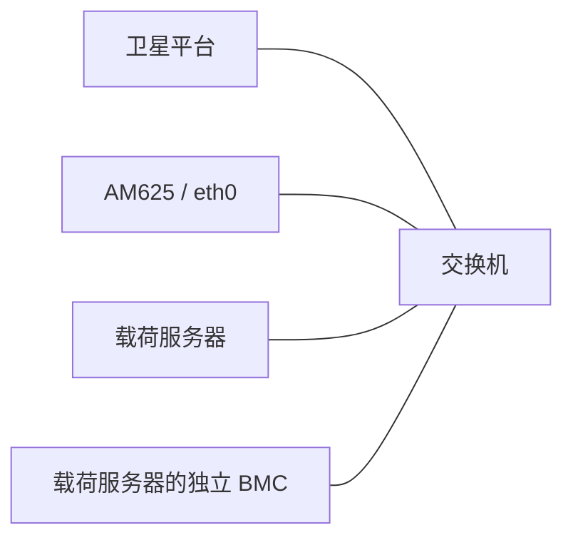

# AM625 EDK 与 Device Manager 可靠性评估及优化计划

日期：2026-11-05。基线：workspace `3f77ba53`、EDK `58ea89da`、Device Manager
`7361ccd4`、BSP `b50455ee`、U-Boot `6d569284`；已验证固件
`v0.0.1 / fd821f46`。本文区分源码能力、实机证据和待验证项，不构成航天鉴定结论。

## 1. 产品边界与设计目标

链路为 **卫星平台 ↔ AM625 ↔ 载荷服务器及其独立 BMC**。各设备通过各自独立网口接入同一交换机，AM625 没有其他连接或独立供电/复位控制链路；当前验证板只枚举 eth0。载荷服务器的 BMC
不等于 AM625 的复位、供电或串口管理器。设备必须在服务器不可达、OTA/SOL
不可用、外设不响应时保持本地有效固件可启动，尽可能维持最低平台通信能力。

上述箭头表示业务流向，物理接线为各自独立接入交换机：

AM625 经同一网口分别与平台、服务器和 BMC 通信。交换机故障可能同时影响所有对端，
应区分本地服务健康、网口状态与远端可达性；不因多个对端同时失联而反复复位 AM625。

EDK 负责外设驱动、SDK 和产品服务；Device Manager 负责固件、日志、时间及管理服务。
监督进程统一持有看门狗。不能由每个业务守护进程独立决定整机复位。
现阶段优先 SD/eMMC；不开展 NAND、i.MX6ULL 或未经硬件确认的启动介质迁移。
用户明确选择的免凭据调试模式继续保留；生产安全配置另作有验收条件的阶段。

## 2. 已有基础与证据边界

| 能力 | 已有实现 | 边界 |
| --- | --- | --- |
| 固件身份与更新 | HWID 匹配、版本+完整 SHA256、A/B、写后读回、双副本 CRC 元数据、健康确认与回退 | 同一存储芯片的 A/B 不覆盖整片失效；升级成功不等于真断电验证 |
| 分阶段恢复 | U-Boot 校验/恢复 FIT，initramfs 校验 rootfs、dm-verity、备用部署与精确网络恢复 | 双槽均失效且服务器不可达时，仍需要独立本地救援路径 |
| 传输 | 统一 C 组件；长度/hash 检查；持久化续传；数据同步先于检查点；不自动重放 POST | 真实重启续传已测；物理断电及各介质控制器缓存行为仍需单独验证 |
| 启动日志 | SPL/U-Boot/kernel 双 RAM 缓冲，归档 ACK 后清理；Linux 持久化与补传 | DDR 掉电丢失；第三次未归档启动可覆盖最旧缓冲；ROM/TIFS/ATF 并非全覆盖 |
| EDK | 驱动分层、显式 UAPI、设备代次、防陈旧句柄、限额队列、健康监督与有限重启 | 仍存在阻塞调用、任务饥饿和可选服务升级为整机故障的路径 |

## 3. 具体问题与改进方向

### 3.1 通信必须有总截止时间和处理预算（P0）

`edk/apps/ptelemetryd/src/psatellited.c` 的 IPC 使用阻塞 connect/send/recv。
对端接收连接却不回复时，主线程不能继续处理请求超时或心跳。
一次请求的截止时间应覆盖连接、发送、响应，使用单调时钟，信号中断不能重置预算。
必须检查完整报文长度、版本、请求 ID 和数据长度。

当前先提交请求再分配 pending 对象，内存不足可能造成“远端已执行、本地无记录”。
应先取得跟踪资源再发送；发送后丢失应答只能认为结果未知，不能直接重发控制命令。
连续输入和 pending 查询都需要每轮配额，保证健康上报和其他任务获得运行机会。
端到端硬实时仍需 CAN 驱动、调度、CPU 和存储负载共同验证。

### 3.2 健康策略需要区分关键、降级与辅助功能（P0）

`system_manager` 已有心跳超时、有限服务重启和独占看门狗，但启动后的可选服务失败
也可能阻止喂狗；`fwctl_health.c` 还把 dropbear PID 作为确认条件。
应使监督策略与固件健康确认使用一致的关键性定义：最低平台通信和监督器是关键项；
遥测扩展、Web、SSH、SOL、OTA 网络不可达等不能无条件触发整机复位。
关键服务仍必须 READY 且持续有进展，不能以“进程存在”替代业务健康。

调试和关机 marker 当前可以无限豁免健康失败，应设置有界单调时钟宽限并明确记录。
未来增加跨重启故障预算，避免相同外部故障引起无限重启；降级策略必须保留平台遥控能力。

### 3.3 遥控事务与内核故障域（P1）

MCU 请求已有有限重试，但需逐条验证接收端去重与非幂等命令语义；不能仅靠重试承诺
exactly-once。明确未发送、已接受、执行结果未知、已完成及实际状态回读。
电源控制已有禁止自动重试、CRC、回显/回读等约束，应保留并扩展测试。

`pdm.ko` 内多个协议/后端共享内核故障域。重点补充异常帧、竞争解绑、队列耗尽、
内存失败、KASAN/UBSAN/锁检查；复杂产品策略优先留在用户态。已有 sanitizer/coverage
配置应进入持续验证，不为“解耦”重写所有内核驱动。

### 3.4 首级启动与离线救援边界（P0/P1，依赖硬件）

当前 ROM 仍启动原始 R5 A。新 A53 SPL/U-Boot 已有执行证据，不能把 R5 B 的构建、
写后读回当作 ROM 已验证备用启动。远程 bootloader 更新继续受限制。
需核实 ROM 启动顺序、板卡引脚/介质能力与独立复位控制，设计受保护的最小本地救援镜像。
在硬件路径明确前，不重写主 R5 A，也不宣称双槽所有异常均可自动恢复。

### 3.5 日志保留、重启原因与故障证据（P0/P1）

`logging/logging.c` 当前按启动顺序保留四次，无归档 ACK 保护的旧启动可能被淘汰。
每流轮转也可能覆盖未上传部分。应建立有界的未上传/异常证据配额、上传确认和明确丢失事件；
磁盘满或日志损坏不能阻塞启动。不能无限增长，也不能声称有限容量能够永久保留所有离线日志。

双 RAM 缓冲已实现 CRC 提交前缀及服务器确认清理，仍要补充跨掉电的最小启动摘要。
启动时间未校准时保留 boot ID、启动序号、单调时间和 UTC 质量，服务器接收时间不是故障发生时间。

重启原因需要早期原始寄存器快照、软件重启意图、pstore 证据、恢复动作和置信度。
ESM 不能直接等同看门狗；无有效寄存器值不能推断上电。
后续采用独立于 A/B 元数据的有界 CRC/序号 journal，控制写放大；不把完整串口流高频写入裸区。

### 3.6 服务端隔离和资源预算（P1）

`ota/server/device-server.c` 当前串行 accept/处理请求，慢上传/下载会拖延设备上报、
SOL 和管理请求。需要有界并发、超时、优先级、SQLite 所有权规则，不能无限创建线程。
设备侧分别约束下载、日志、CAN 处理的 CPU/内存/IO/网络预算，并在过载时优先维持最低通信。

### 3.7 生产安全和演进契约（P1/P2）

当前免凭据、`require-signature=false` 是调试选择。生产配置需要受保护信任根、签名校验、
密钥更新及敏感命令授权；SHA256 用于内容身份/损坏检测，不能代替来源授权。
引擎已有签名与 rollback index 机制，应补充策略和验收，而非重新发明。
版本继续 `v0.0.1`；内容 ID、发布序号、安全代次和批准的回退目标应各司其职。
HWID 描述 PCB/产品匹配，不替代 loader 能力、元数据/schema、持久化配置迁移兼容契约。

### 3.8 工程保证与硬件约束（贯穿各阶段）

测试数量不能直接证明星载适用性。建立需求→实现→主机测试→板上故障测试→发布身份的追踪。
SD/eMMC 分别执行写分区、写元数据、READY、健康确认、日志 ACK 边界的真断电矩阵；
覆盖介质 IO 故障、只读、长断网、复位风暴及持续过载。稳定基线冻结后再受控更新上游。
源码、全子模块、工具链/配置、SBOM、固件和验收证据应进入独立归档，不只保存在被忽略的 output。
ECC、辐射耐受、独立复位/供电等须由实际 PCB 和任务系统确认，软件恢复不能覆盖全部物理故障。

## 4. 优化架构

| 层 | 所有者 | 契约 |
| --- | --- | --- |
| 外设 IO 与协议 | EDK kernel/PDI | 有界资源、明确 errno、无陈旧句柄、控制动作不盲目重放 |
| 产品服务 | psatellited/ptelemetryd | 总截止时间、请求跟踪、工作配额、主循环进展 |
| 故障监督 | system_manager | 单一看门狗所有者；关键性、有限重启、降级/救援策略 |
| 固件状态机 | Device Manager firmware/fwctl | 本地事务、版本+ID、写后校验、可恢复提交、独立健康确认 |
| 证据链 | logging + boot journal | 原始日志与结构事件分离；有限保留；明确同步/上传状态 |
| 传输与主机服务 | transfer + device-server | 有界并发/重试；不代替业务事务或归档确认 |

## 5. 分阶段工作及验收门禁

每阶段完成针对性测试后，构建唯一目录中的 `v0.0.1` 新内容 ID，自动发布；等待指定
AM625 重启、健康确认、服务器匹配该发布的 success，并完成该阶段板上测试，才提交推送。
子仓库先提交推送，再更新 workspace。失败保留证据并修复，不跳过健康检查或 quarantine。
固件源码快照必须包含 EDK，不能只覆盖 Device Manager/BSP/U-Boot。

| 阶段 | 交付范围 | 验收条件 | 状态 |
| --- | --- | --- | --- |
| S1 通信有界化 | IPC 总截止时间、响应身份/长度检查、先分配后发送、处理配额、禁止自动重放 | 无响应/拥塞/中断/畸形响应/内存失败测试；ARM64 实机执行同一故障夹具；OTA/心跳正常 | 已验收：ecd9a717 |
| T1 用户补充：统一 UTC+8 | 设备时区、校时日志、Web 所有日历时间；UTC 协议/RTC 不偏移 | 设备 date/UTC 差值、HTTP/NTP 校时、跨浏览器时区测试、OTA | 已验收：fdfb3a83 |
| S2 健康故障隔离 | 可选服务不拖垮关键链路、去除 SSH 硬依赖、有界 debug/shutdown 宽限 | 关键失败拒绝、可选失败允许、宽限到期拒绝；板上测试不停止唯一看门狗喂养者；OTA 确认 | 已验收：b7225727 |
| S2b 网络产品健康配置 | 替换现有 CAN 演示配置假设；本机网口和本地服务检查；对端失联不触发复位风暴 | 网口存在/缺失、对端不可达与 OTA；保留 UART 验证通道 | 已验收：6c122cca |
| S3 离线证据保留（S3a 容量/续传，S3b 归档确认） | 有界未上传保护、淘汰原因/计数、恢复补传及 ACK 一致性 | 超容量多启动、断网/重连、目录损坏与空间不足；真实启动日志不被误删 | 软件闭环已验收：b04554e0；真实断电矩阵待硬件条件 |
| S4 重启证据与 FDIR | 早期 reset 快照、软件 intent、启动 journal、跨重启预算/降级策略 | 普通重启、watchdog、panic、掉电区分；缺证据显示 unknown；journal 损坏不阻塞启动 | S4a 软件意图/启动记录已实机验收；原始复位位、预算和物理注入待完成 |
| S5 管理服务和负载隔离 | 有界并发、请求优先级、设备资源配额 | 慢传输不阻塞状态/SOL；并发数据库一致性；持续负载下平台通信和看门狗正常 | S5a 接入、S5b/c 传输、S5d 身份复用、S5e 就绪调度已验收；同步制品准备及全局资源预算仍待完善 |
| S6 启动救援与飞行配置 | ROM 备用路径、本地救援、生产签名配置、兼容契约 | 独立介质/真断电矩阵、签名拒绝和受控回退、最小业务恢复 | 硬件条件确认后实施；调试凭据策略不自动更改 |
| S7 交付固化 | 追踪矩阵、独立制品归档、静态/动态检查、耐久与长期运行 | 每项需求有证据或明确残余风险；SD/eMMC 单独记录 | 贯穿开发，最终收敛 |

S4/S6 的硬件前置条件不是“软件已完成”，也不能用模拟器结果替代实机断电/ROM 证据。
阶段结果、固件完整 ID、测试和限制追加到本文件及对应 release 记录。

## 6. 参考与既有资料

- [NASA 故障检测与响应](https://swehb.nasa.gov/spaces/SWEHBVD/pages/102695798/9.07%2BFault%2BDetection%2Band%2BResponse)：作为局部恢复与分级响应设计参考，不作为项目认证声明。
- [ECSS-E-ST-40C Rev.1](https://ecss.nl/standard/ecss-e-st-40c-rev-1-software-30-april-2025/)：按项目裁剪需求、设计、验证、运行和维护过程。
- [现有固件/日志计划](firmware-logging-architecture-plan.md)：与本文合并追踪，已有实现不重复列为缺失。
- [启动链实机边界](firmware-upgrade-optimization-validation.md)。
- [统一传输已验证版本](../../device-manager/docs/releases/v0.0.1-fd821f46.md)。

## 7. 阶段验收记录

### S1（2026-11-05）

- 固件 `v0.0.1 / ecd9a71707f95b4dd8993e3d7a5deeaa71bae158d93754c33daef53dc0e7081c`，发布记录 65。
- 九组 EDK 主机测试通过；同一 IPC 故障测试交叉编译后在 AM625 上通过：静默对端、
  队列满、EINTR、错 ID/长度、超长报文、分配失败、丢失 ACK 不重放、查询轮转与过期处理。
- 四组真实 FIT 校验和 ARM64 initramfs 动态加载回归通过。OTA 后部署 0 已确认，
  服务端对应设备报告 success；板上 health-check、固件身份、日志同步正常。
- 证据目录：`output/ota-validation/0.0.1-reliability-s1/`，包括 EDK 在内的源码快照、
  测试、串口与服务端事务。未向真实 CAN 注入控制命令，不宣称完成端到端总线过载或掉电验收。
- 构建时发现既有 EDK CMake 缓存来自旧输出路径；保留旧缓存并重新配置，未更改工具链。

### T1 用户补充：UTC+8（2026-11-05）

固件 `v0.0.1 / fdfb3a83`（完整 ID 见 Device Manager release 记录），发布记录 66，
AM625 重启后 health-check=0、服务端 success。默认 date 与 NTP 校准日志显示 UTC+8；
UTC 与 Unix 秒未偏移。实机标准 NTP 采样修正 3 ms；UTC 与本地显示相差八小时。
12 组校时客户端、9 组服务端时间测试及真实 Chromium（浏览器设为纽约时区）回归通过。
证据：`output/ota-validation/0.0.1-reliability-utc8-validated/`。随后继续 S2。

### S2（2026-11-05）

`v0.0.1 / b7225727`，发布记录 67，实机部署 0 confirmed、OTA success。
EDK 9 组、固件 8 组、启动确认 8 例、启动关键性 3 组、FIT 4 例与 ARM64 loader 通过。
板上隔离执行关键/可选状态、宽限到期及禁止续期测试；真实停止 dropbear 后健康检查仍为 0，随后恢复服务。
此阶段保留了原实验室 CAN/PDM 健康配置，不代表卫星 Ethernet 链路产品配置已完成。
用户补充确认仅有网口/交换机链路，无独立复位/供电控制；S2b 优先修正产品配置，真断电项目仍待外部测试装置。

### S2b（2026-11-05）

`v0.0.1 / 6c122cca`，发布记录 68，AM625 部署 1 confirmed、OTA success。
健康配置要求本地 lo/eth0 管理状态 UP，不要求交换机/对端在线；CAN/PDM 演示服务可降级。
实机发现并修复 lo 未初始化的问题，OTA 重启后自动出现 127.0.0.1/8。
板上停止 psatellited 后健康检查仍为 0，随后恢复服务；新镜像、ARM64 loader 与策略测试通过。
设备分别通过独立网口接入交换机；当前板仅枚举 eth0，不假设第二网口或带外复位链路。
证据：`output/ota-validation/0.0.1-reliability-s2b/`。继续 S3 离线日志保留与上传确认。

### S3a（2026-11-05）

`v0.0.1 / 53425c82`，发布记录 69，AM625 部署 0 confirmed、OTA success。
本地 12 次启动与 64 MiB 工作预算、淘汰审计、历史队列公平补传、服务端完整代际清理已验证。
实机隔离队列七次启动全部上传；中途终止上传进程后续传，字节/偏移/SHA256 均一致，健康检查为 0。
服务端数据库先备份并在副本上迁移验证；没有删除真实现场日志。
证据：`output/ota-validation/0.0.1-reliability-s3a/`。
S3 尚未全部完成：S3b 将增加整次闭合日志归档确认和按确认状态的保留优先级。
实机新发现 BusyBox tar 不支持 -z，压缩导出也在 S3b 修复；不能仅凭主机 GNU tar 测试认定板上导出可用。

### S3b1（2026-11-05）

`v0.0.1 / 8be2b2b6`，发布记录 70，AM625 部署 1 confirmed、OTA success。
修复实际 BusyBox 压缩导出配置，增加临时文件/同步/原子替换以及压缩进程截止时间。
15 组日志测试、4 组 FIT 和实际 ARM64 loader 检查通过。板上导出上一轮真实启动目录，
服务器校验 gzip 尾部、包内文件及 SHA256，板上 tar 可列出归档，health-check=0。
证据：`output/ota-validation/0.0.1-reliability-s3b1/`。
下一步继续 S3b2 的整次闭合日志包上传、服务器完整性确认和本地保留优先级。

### S3b2（2026-11-05）

`v0.0.1 / b04554e0`，完整 ID `b04554e048c992044ac76a03df9ebeca993b99672af86ac67f2a7e737894c4cf`，
发布记录 71，AM625 部署 0 经重启、健康确认并上报 success。

闭合启动日志采用单包持久缓存和有界续传；服务器完整长度/SHA256/文件与目录/SQLite
提交后才返回归档确认。本地保留优先淘汰已确认历史，未确认损失必须审计；服务器整包
配额为每设备 16 包/256 MiB，部分包有 24 小时无请求超时。SOL 可下载完整日志包，
时间戳为服务器接收时间 UTC+8；历史窗口淘汰不影响仍保留的整包。

15 组 logging、11 组整包、13 组 SOL、8 组删除、9 组事故、8 组 startup、10 组事故关联、
15 项前端底层检查、浏览器桌面/移动及下载删除、4 组 FIT 和实际 ARM64 loader 检查通过。
实机隔离包 1,710,969 字节，16,384 字节时中断并正常重启，继续同一包上传、完整 SHA256
和原始文件逐字节匹配；另一真实启动的 14 文件与归档逐一匹配。最终 archive-ack=8、
archive-pending=0、sync-state=ok、health-check=0。两次验收脚本问题及修正过程保留。

证据：`output/ota-validation/0.0.1-reliability-s3b2/`。未注入真实掉电，未改变引导程序。
下一阶段 S4 先处理可独立验证的重启意图/启动记录；AM625 当前 U-Boot 会在读取
`CTRLMMR_MCU_RST_SRC` 后清除寄存器，后续必须在清除前保留原始位，不能从 Linux
再次读取的零值推断断电，也不能把所有 ESM 都认定为 watchdog。

### S4a（2026-11-05）

`v0.0.1 / 8c1f2777`，完整 ID `8c1f2777560be5a203eac38a01e92b16d166cf027b0334fba3aadad4fdd3e8fa`，
发布记录 72，AM625 重启、健康确认及服务端 success 通过。
增加 CRC/序号启动状态与有界事件历史、软件重启意图、上一条 Linux 启动关联和 UTC+8 显示。
状态原子提交；损坏记录保留；OTA 可选记录程序有独立截止时间，不替代固件事务。

七组记录、15 组 logging、11 组整包、39 组自动 OTA、九组健康、四组关机、五组日志停止、
四组 FIT 与 ARM64 loader 检查通过。新版实机强制重装同一内容后，完整验证
healthy → ota-update → shutdown-started → 下一次 confirmed 的关联；归档记录的 CRC、
板上与服务器 SHA256 一致。首次验收查询早于周期上报，修正测试等待回执后通过。
最终 health-check=0，data 空间充足。证据：`output/ota-validation/0.0.1-reliability-s4a/`。

软件意图与硬件复位原因分开，当前 `reset_cause=unknown`；没有将 RST/ESM 简化为物理原因。
未改引导程序，未做物理掉电。下一小阶段约束健康/关机钩子中可选日志 IO 的等待时间；
原始复位位保存和跨重启预算仍需继续实施，不因本阶段通过而认定 S4 全部完成。

### S4b（2026-11-05）

`v0.0.1 / 819084b0`，完整 ID `819084b0ef8cb7d2e6c4216b113f339419e5b45ee31a3b5fd80af867d53da009`，
发布记录 73，重启、健康确认、服务端 success 通过。
`logctl boot-event` 增加两秒 IO 截止时间、有限回收及 /run 单工作进程锁；即使旧工作进程
暂时无法退出，后续调用也不累积更多工作进程。明确添加 Buildroot zlib 依赖。

11 组启动证据、15 组 logging、九组健康、三组 OTA 意图、四组 FIT 与 ARM64 loader 通过。
实机隔离目录中注入三次 30 秒 fsync 停顿，调用均约 2.124 秒返回，旧记录不变、工作进程
退出、随后正常写入成功，生产 health-check=0。测试夹具依赖缺失 cmp 的问题已修正并留证。
这不是内核 D 状态或真实掉电测试；不声称覆盖其他关机服务和最终系统 sync。
证据：`output/ota-validation/0.0.1-reliability-s4b/`。

S4 剩余原始复位位/独立持久摘要和跨重启恢复预算继续保留为待完成项。
接下来先做可独立验证的 S5a HTTP 请求头接入隔离，再处理大文件传输与数据库事务调度。

### S5a（2026-11-05）

`v0.0.1 / 19957124`，完整 ID `19957124076ca27b3596680b6660413c0f3d6611ce2f774a0220ef1a7930edf4`，
发布记录 74，实机 confirmed/success 通过。接入层并行收集请求头，限额 32 连接、
每 IPv4 对端 16 连接、8191 字节、接入起算 15 秒截止时间；业务处理仍串行。
共享传输组件每步最多读取 2048 字节，准确保留请求体边界。

七组接入、17 组传输、八组上传发布、13 组 SOL、11 组整包、三组时钟、四组设备上下文、
18 组 HWID 通道、七组隔离策略、四组 FIT 与 ARM64 loader 通过。
服务数据库备份后重载；12 个慢请求头连接持续加载期间，30 次状态/SOL/校时查询最慢
9.287 ms，板端 HTTP 请求与完整 OTA 仍成功。最终 health-check=0、sync-state=ok、
archive-ack=11、archive-pending=0；上一启动的 OTA 意图和 CRC 关联仍正确。
证据：`output/ota-validation/0.0.1-reliability-s5a/`。
后续 S5b 隔离大文件下载，保留主进程数据库事务所有权和完成后统计语义。

### S5b（2026-11-05）

`v0.0.1 / 2d3ce995`，完整 ID `2d3ce99582613dba287854b6dbee8b79eb216a4fb7641cc5bbffafd34cf2b4ce`，
发布记录 75，实机 confirmed/success 通过。大于 64 KiB 的文件最多四个只读传输进程，
总生命周期 180 秒；主进程保留数据库写入、传输完成统计和隔离策略所有权。
异常固件对应的在途下载会被终止，策略检查复用目录数据库中的 payload hash。
短错误响应增加非阻塞、有界连接收尾，修复拒绝上传时可能提前 TCP reset 的问题。

五组下载工作进程、16 组目录、八组管理、七组隔离、11 组整包、八组删除、七组接入、
四组设备上下文、四组 FIT 和 ARM64 loader 通过。服务备份后重载；两个停滞文件下载
持续加载期间，30 次控制请求最慢 13.052 ms，实机校时和完整 OTA 成功。
最终 health-check=0、固件身份正确、sync-state=ok，测试下载进程已退出。
证据：`output/ota-validation/0.0.1-reliability-s5b/`。

上传体、制品准备与长数据库/存储操作仍可能阻塞主进程，继续 S5c 的有界上传接收。
下载计数不是设备接收确认，主进程崩溃可能丢失尚未记入的完成统计；不声称 exactly-once。

### S5c（2026-11-05）

`v0.0.1 / 5afea0a4`，完整 ID `5afea0a4f353305b5f960aab7d75c5ea945adf5e8020f45b761baa962ffab284`，
发布记录 76，实机重启、健康确认及服务端 success 通过。固件上传接收最多两个工作进程，
180 秒总生命周期；主进程保留校验、目录数据库和最终响应所有权。未完成上传不会成为草稿。

四组上传、五组下载、七组接入、八组管理、16 组目录、七组隔离、11 组整包、八组删除、
四组设备上下文、四组 FIT 与 ARM64 loader 通过。一个停滞上传持续覆盖完整 OTA；
30 次控制请求最慢 27.748 ms，实机校时/健康检查正常，断开后临时文件和工作进程均清理。
最终 health-check=0、sync-state=ok、archive-pending=0、UTC+8 显示正确。
证据：`output/ota-validation/0.0.1-reliability-s5c/`。

解包、校验和数据库登记仍串行，未承诺存储阻塞隔离或全局磁盘配额。
后续先去除隔离策略查询中的重复内容哈希计算，保留文件变更检测和发布前完整校验。

### S5d（2026-11-05）

`v0.0.1 / 5be2625b`，完整 ID `5be2625b29116dc531625d9820a3b010dab6168e7abab36e66edd1c2bad0fda9`，
发布记录 77，实机重启、健康确认及服务端 success 通过。设备策略和制品读取复用目录数据库
中的完整 payload hash；文件属性变化触发重验证，隔离标记实时检查，发布/回退仍完整校验。

回归先复现旧行为，再通过 18 组目录、七组隔离、18 组 HWID 通道、五组下载、四组上传、
四组上下文、四组 FIT 和 ARM64 loader。服务重载前后各 30 次本机请求，最大耗时由
153.797 ms 降至 2.089 ms；实际 OTA 期间另有 435 次策略查询无错误，最大 539.504 ms，
包括串行发布处理的影响。实机 health-check=0、身份匹配、sync-state=ok、归档确认正常。
证据：`output/ota-validation/0.0.1-reliability-s5d/`。

文件属性缓存不能代替介质巡检。接下来增加已就绪请求的优先级调度；正在执行的同步
制品准备和存储操作仍不能被抢占，后续需单独处理，不能将样本延迟当成实时性保证。

### S5e（2026-11-05）

`v0.0.1 / 8867e6cc`，完整 ID `8867e6cc58a06028d0d9dd1dd00811200f128f30ca022bc7068e2069193be4dc`，
发布记录 78，实机重启、健康确认及服务端 success 通过。完整请求先按设备控制、一般管理、
批量固件操作分级，再在同级内轮转；每轮处理固定就绪集合，避免新控制请求持续挤占批量任务。

两组排队/导出门控、七组接入、八组管理、五组下载、四组上传、13 组 SOL、11 组整包、
三组时间、四组上下文、四组 FIT 和 ARM64 loader 通过。一个停滞上传覆盖真实 OTA，
30 次控制请求最大 28.809 ms；断开后清理正常。最终 health-check=0、身份正确、日志持久化
同步正常、archive-pending=0、启动证据已确认、UTC+8 显示正确。
证据：`output/ota-validation/0.0.1-reliability-s5e/`。

这是非抢占调度；正在执行的处理、请求体接收、制品准备或存储 IO 仍可能延迟后续请求。
S4 原始复位位/跨重启恢复预算、S5 全局资源预算及同步准备隔离、S6 硬件救援验证均未宣称完成。
