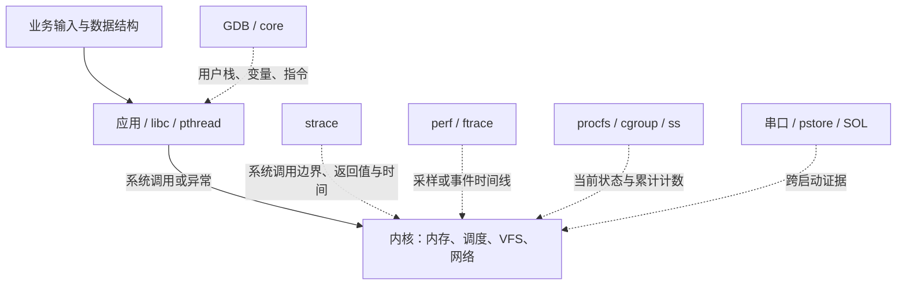

# 嵌入式 Linux 故障定位基础：从现象建立证据链

本章是案例教材的先修内容。目标不是先记住一百条命令，而是理解每一类观测能回答
什么问题、不能回答什么问题。读完后，再按 [学习路线](study-guide.md) 进入案例。
本项目实际环境是 ARM64 AM6254、Linux 7.0、systemd、cgroup v2；32 位板或其他
内核中的地址、函数、配置与工具选项可能不同，需要重新核对。

## 1. 把“系统有问题”转换成可验证的问题

### 1.1 现象、直接原因和根因

假设设备上一个服务消失了。此时“程序崩溃”仍然是假设，不是事实。它可能主动退出，
被管理员停止，被 systemd 超时结束，被 OOM 杀死，或者访问非法地址后被信号终止。
第一步要记录服务名、PID、出现时间、输入和退出结果，再选择深入的方向。

把结论拆成三层：

| 层次 | 崩溃例子 | OOM 例子 |
| --- | --- | --- |
| 现象 | 请求编号 42 后进程消失 | 处理若干数据块后进程消失 |
| 直接原因 | 指令访问无效地址，引发 SIGSEGV | memcg OOM 处置向进程发 SIGKILL |
| 根因 | 查询失败返回 NULL，调用者未检查 | 循环丢失分配地址，没有释放所有权 |

只定位到信号不足以修复业务；只看到 malloc 也不足以证明这一次退出由 OOM 导致。
完整解释需要把输入、错误状态、内核处置和可见结果串起来。

### 1.2 让每条命令对应一个假设

排查前写出两个候选原因及它们的不同预测。例如慢请求可能由计算多，也可能由等待多：
前者预计 task-clock 接近墙钟，后者预计墙钟明显大于 CPU 时间。先比较这两类时间，
再决定使用 CPU 采样还是调度/锁分析，避免在等待程序上盲目生成 CPU 火焰图。

不要把“没有看到”直接写成“不存在”。没抓到系统调用可能是开始太晚，没看到函数名
可能是符号不匹配，没出现 OOM 可能是杀进程的日志已被覆盖。记录观测窗口与采集限制，
必要时使用能够推翻假设的对照实验。

## 2. 先理解用户态、内核态和工具的位置

应用执行普通加法、查表时通常停留在用户态；open、读写、等待、映射等操作通过系统
调用进入内核。用户态访存还可能因缺页异常进入内核，这不要求源代码显式调用某个函数。
中断和调度也能打断用户程序，因此“源代码没有调用内核”不等于运行没有内核参与。



工具观察的是不同切面。GDB 用户栈不能自动提供内核栈；strace 看不到普通用户态循环
里的每一次查表；perf 的 CPU 采样不能完整记录线程睡眠期间的时间；日志可能记录错误
处置，却没有记录更早的业务状态。组合工具的目的，是用相互独立的观测补足因果链。

## 3. 第一层分类：退出、忙、等、断、重启

### 3.1 退出状态不是故障类别

交互式 shell 的 `$?` 只保存上一条命令的状态，必须紧接实验读取。通常 shell 用
128 加信号编号表示信号退出，因此本环境 139 常对应 SIGSEGV，137 常对应 SIGKILL。
但程序也可以主动 `return 137`，外层 timeout/systemd 还可能转换结果，所以还要读
监督记录、信号、core 或 OOM 计数，不能只凭一个数字归类。

```sh
sadboard run crash
rc=$?
printf 'exit=%s\n' "$rc"
```

上面故意不启用 `set -e`，否则非零退出可能在保存 rc 前让脚本结束。管道中的 `$?`
通常是最后一个命令的状态；把实验接到 tee 后，需要明确 shell 的管道状态规则。
统一入口把结果写入 `result`，其中场景码、监督器原始码和取消标志分别保存。

### 3.2 用资源方向选择工具

| 观测 | 优先提出的问题 | 后续证据 |
| --- | --- | --- |
| CPU 接近一核满载 | 算法、忙轮询、重复工作在哪里？ | perf stat/record、业务工作量 |
| 墙钟长、CPU 少 | 在睡眠、锁、I/O 还是等待 CPU？ | 全线程栈、strace、sched trace |
| 内存增长后进程消失 | 谁在计费，是否触及该组上限？ | limits/events、分配栈、内核日志 |
| ping 正常、TCP 慢 | 小包连通和业务吞吐为何不同？ | iperf 字节、RTT、ss、抓包、队列 |
| 设备重启 | 谁决定重启，哪次启动没有完成？ | 意图、复位原因、panic/pstore、startup ID |

这些是选择方向的线索，不是判定表。一个程序可同时 CPU 高且锁竞争严重；一次网络
超时也可能由进程调度或对端应用阻塞造成。用证据逐步细分，而不是给现象贴标签后停止。

## 4. 内存基础：地址、物理页、分配器和资源组

### 4.1 malloc、虚拟地址、RSS 分别是什么

malloc 返回可用的虚拟地址范围，底层可能重用已有堆块，也可能扩展映射。首次写触
尚未驻留的合法页面时，内核可以分配物理页并建立页表，之后进程继续执行。因此虚拟
大小增长、RSS 增长、分配成功和物理内存已经实际消耗，不能视为同一时刻。

RSS 表示驻留页的一个观测口径；它不是所有 malloc 的简单总和，包含共享/映射因素，
与 cgroup 总计费也不必相等。free 把块交还给分配器，分配器可能保留页用于后续复用，
所以 free 后 RSS 未立即下降不能单独证明泄漏。要观察同样业务长期运行是否有界，
再结合所有权、分配栈与失去引用的内存块。

### 4.2 合法缺页与 SIGSEGV

合法 VMA 的页尚未建立、写时复制等情形可能通过缺页处理恢复；没有对应 VMA 或权限
不允许时，则可能向用户进程发 SIGSEGV。本案例 NULL 字段访问属于后者。
MAPERR 与 ACCERR 用于区分地址映射与访问权限问题，仍需根据具体地址、指令和映射判断。

### 4.3 cgroup 为什么在整机有空闲内存时 OOM

cgroup 将一组进程的资源计费和限制组织起来。本案例叶子组 memory.max 为 32 MiB、
swap.max 为 0；它可能达到自己的预算，而整机依然有可用内存。内核先进行允许的回收
和重试，再根据分配标志、余量和竞争状态决定失败或 OOM 处置，不是 max 加一就必杀。

`memory.events` 的 max、oom、oom_kill 是不同事件；组终止还可能出现对同一 PID 的
多次 kill 计数。应同时记录真实限制、计数、退出、时间及对应进程。精读条件分支见
[内核笔记](kernel-reading-notes.md#memcg-是先回收重试再决定失败)。

## 5. 时间基础：CPU 时间、墙钟、排队与重复测量

### 5.1 为什么两个时间不相同

墙钟时间是从开始到完成的经过时间，包含计算、阻塞、睡眠和等待调度。进程 CPU 时间
累计其线程实际被 CPU 执行的时段，多线程并行时可以大于墙钟；单线程计算密集时两者
通常接近。CPU 时间很少而墙钟很长，说明需要继续调查等待，不能直接归因于 CPU 慢。

短程序的启动、动态链接、缓存冷暖和计时开销可能比有效工作还显著。工具本身也会
改变时间：strace 的系统调用拦截、GDB 暂停、Valgrind 动态翻译都不是无成本观测。
定位工具的运行结果用于解释机制，最终性能比较应使用一致的测量方式和环境。

### 5.2 正确对照必须保持工作契约

CPU 案例固定 items、queries、seed，比较同一查询序列及 checksum；锁案例两版都要
完成每线程 N 次、总计 2N 次更新，并保留同样的模拟等待。把查询减半、删掉 I/O、提前
返回错误都可能更快，但它们没有完成相同工作，不能当成优化。

至少重复三次并保存每次原始值，观察中位数与分布。需要更严谨比较时增加样本，交替
执行两版并控制频率、温度和背景负载。本项目 `check` 只验收业务/最低证据，单次比值
明确标为人工性能判断；不存在对所有输入适用的固定提速倍数。

## 6. 并发基础：线程状态、mutex 和 futex

mutex 保护共享状态的访问契约。用户态无竞争的加解锁通常能用原子操作完成；竞争时
libc 可用 futex 协助等待和唤醒。futex 本身不了解“这是哪项业务”，同类调用也用于
条件变量、线程 join 等，因此看到 futex 不能直接认定业务 mutex 出错。

区分四个时刻：尝试获得锁、进入睡眠、被唤醒变为可运行、真正调度执行。被唤醒不等于
立即拿到 CPU，更不等于拿到锁。调度时间线能分开这些时段；全线程 GDB 栈说明每个
线程停在哪条业务路径。主线程停在 join 可能完全正常，必须继续查看工作线程。

本例在持锁期间模拟 I/O，另一线程无法并行等待；修复将独立等待移出临界区，再对共享
完成数加锁更新。一般项目不能照搬：若等待操作依赖锁保护的对象生存期，解锁可能引入
use-after-free 或状态竞态，必须重新设计所有权和状态机。

## 7. 网络基础：连通、时延、吞吐和队列

ping 证明特定 ICMP 探测的往返情况，不证明某 TCP 端口开放、应用处理及时或大流量
吞吐足够。iperf 的测试时长、字节预算、并发数、协议和方向都改变测量含义。
本例固定 1 MiB，比较的首先是同字节传输能否完成及耗时，不能当物理网口极限吞吐。

RTT 是去程和回程的合计；只对一侧出口加 100 ms，通常只让其中一程增加约 100 ms。
qdisc 决定出口排队，tcpdump 的抓包点未必在实际出队之后，所以本机时间戳差值不能
直接等于线上的发送间隔。还要考虑协议处理、调度、拥塞控制和重传。

本项目把 netem 放进专用 namespace，veth 连接两个实验端点，eth0 保持管理通道。
namespace 有独立网络对象，但仍共享同一内核、CPU 和内存，不能用本实验代表独立物理
设备。结束必须回收进程及 namespace 引用；仅杀掉 iperf 并不保证网络对象都消失。

## 8. 启动故障：一次固件与多次启动

固件内容 ID、Linux boot ID 和启动日志 startup ID 含义不同：相同固件可重启多次，
而 SPL 阶段还没有 Linux boot ID。要把故障启动的 SPL、U-Boot、kernel、rootfs 证据
关联到恢复启动，需要依赖阶段缓冲、持久记录、复位原因和上传确认。

先保存原始串口，再做栈符号化。内核栈里的 vpanic 是共同终止路径，需要追调用者；
`Tainted: O` 只说明加载过树外模块，不能因此判定它是根因。复位标签如 RST 本身
也不能区分 OTA 主动重启与异常重启，必须结合软件意图和上一次健康状态。

暖重启后内存保留的验证不能证明断电仍保留；pstore 导出后目录为空也不等于没有日志，
可能已经被归档消费。检查本地文件、服务端内容与 ACK，而不是只检查目录非空。

## 9. 可复现证据的最小集合

每次保留完整固件 ID、源码/配置/ELF 清单、boot ID、时区、输入和原始附件。八位 ID
方便人读，完整 ID 才用于内容匹配。保留错误命令、丢样和失败结果，不能只留下漂亮截图。

| 证据 | 推荐保留方式 | 容易遗漏的条件 |
| --- | --- | --- |
| 用户崩溃 | core、ELF、匹配 rootfs/sysroot、GDB 输出 | PIE、动态库、core 上限及过滤策略 |
| CPU/等待 | 程序 JSON、perf.data、trace/strace、配置 | 同输入、采样时间窗、工具开销 |
| OOM | 实际 limits、events、peak、内核日志 | 组名、PID、层级、时间 |
| 网络 | namespace 配置、pcap、iperf JSON、qdisc、RTT | 方向、字节、管理网口未被修改 |
| 启动恢复 | 原始串口、pstore、失败/恢复阶段日志 | boot/startup ID、重启意图、上传确认 |

`check` 的作用是拒绝明显不完整或不符合案例契约的现场，不是证明任意程序完全正确，
也不防御操作者恶意伪造全部文件。最后用 [报告模板](lab-report-template.md) 写清楚：
哪条原始证据支持哪条结论，以及还不能解释什么。
