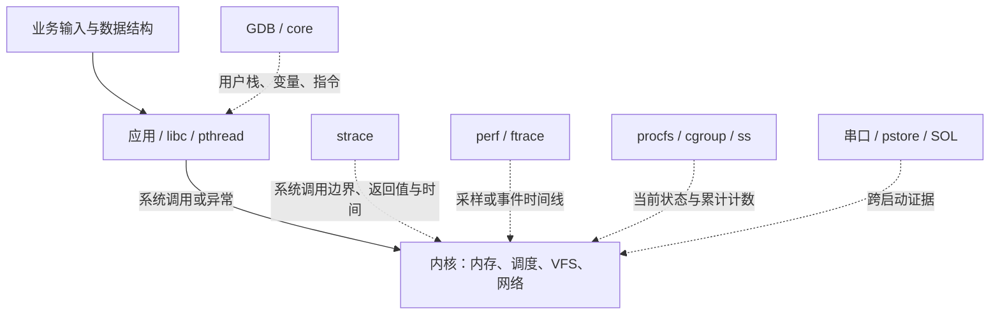

[[首页]] · [[案例索引]] · [[工具索引]] · [[00-实验准备与通用方法/00-章节导航|章节导航]]

## 0.5 把“系统有问题”转换成可验证的问题

### 0.5.1 现象、直接原因和根因

假设设备上一个服务消失了。此时“程序崩溃”仍然是假设，不是事实。它可能主动退出，
被管理员停止，被 systemd 超时结束，被 OOM 杀死，或者访问非法地址后被信号终止。
第一步要记录服务名、PID、出现时间、输入和退出结果，再选择深入的方向。

把结论拆成三层：

| 层次 | 崩溃例子 | OOM 例子 |
| --- | --- | --- |
| 现象 | 请求编号 42 后进程消失 | 处理若干数据块后进程消失 |
| 直接原因 | 指令访问无效地址，引发 SIGSEGV | memcg OOM 处置向进程发 SIGKILL |
| 根因 | 查询失败返回 NULL，调用者未检查 | 循环丢失分配地址，没有释放所有权 |

只定位到信号不足以修复业务；只看到 malloc 也不足以证明这一次退出由 OOM 导致。
完整解释需要把输入、错误状态、内核处置和可见结果串起来。

### 0.5.2 让每条命令对应一个假设

排查前写出两个候选原因及它们的不同预测。例如慢请求可能由计算多，也可能由等待多：
前者预计 task-clock 接近墙钟，后者预计墙钟明显大于 CPU 时间。先比较这两类时间，
再决定使用 CPU 采样还是调度/锁分析，避免在等待程序上盲目生成 CPU 火焰图。

不要把“没有看到”直接写成“不存在”。没抓到系统调用可能是开始太晚，没看到函数名
可能是符号不匹配，没出现 OOM 可能是杀进程的日志已被覆盖。记录观测窗口与采集限制，
必要时使用能够推翻假设的对照实验。

## 0.6 先理解用户态、内核态和工具的位置

应用执行普通加法、查表时通常停留在用户态；open、读写、等待、映射等操作通过系统
调用进入内核。用户态访存还可能因缺页异常进入内核，这不要求源代码显式调用某个函数。
中断和调度也能打断用户程序，因此“源代码没有调用内核”不等于运行没有内核参与。

工具定位图：区分用户态、内核态以及各类调试工具能够观察的边界。



工具观察的是不同切面。GDB 用户栈不能自动提供内核栈；strace 看不到普通用户态循环
里的每一次查表；perf 的 CPU 采样不能完整记录线程睡眠期间的时间；日志可能记录错误
处置，却没有记录更早的业务状态。组合工具的目的，是用相互独立的观测补足因果链。

## 0.7 第一层分类：退出、忙、等、断、重启

### 0.7.1 退出状态不是故障类别

交互式 shell 的 `$?` 只保存上一条命令的状态，必须紧接实验读取。通常 shell 用
128 加信号编号表示信号退出，因此本环境 139 常对应 SIGSEGV，137 常对应 SIGKILL。
但程序也可以主动 `return 137`，外层 timeout/systemd 还可能转换结果，所以还要读
监督记录、信号、core 或 OOM 计数，不能只凭一个数字归类。

设备端：运行“缺失记录未判空导致空指针崩溃”故障现场，记录输出中的实际结果目录与异常证据。

```sh
sadboard run crash
```

设备端：紧接上一步保存退出码并立即打印，结合本例日志解释该状态。

```sh
rc=$?
printf 'exit=%s\n' "$rc"
```

上面故意不启用 `set -e`，否则非零退出可能在保存 rc 前让脚本结束。管道中的 `$?`
通常是最后一个命令的状态；把实验接到 tee 后，需要明确 shell 的管道状态规则。
统一入口把结果写入 `result`，其中场景码、监督器原始码和取消标志分别保存。

### 0.7.2 用资源方向选择工具

| 观测 | 优先提出的问题 | 后续证据 |
| --- | --- | --- |
| CPU 接近一核满载 | 算法、忙轮询、重复工作在哪里？ | perf stat/record、业务工作量 |
| 墙钟长、CPU 少 | 在睡眠、锁、I/O 还是等待 CPU？ | 全线程栈、strace、sched trace |
| 内存增长后进程消失 | 谁在计费，是否触及该组上限？ | limits/events、分配栈、内核日志 |
| ping 正常、TCP 慢 | 小包连通和业务吞吐为何不同？ | iperf 字节、RTT、ss、抓包、队列 |
| 设备重启 | 谁决定重启，哪次启动没有完成？ | 意图、复位原因、panic/pstore、startup ID |

这些是选择方向的线索，不是判定表。一个程序可同时 CPU 高且锁竞争严重；一次网络
超时也可能由进程调度或对端应用阻塞造成。用证据逐步细分，而不是给现象贴标签后停止。

## 0.13 工具选择与练习验收

| 问题 | 首选证据 | 深入工具 |
| --- | --- | --- |
| 程序崩溃 | 信号、core、配套 ELF | GDB 寄存器/调用链、反汇编、Valgrind |
| 无法再打开资源 | errno、/proc/PID/limits 和 fd | strace openat/close、资源所有权源码 |
| 进程被杀 | cgroup events、内核 OOM 记录、退出信号 | 内存趋势、Valgrind、分配源码 |
| CPU 忙 | 同输入 CPU/墙钟、perf stat | perf record/report、火焰图、算法分析 |
| CPU 闲却慢 | 线程状态、墙钟/CPU 比、strace | GDB 全线程栈、调度事件时间线 |

独立完成“现象 → 假设 → 证据 → 源码机制 → 修复 → 同输入验收”，并记录一个能推翻
原假设的结果。不要用没有错误日志、进程提前退出或某个单独命令返回 0 代替完整验收。

### 同输入优化的统一验收方法

性能、内存和网络优化都要先证明业务工作相同，再解释指标变化。至少遵循以下约束：

1. **先定义业务契约。** 输入数、完成数、序号、checksum、允许丢弃策略先固定。只减少任务、降低频率、丢消息或关闭校验，不算同等语义优化。
2. **分开量 wall 与 CPU。** wall 包括睡眠、调度、I/O；CPU 时间衡量实际执行。平均 CPU 低不能排除长尾或资源等待。
3. **保存原始分布。** 记录逐次时间和队列高水位，再算 P50/P99/max；样本太少时 P99 近似最大值。至少三次同输入，报告每次值和中位数，不只挑最好的一次。
4. **量资源与副作用。** RSS/PSS、cgroup memory、FD/线程、队列、包丢失/重传、上下文切换、持久化窗口要与性能放在同一张报告内。
5. **做负例。** 截断 CSV、改 checksum、减少 completed 必须拒绝；这是证据契约，不能证明学习者的任意新算法正确。参考检查器只验镜像提供的参考实现。
6. **区分机制和测量。** 源码箭头是推导；perf 是采样；ftrace 是选定事件；strace 会干扰时序。先跑低干扰基线，再单独取证，写明采样与未观测部分。
7. **保留环境。** 固件版本/完整 ID、内核配置、匹配 ELF、温度/频率（若可读）、挂载类型、输入、采样命令和退出状态都归档。实验只动自己的 cgroup/netns/文件。

参考检查器验证“工作量和证据真实一致、资源边界生效”。它不以一次 P99 或 wall 时间阈值代替跨负载性能验收，也不提供任意补丁的通用自动评分。

## 0.14 三个学习层次

| 层次 | 给你的信息 | 完成标准 |
| --- | --- | --- |
| L1 复现与取证 | 案例类型、输入、工具入口 | 保存完整现场，正确解释退出状态和关键指标 |
| L2 独立定位 | 现象与业务契约 | 自选工具，提出至少两个假设，用证据排除其中一个 |
| L3 机制与迁移 | 改变输入或加入容易混淆的对照 | 解释内核条件分支，识别证据不充分的情形，给出同输入修复验证 |

普通案例先等本次健康确认，确认 data 可用；panic 按自己的启动窗口流程执行。
`check` 通过表示保存的证据符合本案例契约；`verify` 对照的是随镜像提供的参考修复。
一次计时和一个校验和不能证明任意业务代码完全正确，性能结论还要做重复测量。
