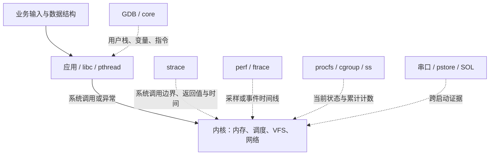

# 先理解用户态、内核态和工具的位置

[[首页]] · [[00-实验准备与通用方法/00-章节导航|章节导航]] · [[案例索引]] · [[工具索引]]

## 0.6 先理解用户态、内核态和工具的位置

应用执行普通加法、查表时通常停留在用户态；open、读写、等待、映射等操作通过系统
调用进入内核。用户态访存还可能因缺页异常进入内核，这不要求源代码显式调用某个函数。
中断和调度也能打断用户程序，因此“源代码没有调用内核”不等于运行没有内核参与。

工具观察的是不同切面。GDB 用户栈不能自动提供内核栈；strace 看不到普通用户态循环
里的每一次查表；perf 的 CPU 采样不能完整记录线程睡眠期间的时间；日志可能记录错误
处置，却没有记录更早的业务状态。组合工具的目的，是用相互独立的观测补足因果链。
