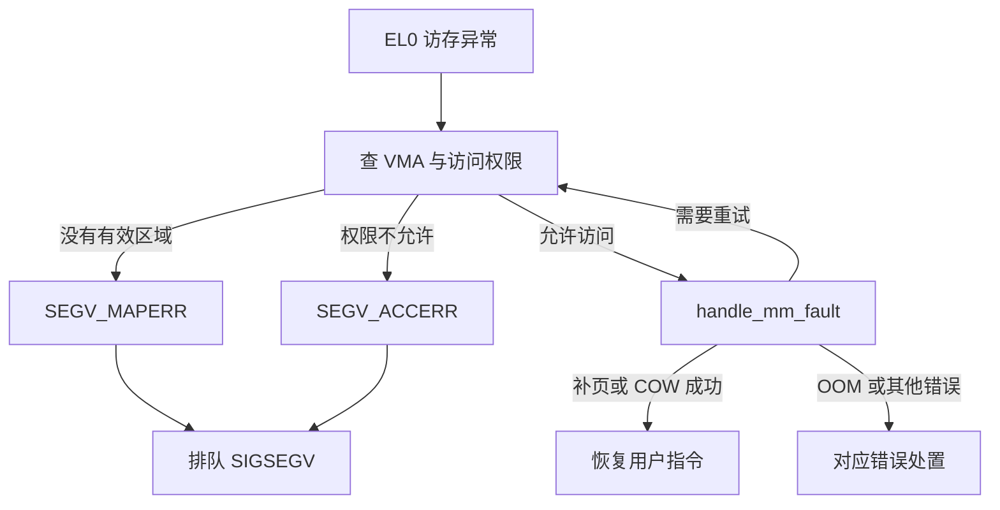

# 内核流程

[[首页]] · [[01-应用崩溃/00-章节导航|章节导航]] · [[01-应用崩溃/B-CR01-缺失记录未判空导致空指针崩溃/00-案例导航|本例导航]] · [[案例索引]] · [[工具索引]]


## 1.14 内核源码精读与关键分支

读 [fault.c](https://github.com/linux-bsp/linux-7.0/blob/1c04c52c72b0e67ad4b5deca464ea70bc6ebb718/arch/arm64/mm/fault.c) 的 `do_page_fault`：

1. 识别 EL0/EL1、读/写/取指，决定需要什么 VMA 权限。
2. 根据地址查找有效 VMA；没有 VMA 与权限不符是不同的错误分支。
3. 合法 VMA 进入 `handle_mm_fault`，可能建立页表或处理写时复制，恢复后重试原指令。
4. 无法合法恢复才转入信号或内核异常处置；`VM_FAULT_OOM` 还有自己的处理分支。

再读 [memory.c](https://github.com/linux-bsp/linux-7.0/blob/1c04c52c72b0e67ad4b5deca464ea70bc6ebb718/mm/memory.c) 的 `handle_mm_fault`、
`do_anonymous_page`：合法首次写触可以分配匿名 folio、做 memcg 计费、建立 PTE。
因此“缺页数增加”“malloc 返回地址”“RSS 增加”是不同事件，不能混用。

对照实验：正常内存程序大量写触也会发生缺页，但应继续运行；crash 案例访问无效
记录，内核无法为它建立合法 VMA。用 GDB 的地址、指令和变量证明是哪一类。
SIGSEGV 还需区分 MAPERR/ACCERR，不能把所有访存异常都归为 NULL。


## 1.16 详细内核流程：错误指令怎样变成 SIGSEGV 和 core

这里把入口、内存判定、信号和转储拆成四段。以下是固定 Linux 提交的**源码推导**，
不是额外抓到的一条完整实机内核栈；第 1.12 节的用户 core 则是真实采集结果。

### 1.16.1 MMU 报错之前与之后

用户态 LDR 先计算虚拟地址，CPU 的地址转换单元尝试通过 TLB/页表获得允许的映射。
本例基址为零、偏移为四，访问 0x4；通常不存在可读 VMA，硬件产生 EL0 Data Abort。
这不是调用了某个 `segfault()` 函数，也不要求应用显式执行 SVC。

```text
故障 LDR
  → EL0 同步异常入口，软件保存 pt_regs
  → el0t_64_sync_handler：ESR_ELx_EC_DABT_LOW
  → el0_da：读取 FAR_EL1
  → do_mem_abort：根据 fault_info 分派具体错误
  → 对用户地址的 translation fault，可经 do_translation_fault → do_page_fault
```

ESR 说明异常类别及访问状态，FAR 保存与访存错误有关的地址，ELR/保存的 PC 用于定位
指令。此处没有新的现场 ESR 数值，不能根据用户 core 编造一份硬件 ESR。GDB 中已经
验证的 si_addr=0x4 是 Linux 导出的用户信号证据，和原始硬件寄存器不是同一接口。

### 1.16.2 do_page_fault 为什么不会为 NULL 自动分配页

| 阶段 | 关键对象或判断 | 本例与正常缺页的区别 |
| --- | --- | --- |
| 取得上下文 | current->mm、user_mode、fault handler 状态 | 不是所有内核上下文都允许进入可睡眠缺页处理 |
| 确定权限 | 读/写/取指和 VMA flags | 同一个地址读与写可能走不同判断 |
| 快路径 | lock_vma_under_rcu | 需要有效 VMA，不存在则进入后备路径 |
| 后备查找 | lock_mm_and_find_vma | 找不到可接受区域，形成 SEGV_MAPERR |
| 合法映射 | handle_mm_fault | 可能分配页、处理 COW、等待或重试，而不是直接发信号 |
| 错误分支 | bad_area 与 arm64_force_sig_fault | 还区分 ACCERR、SIGBUS、OOM 等情况 |

关键点是**先判断地址是否属于允许访问的区域，再考虑能否补页**。若内核为任何出错
地址都分配页，NULL、越权写入等错误将破坏进程隔离。有效 VMA 的首次匿名写触则是
正常慢路径，处理成功后恢复并重新执行原指令，与本例的非法地址分支不同。



### 1.16.3 信号是后续处置，不是把所有工作塞进异常入口

arm64_force_sig_fault 构造信号信息并使其待处理。返回用户态的工作路径会检查这些
状态，经 ARM64 的信号恢复逻辑及 `get_signal()` 取出信号。若程序没有安装适用的
用户处理函数，则按默认致命行为进行 core 和线程组退出；若存在处理函数，则还需要
建立用户信号帧，不能把所有 SIGSEGV 都描述为立即执行同一终止流程。

当前内核的普通 ELF 转储关键调用为：

```text
get_signal
  → vfs_coredump
    → do_coredump：解析 core_pattern 与输出类型、建立输出
      → coredump_write：获取 VMA 快照并调用 binfmt->core_dump
        → elf_core_dump：生成 ELF header、notes 与选定 PT_LOAD 数据
  → do_group_exit：完成致命信号的线程组退出
```

组内线程协调、dumpable/权限检查、core 大小限制、coredump_filter、普通文件/管道输出
都是这条路径的条件。SIGKILL 不生成同样的 core；core 写入失败也不代表原先没有异常。
参考 [signal.c](https://github.com/linux-bsp/linux-7.0/blob/1c04c52c72b0e67ad4b5deca464ea70bc6ebb718/kernel/signal.c)、
[coredump.c](https://github.com/linux-bsp/linux-7.0/blob/1c04c52c72b0e67ad4b5deca464ea70bc6ebb718/fs/coredump.c)、
[binfmt_elf.c](https://github.com/linux-bsp/linux-7.0/blob/1c04c52c72b0e67ad4b5deca464ea70bc6ebb718/fs/binfmt_elf.c)。

### 1.16.4 ESR 解码入门：错误类别与页表阶段

仅在确实保存了相应寄存器的现场中解码 ESR；用户 core 的 si_code 不是 ESR。
固定内核 [esr.h](https://github.com/linux-bsp/linux-7.0/blob/1c04c52c72b0e67ad4b5deca464ea70bc6ebb718/arch/arm64/include/asm/esr.h) 给出了字段宏：
EC 位于高部位的 [31:26]，DABT_LOW 的类别值为 0x24，DABT_CUR 为 0x25；
对于数据异常还要继续解释 ISS 中的读写与 Fault Status Code，而不是只看最高字节。

下面的数值是**人为构造的教学输入，不是本例实机寄存器**，可在主机 Python 里计算：

```python
esr = 0x92000004  # 教学构造值
ec = (esr >> 26) & 0x3f
il = (esr >> 25) & 1
write = (esr >> 6) & 1
fsc = esr & 0x3f
print(hex(ec), il, write, hex(fsc))
```

输出为 `0x24 1 0 0x4`：在这项假设中，是来自较低异常级的数据访问异常、对应指令
长度标记为 32 位、读访问、translation fault 的相应阶段。结合该表的 FSC 定义，
0x4 表示 level 0 translation fault；这不等于已经证明是 NULL，仍需 FAR、PC、
映射与业务对象共同判断。其他 EC 下，ISS 字段的含义可能不同，不套用这套读取规则。

指令异常、权限、对齐、外部 abort、硬件错误还各有分支，某些场合 FAR 也不保证有效。
完整分析应依次确定 EC、字段适用条件、FSC/读写、地址有效性、错误指令，最后才归因。
不为了让一张示意图完整，就给没有记录寄存器的现场补造一个数值。

### 1.16.5 源码阅读练习

在 fault.c 标出正常补页、无 VMA、权限、OOM 四个出口；再在 signal.c 找到默认致命
处置。解释以下反例：写只读映射与 NULL 读为何可能都是 SIGSEGV，却不能用同一业务
修复？合法首次写触为何没有退出？为什么空 core 不能成为“没有缺页异常”的证据？

## 本例其他笔记

[[01-应用崩溃/B-CR01-缺失记录未判空导致空指针崩溃/01-现场与原理|现场与原理]] · [[01-应用崩溃/B-CR01-缺失记录未判空导致空指针崩溃/02-练习任务|练习任务]] · [[01-应用崩溃/B-CR01-缺失记录未判空导致空指针崩溃/03-工具参数|工具参数]] · [[01-应用崩溃/B-CR01-缺失记录未判空导致空指针崩溃/04-定位分析|定位分析]] · [[01-应用崩溃/B-CR01-缺失记录未判空导致空指针崩溃/06-汇编与反汇编|汇编与反汇编]] · [[01-应用崩溃/B-CR01-缺失记录未判空导致空指针崩溃/07-修复与验收|修复与验收]] · [[01-应用崩溃/B-CR01-缺失记录未判空导致空指针崩溃/08-实机证据与反例|实机证据与反例]]
