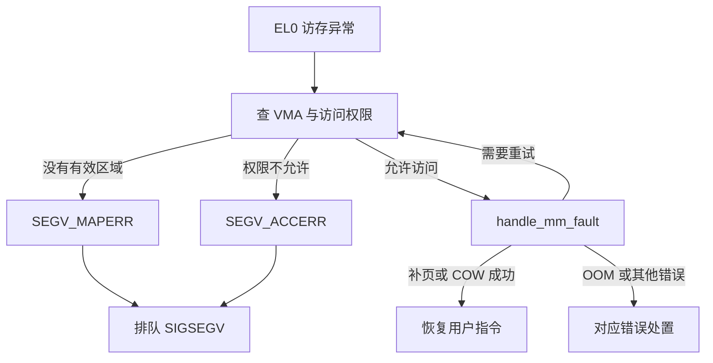

[[首页]] · [[案例索引]] · [[工具索引]] · [[01-应用崩溃/00-章节导航|章节导航]]

先按现象提出假设并完成练习，再核对定位、内核机制和参考修复。`verify` 验证镜像提供的参考实现。

[[01-应用崩溃/B-CR01-缺失记录未判空导致空指针崩溃/B-CR01：缺失记录导致应用崩溃#现象与原理|现象与原理]] · [[01-应用崩溃/B-CR01-缺失记录未判空导致空指针崩溃/B-CR01：缺失记录导致应用崩溃#练习任务|练习任务]] · [[01-应用崩溃/B-CR01-缺失记录未判空导致空指针崩溃/B-CR01：缺失记录导致应用崩溃#使用工具|使用工具]] · [[01-应用崩溃/B-CR01-缺失记录未判空导致空指针崩溃/B-CR01：缺失记录导致应用崩溃#定位方法|定位方法]] · [[01-应用崩溃/B-CR01-缺失记录未判空导致空指针崩溃/B-CR01：缺失记录导致应用崩溃#内核流程与汇编|内核流程与汇编]] · [[01-应用崩溃/B-CR01-缺失记录未判空导致空指针崩溃/B-CR01：缺失记录导致应用崩溃#修复与验收|修复与验收]] · [[01-应用崩溃/B-CR01-缺失记录未判空导致空指针崩溃/B-CR01：缺失记录导致应用崩溃#实机证据与反例|实机证据与反例]]

## 现象与原理

### 1.1 问题现场与目标

难度：入门到进阶。程序按编号查询记录，正常编号输出结果；某些输入直接退出。
任务是从退出信号找到出错指令，恢复调用者与输入，并验证错误处理没有破坏正常路径。
入口 `sadboard run crash` 固定输入 42，故障函数为 `process_request()`。
源码：[crash.c](https://github.com/linux-bsp/sadboard-external/blob/93c81e82acfdf5d54155d1b9bb750e78645d384f/package/sadboard-labs/src/crash.c)。

设备端：记录本例运行的构建标识，后续使用同一构建的 ELF 和 sysroot。

```sh
/usr/libexec/sadboard/boot-context
```

设备端：记录本次 Linux boot ID，避免混淆不同启动的 core 与日志。

```sh
cat /proc/sys/kernel/random/boot_id
```

设备端：运行“缺失记录未判空导致空指针崩溃”故障现场，记录输出中的实际结果目录与异常证据。

```sh
sadboard run crash
```

设备端：紧接上一条实验读取退出状态，结合日志确认含义，不要先执行其他命令。

```sh
echo "$?"
```

启动器打印现场目录。预期 shell 返回 139，即常见 shell 表示的 `128 + SIGSEGV(11)`。
这提示可能是信号终止，还需信号/core 证据，也不能直接证明是空指针。退出码 137 是 SIGKILL 的常见表示，
不能混为本案例；没有 core 也不能据此判定没有崩溃。

### 1.3 先修概念：指针值、对象与字段地址

`struct record` 有 key 和 value 两个 int。查询得到的是对象地址，读取 `record->value`
需要以该地址为基址，再加上 value 的成员偏移。有效指针不是“任何非零整数”，它还要
指向生存期内、允许访问的对象；非 NULL 的悬空指针同样会错。

本构建中可以在 GDB 用 `ptype struct record`、`print sizeof(struct record)` 和
`print &((struct record *)0)->value` 理解布局；最后一条仅用于调试器求成员偏移的观察，
不要把 NULL 成员访问写进业务代码当成可移植 C 技巧。也可用标准 `offsetof` 在源码中
计算成员偏移。实际大小与对齐要以目标 ABI 为准，不能把主机布局无条件用于板端。

当查询 42 返回 0 时，读取 value 的有效地址可表现为 0x4。故障发生时 PC 是**执行
访存指令的位置**，si_addr 是**访问失败的地址**，两者概念不同。一个是代码地址，一个
是数据地址；不能用 si_addr 作为崩溃函数地址去符号化。

### 1.5 从 C 指针到 ARM64 异常

查找函数对不存在的编号返回 NULL，调用者没有检查，就读取记录字段。这是 C 的未定义
行为；本镜像使用保留调试信息的特定构建，在实机上表现为 SIGSEGV。访问字段的有效地址
可能是 `NULL + 字段偏移`，因此 `si_addr` 不一定恰好为零。

CPU 在 EL0 执行载入指令，MMU 发现该虚拟地址没有合法映射，进入同步 Data Abort。
这与正常按需分配缺页的入口相同，但内核找不到可接受的 VMA，不能建立映射，最终产生
SIGSEGV；它不是“用户程序把内核打崩”。进程尚有有效的内核栈，内核能够正常处置信号。

以下是**源码整理路径**，分两段理解，不是一个连续现场栈：

源码流程示意：把非法访存产生 SIGSEGV、默认信号处理和 core 转储分成不同阶段。

```text
EL0 访存异常
  el0t_64_sync_handler → el0_da → do_mem_abort → do_page_fault
  地址无有效 VMA / 权限不符 → arm64_force_sig_fault(SIGSEGV, ...)

返回用户态前的信号处理
  get_signal → 默认致命信号处理 → vfs_coredump
  do_coredump → coredump_write → ELF 的 elf_core_dump → 退出线程组
```

阅读入口：[entry-common.c](https://github.com/linux-bsp/linux-7.0/blob/1c04c52c72b0e67ad4b5deca464ea70bc6ebb718/arch/arm64/kernel/entry-common.c)、
[fault.c](https://github.com/linux-bsp/linux-7.0/blob/1c04c52c72b0e67ad4b5deca464ea70bc6ebb718/arch/arm64/mm/fault.c) 的 `do_page_fault/bad_area`、
[signal.c](https://github.com/linux-bsp/linux-7.0/blob/1c04c52c72b0e67ad4b5deca464ea70bc6ebb718/kernel/signal.c) 的 `get_signal`、
[coredump.c](https://github.com/linux-bsp/linux-7.0/blob/1c04c52c72b0e67ad4b5deca464ea70bc6ebb718/fs/coredump.c) 及
[binfmt_elf.c](https://github.com/linux-bsp/linux-7.0/blob/1c04c52c72b0e67ad4b5deca464ea70bc6ebb718/fs/binfmt_elf.c) 的 `elf_core_dump`。
检查 `SEGV_MAPERR` 与 `SEGV_ACCERR` 两个分支，理解“无映射”和“权限错误”的差异。

## 练习任务

### 1.2 独立练习任务与分级提示

**现场入口**：`sadboard run crash 42`；对照 `sadboard run crash 1`。

**任务**：不用改代码，说明退出是程序主动返回还是信号终止；找到出错指令的访存地址、
调用者与原始输入。保存在线栈和离线 core 各一份，并说明它们为何能解释同一类故障。

**必须提交**：完整固件 ID、退出码、core 结构检查、匹配 ELF/sysroot、`bt full`、
出错指令及有关寄存器；最后给出缺失记录与正常记录的修复对照。

<details><summary>L1 提示：先区分退出结果</summary>

用 `echo $?` 保存上一条命令结果，再读现场 result；不要运行其他命令后才取退出码。
139 是此 shell 对 SIGSEGV 的常见表示，仍需要 GDB 中的信号与指令证据。
`sadboard check RUN` 检查 ELF core 及线程状态 note，而不是只检查文件名存在。

</details>
<details><summary>L2 提示：从现场值往上游追</summary>

先看 `frame 0 / info locals / x/i $pc`，再沿调用者追查询失败如何被处理。
`si_addr=0x4` 并不排除 NULL 基址，它可能是读取结构体字段产生的偏移。

</details>

**L3 对照**：传入字符串、负数和未知编号，区分参数拒绝与业务故障；用错误固件的
符号尝试解释旧 core 时，应如何识别不可信结论？不要为“看起来有函数名”就接受它。
参考：[[01-应用崩溃/00-章节导航|应用崩溃]]、[[01-应用崩溃/B-CR01-缺失记录未判空导致空指针崩溃/B-CR01：缺失记录导致应用崩溃#1.14 内核源码精读与关键分支|内核阅读笔记]]。

## 使用工具

通用原理、参数和使用边界见工具手册；具体命令与证据判断见本例定位方法。

[[工具手册/sadboard|sadboard]] · [[工具手册/GDB|GDB]] · [[工具手册/gdbserver|gdbserver]] · [[工具手册/strace|strace]] · [[工具手册/readelf|readelf]] · [[工具手册/nm|nm]] · [[工具手册/objdump|objdump]] · [[工具手册/addr2line|addr2line]]

## 定位方法

### 1.4 把定位过程拆成四个问题

| 要回答的问题 | GDB 观测 | 仍需继续追什么 |
| --- | --- | --- |
| 怎样终止？ | 停止信号、`$_siginfo` | 不能只看 shell 139 |
| 哪条指令出错？ | PC、`x/i $pc`、寄存器 | 指令的基址与偏移 |
| 哪个业务状态错误？ | frame 0 的 record、调用者 key | record 为何没有对象 |
| 谁应该处理错误？ | 查找返回值与调用者分支 | 缺失是否正常业务输入 |

单步时 `next` 通常越过函数调用，`step` 尝试进入；`continue` 让程序继续直到断点或信号。
`frame N` 只切换查看的栈帧，不倒放程序。`bt full` 提供各帧已能恢复的参数/局部量，
但优化可能使值显示 optimized out，内存破坏也可能让栈展开不完整；这些情况应保留原始
指令和寄存器，不能凭空补出变量值。

### 1.6 定位流程一：在线 GDB

设备终端先运行：

设备端：以一次性 gdbserver 启动故障程序并等待主机连接；保留该终端供查看输出。

```sh
gdbserver --once :22345 /usr/libexec/sadboard/crash-bug 42
```

服务器另一个终端，从 SadBoard 根目录运行：

主机端：加载本次构建的 crash-bug 符号文件，进入交叉 GDB。

```sh
output/am625-debug-systemd/host/bin/aarch64-buildroot-linux-gnu-gdb \
  output/am625-debug-systemd/images/debug/labs/crash-bug
```

GDB 中按当前机器的绝对路径替换 `/path/to/SadBoard`：

主机 GDB：批量关闭分页并设置匹配的 sysroot 与源码映射，先替换本机绝对路径。

```gdb
set pagination off
set sysroot /path/to/SadBoard/output/am625-debug-systemd/staging
set substitute-path /usr/src/sadboard /path/to/SadBoard/output/am625-debug-systemd/images/debug/source
```

主机 GDB：连接板卡 gdbserver，确认连接成功并读到停止位置后再继续执行。

```gdb
target remote 192.168.10.211:22345
```

主机 GDB：继续执行到信号或断点，确认实际停止原因后再检查现场。

```gdb
continue
```

主机 GDB：打印完整调用栈及可恢复的局部变量，先定位业务调用层。

```gdb
bt full
```

主机 GDB：切换到最内层栈帧，再检查该函数的参数和局部变量。

```gdb
frame 0
```

主机 GDB：查看当前栈帧的参数，核对触发请求是否符合预期。

```gdb
info args
```

主机 GDB：查看当前栈帧的局部变量，寻找缺失记录与无效指针。

```gdb
info locals
```

主机 GDB：检查 record 指针的实际值，与故障访存地址对应。

```gdb
print record
```

主机 GDB：读取信号信息，核对信号类别及导致异常的地址。

```gdb
print $_siginfo
```

主机 GDB：显示当前源码位置，检查错误路径是否遗漏了返回值判断。

```gdb
list
```

主机 GDB：记录 PC、SP 及相关寄存器，按当前指令解释参数和地址。

```gdb
info registers pc sp x0 x1
```

主机 GDB：结合源码反汇编当前函数，将 C 字段访问对应到具体指令。

```gdb
disassemble /s process_request
```

主机 GDB：只查看当前 PC 处的指令，核对具体是哪次访存失败。

```gdb
x/i $pc
```

先看信号与 PC，再看 frame 0 中的 `record`，然后向上追溯参数 42 的来源。把反汇编
中的访存基址、偏移与 C 字段对应起来；优化后寄存器含义应按指令判断，不能一律把 x0
当成当前函数参数。`record == 0x0`、具体访存指令及缺失记录的控制流共同构成根因证据。
GDB 参数含义见 [[工具手册/GDB#常用命令与参数|工具手册]]。

扩展练习：在 `process_request` 设置断点，用 `next` 越过查找，再检查返回值；用
`step` 进入查找函数。不要只在崩溃行反复设置断点而忽略上游失败原因。

### 1.7 定位流程二：离线 core

`sadboard run crash` 在现场目录生成 `core.crash-bug.<PID>`。记录文件 SHA256。
NFS 模式下，可直接在主机的 `/srv/nfs/sadboard-am625/srv/sadboard/对应现场/` 读取它，
无需 SCP。以下是本地 SD 模式的拷贝方法；本设备没有 SFTP 服务，使用 SCP 的传统协议：

主机端：用传统 SCP 协议取回 SD 上的实际 core 文件，先替换现场目录与 PID。

```sh
scp -O root@192.168.10.211:/data/sadboard/crash-XXXXXXXX/core.crash-bug.PID ./core
```

加载匹配程序，设置完整 sysroot 后执行 `core-file /absolute/path/core`，再执行上述
`bt full / info locals / disassemble`。当前构建树可用 `output/am625-debug-systemd/target`
作为完整 sysroot；分析历史版本，应从当时保留的 `rootfs.squashfs` 提取副本。
需要目标程序在 sysroot 中保持原来的 `/usr/libexec/sadboard/crash-bug` 路径。
[GDB 文件规则](https://sourceware.org/gdb/current/onlinedocs/gdb.html/Files.html) 说明
sysroot 的目录结构应对应目标文件系统。

core 是部分地址空间和寄存器的快照，不是整个 Linux 内存。ELF notes 描述线程寄存器、
信号和文件映射，PT_LOAD 保存选定内存。ASLR/PIE 使运行地址与 ELF 链接地址不同，
不能直接把运行 PC 交给普通 addr2line 而忽略装载偏移。

### 1.8 core 缺失或 GDB 出现问号时

按顺序检查：`ulimit -c`、`kernel.core_pattern`、目录可写性、可用空间、
`/proc/self/coredump_filter`、ELF 是否 strip、程序与库是否匹配。SadBoard 把 pattern
设置为 `core.%e.%p`，仅在实验子进程设置 32 MiB core 上限；BusyBox ash 的此项单位为
512 字节，所用值为 65536。当前 ELF headers 配置对应新进程 filter 为 `0x33`。
实机曾因 PIE core 缺 ELF header 且 sysroot 不完整出现 `??`，修复过程见
[[01-应用崩溃/B-CR01-缺失记录未判空导致空指针崩溃/B-CR01：缺失记录导致应用崩溃#1.15 实战补充：在线正常、离线 core 却没有符号|PIE core 取证]]，不要将这类符号问题误报为栈损坏。

### 1.15 实战补充：在线正常、离线 core 却没有符号

#### 1.15.1 现象

AM625 的 `crash-bug 42` 在 gdbserver 下能显示 `process_request`、源码行号和
`record = 0x0`。对同次构建的程序加载 core 时，却出现：

历史错误输出：识别 core 分析时缺少映射文件和符号的表现，后续核对 ELF 与 sysroot。

```text
Can't open file /usr/libexec/sadboard/crash-bug during file-backed mapping note processing
#0  0x0000aaaadd829a34 in ?? ()
Backtrace stopped: previous frame identical to this frame (corrupt stack?)
```

程序确实有空指针缺陷，但这段离线输出不能作为“栈被覆盖”的证据。

#### 1.15.2 定位过程

1. 核对设备程序、主机符号、core 文件 SHA256，排除传输损坏和符号混用。
2. 检查 `readelf -h`，确认程序为 PIE；检查 `.debug_info`，确认符号未剥离。
3. 设备 `/proc/self/coredump_filter` 为 `00000023`，ELF 头部对应的 bit 4 未启用。
4. 原 BSP 关闭 `CONFIG_CORE_DUMP_DEFAULT_ELF_HEADERS`。core 没有保存映射的 ELF
   头部，而 staging sysroot 只有开发库，没有目标路径下的实验程序，GDB 未能自动
   恢复 PIE 加载基址。
5. 使用匹配的完整 rootfs 作为 sysroot，原 core 能正确回溯；在子进程中将过滤器
   设为 `0x33` 后生成的新 core，使用 staging sysroot 也能正确回溯。

这两个对照证明问题在离线分析所需的映射资料，不需要据此推断真实栈损坏。

#### 1.15.3 处理方式

SadBoard 调试内核启用：

内核配置示例：同时保留 core 转储能力与默认 ELF 头部，便于离线恢复 PIE 映射。

```text
CONFIG_COREDUMP=y
CONFIG_CORE_DUMP_DEFAULT_ELF_HEADERS=y
```

对于已启用 core 文件保存的系统，也可在实验子进程中临时设置：

设备端：将本次 NFS/SD 模式的实际结果根目录保存为当前终端变量，供后续命令复用。

```sh
SADBOARD_RESULTS=$(sadboard results)
```

设备端：进入自己这次采集的结果目录，后续 core 输出保存在这里。

```sh
cd ${SADBOARD_RESULTS}/自己的现场目录
```

设备端：在同一个子 shell 内设置 core 过滤器和大小上限，再执行故障程序生成新 core。

```sh
sh -c 'echo 0x33 > /proc/self/coredump_filter; ulimit -c 65536; exec /usr/libexec/sadboard/crash-bug 42'
```

BusyBox ash 的 core 上限单位为 512 字节，上述上限为 32 MiB。该命令会触发教学
程序的 SIGSEGV，需要在完成启动健康确认后手动执行。旧 core 可以配合对应固件的
完整 rootfs 分析，重新编译内核不会补回旧 core 缺少的字节。

主机仍须使用匹配的可执行文件、sysroot 和源码映射。`verify-debug.sh` 同时检查
符号 SHA256 与关键内核配置；符号文件存在不代表 GDB 已正确恢复加载地址。

过滤器定义见内核源码的
[proc 文档](https://github.com/linux-bsp/linux-7.0/blob/1c04c52c72b0e67ad4b5deca464ea70bc6ebb718/Documentation/filesystems/proc.rst)，
实际初版现场和对照输出保存在 `output/validation/stage1-debug/`。

## 内核流程与汇编

### 1.14 内核源码精读与关键分支

读 [fault.c](https://github.com/linux-bsp/linux-7.0/blob/1c04c52c72b0e67ad4b5deca464ea70bc6ebb718/arch/arm64/mm/fault.c) 的 `do_page_fault`：

1. 识别 EL0/EL1、读/写/取指，决定需要什么 VMA 权限。
2. 根据地址查找有效 VMA；没有 VMA 与权限不符是不同的错误分支。
3. 合法 VMA 进入 `handle_mm_fault`，可能建立页表或处理写时复制，恢复后重试原指令。
4. 无法合法恢复才转入信号或内核异常处置；`VM_FAULT_OOM` 还有自己的处理分支。

再读 [memory.c](https://github.com/linux-bsp/linux-7.0/blob/1c04c52c72b0e67ad4b5deca464ea70bc6ebb718/mm/memory.c) 的 `handle_mm_fault`、
`do_anonymous_page`：合法首次写触可以分配匿名 folio、做 memcg 计费、建立 PTE。
因此“缺页数增加”“malloc 返回地址”“RSS 增加”是不同事件，不能混用。

对照实验：正常内存程序大量写触也会发生缺页，但应继续运行；crash 案例访问无效
记录，内核无法为它建立合法 VMA。用 GDB 的地址、指令和变量证明是哪一类。
SIGSEGV 还需区分 MAPERR/ACCERR，不能把所有访存异常都归为 NULL。

### 1.16 详细内核流程：错误指令怎样变成 SIGSEGV 和 core

这里把入口、内存判定、信号和转储拆成四段。以下是固定 Linux 提交的**源码推导**，
不是额外抓到的一条完整实机内核栈；第 1.12 节的用户 core 则是真实采集结果。

#### 1.16.1 MMU 报错之前与之后

用户态 LDR 先计算虚拟地址，CPU 的地址转换单元尝试通过 TLB/页表获得允许的映射。
本例基址为零、偏移为四，访问 0x4；通常不存在可读 VMA，硬件产生 EL0 Data Abort。
这不是调用了某个 `segfault()` 函数，也不要求应用显式执行 SVC。

源码流程示意：从故障 LDR 追到地址转换异常、FAR_EL1 读取和缺页分派。

```text
故障 LDR
  → EL0 同步异常入口，软件保存 pt_regs
  → el0t_64_sync_handler：ESR_ELx_EC_DABT_LOW
  → el0_da：读取 FAR_EL1
  → do_mem_abort：根据 fault_info 分派具体错误
  → 对用户地址的 translation fault，可经 do_translation_fault → do_page_fault
```

ESR 说明异常类别及访问状态，FAR 保存与访存错误有关的地址，ELR/保存的 PC 用于定位
指令。此处没有新的现场 ESR 数值，不能根据用户 core 编造一份硬件 ESR。GDB 中已经
验证的 si_addr=0x4 是 Linux 导出的用户信号证据，和原始硬件寄存器不是同一接口。

#### 1.16.2 do_page_fault 为什么不会为 NULL 自动分配页

| 阶段 | 关键对象或判断 | 本例与正常缺页的区别 |
| --- | --- | --- |
| 取得上下文 | current->mm、user_mode、fault handler 状态 | 不是所有内核上下文都允许进入可睡眠缺页处理 |
| 确定权限 | 读/写/取指和 VMA flags | 同一个地址读与写可能走不同判断 |
| 快路径 | lock_vma_under_rcu | 需要有效 VMA，不存在则进入后备路径 |
| 后备查找 | lock_mm_and_find_vma | 找不到可接受区域，形成 SEGV_MAPERR |
| 合法映射 | handle_mm_fault | 可能分配页、处理 COW、等待或重试，而不是直接发信号 |
| 错误分支 | bad_area 与 arm64_force_sig_fault | 还区分 ACCERR、SIGBUS、OOM 等情况 |

关键点是**先判断地址是否属于允许访问的区域，再考虑能否补页**。若内核为任何出错
地址都分配页，NULL、越权写入等错误将破坏进程隔离。有效 VMA 的首次匿名写触则是
正常慢路径，处理成功后恢复并重新执行原指令，与本例的非法地址分支不同。

缺页分支图：比较合法地址补页、访问权限错误与地址不存在三类处理结果。



#### 1.16.3 信号是后续处置，不是把所有工作塞进异常入口

arm64_force_sig_fault 构造信号信息并使其待处理。返回用户态的工作路径会检查这些
状态，经 ARM64 的信号恢复逻辑及 `get_signal()` 取出信号。若程序没有安装适用的
用户处理函数，则按默认致命行为进行 core 和线程组退出；若存在处理函数，则还需要
建立用户信号帧，不能把所有 SIGSEGV 都描述为立即执行同一终止流程。

当前内核的普通 ELF 转储关键调用为：

源码流程示意：观察待处理信号如何触发 ELF core 写出与线程组退出。

```text
get_signal
  → vfs_coredump
    → do_coredump：解析 core_pattern 与输出类型、建立输出
      → coredump_write：获取 VMA 快照并调用 binfmt->core_dump
        → elf_core_dump：生成 ELF header、notes 与选定 PT_LOAD 数据
  → do_group_exit：完成致命信号的线程组退出
```

组内线程协调、dumpable/权限检查、core 大小限制、coredump_filter、普通文件/管道输出
都是这条路径的条件。SIGKILL 不生成同样的 core；core 写入失败也不代表原先没有异常。
参考 [signal.c](https://github.com/linux-bsp/linux-7.0/blob/1c04c52c72b0e67ad4b5deca464ea70bc6ebb718/kernel/signal.c)、
[coredump.c](https://github.com/linux-bsp/linux-7.0/blob/1c04c52c72b0e67ad4b5deca464ea70bc6ebb718/fs/coredump.c)、
[binfmt_elf.c](https://github.com/linux-bsp/linux-7.0/blob/1c04c52c72b0e67ad4b5deca464ea70bc6ebb718/fs/binfmt_elf.c)。

#### 1.16.4 ESR 解码入门：错误类别与页表阶段

仅在确实保存了相应寄存器的现场中解码 ESR；用户 core 的 si_code 不是 ESR。
固定内核 [esr.h](https://github.com/linux-bsp/linux-7.0/blob/1c04c52c72b0e67ad4b5deca464ea70bc6ebb718/arch/arm64/include/asm/esr.h) 给出了字段宏：
EC 位于高部位的 [31:26]，DABT_LOW 的类别值为 0x24，DABT_CUR 为 0x25；
对于数据异常还要继续解释 ISS 中的读写与 Fault Status Code，而不是只看最高字节。

下面的数值是**人为构造的教学输入，不是本例实机寄存器**，可在主机 Python 里计算：

主机 Python 示例：用构造的 ESR 值计算异常类别、指令长度、读写方向和故障状态码。

```python
esr = 0x92000004  # 教学构造值
ec = (esr >> 26) & 0x3f
il = (esr >> 25) & 1
write = (esr >> 6) & 1
fsc = esr & 0x3f
print(hex(ec), il, write, hex(fsc))
```

输出为 `0x24 1 0 0x4`：在这项假设中，是来自较低异常级的数据访问异常、对应指令
长度标记为 32 位、读访问、translation fault 的相应阶段。结合该表的 FSC 定义，
0x4 表示 level 0 translation fault；这不等于已经证明是 NULL，仍需 FAR、PC、
映射与业务对象共同判断。其他 EC 下，ISS 字段的含义可能不同，不套用这套读取规则。

指令异常、权限、对齐、外部 abort、硬件错误还各有分支，某些场合 FAR 也不保证有效。
完整分析应依次确定 EC、字段适用条件、FSC/读写、地址有效性、错误指令，最后才归因。
不为了让一张示意图完整，就给没有记录寄存器的现场补造一个数值。

#### 1.16.5 源码阅读练习

在 fault.c 标出正常补页、无 VMA、权限、OOM 四个出口；再在 signal.c 找到默认致命
处置。解释以下反例：写只读映射与 NULL 读为何可能都是 SIGSEGV，却不能用同一业务
修复？合法首次写触为何没有退出？为什么空 core 不能成为“没有缺页异常”的证据？

### 1.17 汇编实战：从指令恢复字段访问与修复分支

配套 ELF 中 process_request 起点为 0xa18，故障处 0xa34，差值为 0x1c，即 28 字节。
这正是实机 GDB 的 `<process_request+28>`，不要把十进制 28 看成十六进制 0x28。

故障版反汇编摘录：跟踪查找返回指针，定位零基址加字段偏移后的 LDR。

```asm
/* 故障版，摘自 668ad82f 的配套 ELF */
a28: 97ffffeb  bl  9d4 <lookup_record>
a2c: f90017e0  str x0, [sp, #40]
a30: f94017e0  ldr x0, [sp, #40]
a34: b9400400  ldr w0, [x0, #4]
a38: 2a0003e2  mov w2, w0
```

查找返回指针经 x0 保存到栈，再取出后读偏移四的 int。故障时 x0=0，地址为 0x4。
若成功读取，随后的 w2 会承载 printf 的一个整数参数；可见同一个 x0 在不同位置角色
不同，不能到函数末尾仍把它叫 record 指针。

参考版反汇编摘录：确认读取字段前新增空指针判断，并存在受控的错误返回分支。

```asm
/* 参考版，同样是真实反汇编，省略错误打印的中间指令 */
a30: f94017e0  ldr x0, [sp, #40]
a34: f100001f  cmp x0, #0x0
a38: 54000161  b.ne a64 <process_request+0x4c>
a5c: 52800040  mov w0, #0x2
a60: 14000009  b   a84 <process_request+0x6c>
a64: f94017e0  ldr x0, [sp, #40]
a68: b9400400  ldr w0, [x0, #4]
```

有对象才跳到正常访问分支；无对象先打印错误、返回 2、跳到统一收尾，不执行解引用。
“加了 NULL 检查”在机器码层面表现为改变可到达路径，而不只是源文件多了一行。
练习：用 objdump 找到错误路径的 fprintf 调用和统一恢复栈位置，再用 GDB 对照两种
输入；不要在旧 core 上尝试单步执行修复版。

## 修复与验收

### 1.9 修复、验收与迁移练习

参考修复在解引用前检查 NULL，缺失记录返回 2；正常编号 1 仍输出 `value=64`。
`sadboard verify crash` 检查这两个契约。真实修复还应明确错误向上传递、日志和调用者
的重试行为，而不是把 NULL 随意改成某个地址。

练习：分别比较越界、释放后使用、栈溢出与本案例会产生哪些不同证据；说明为什么
某些越界不立即触发缺页异常。清理时先结束自己启动的 gdbserver，确认进程退出，
保留必要 core 后只删除对应现场目录。

### 1.10 证据验收与分级练习

`check` 要求 core 为本架构 ELF64 ET_CORE，段数据未截断，并包含线程状态 note；空文件
或改名的普通可执行文件不能通过。此检查不替代 GDB：仍应确认信号、访存地址和变量。
参考修复另外保存有效输入输出、缺失输入 stderr 与退出码 2。
按 [[01-应用崩溃/B-CR01-缺失记录未判空导致空指针崩溃/B-CR01：缺失记录导致应用崩溃#1.2 独立练习任务与分级提示|练习册]] 完成 L1～L3，使用
[[附录A-实验报告/00-章节导航|报告模板]] 记录错误符号、缺失 core 等反例。

## 实机证据与反例

### 1.11 反例与进一步推理

为什么有的越界没有立刻崩溃？MMU 以页及权限检查映射，不知道 C 数组边界；越界地址
若仍落在允许访问的页，指令可能继续执行并破坏其他对象。因而“没有 SIGSEGV”不能证明
内存安全；检测这类问题可能需要编译插桩、分配器检查或 Valgrind，而不是只等 core。
这些是扩展机制，当前例子没有因此自动获得 KASAN/ASan 覆盖。

为什么改为 `if (!record) return 0` 不够？它掩盖了缺失请求，调用者可能把没有处理完成
当成成功。参考版返回 2，是为了明确区分存在、缺失和参数错误；真实接口还应设计稳定
的业务错误码并向上层传播。修复验收同时跑输入 1 与 42，保证正常能力和错误契约。

为什么 core 能离线看栈，却不能执行 `next`？它是某个时刻保存的数据，不是运行进程。
GDB 可借寄存器、内存段、映射与匹配 ELF 解释状态，但不能从静态快照继续产生真实业务
执行。在线调试可继续，代价是暂停会改变线程与外部设备的时序。

### 1.12 本轮实机 core 的逐项解读

2026-11-09，`v0.0.1 / 668ad82f`，用本固件配套 ELF 和完整 sysroot 分析新 core，
摘取以下真实输出，省略无关行：

实机 core 输出摘录：对照 SIGSEGV、process_request 调用栈、故障指令及 x0 的值。

```text
Program terminated with signal SIGSEGV, Segmentation fault.
#0  0x0000aaaaaaf89a34 in process_request (key=42) at src/crash.c:27
        record = 0x0
#1  0x0000aaaaaaf89b68 in main (...) at src/crash.c:44
=> 0xaaaaaaf89a34 <process_request+28>: ldr w0, [x0, #4]
x0  0x0
```

相同现场的 siginfo 为 si_signo=11、si_code=1、`_sigfault.si_addr=0x4`。
解读顺序如下：

1. SIGSEGV 证明实际信号，排除只依赖 shell 返回码的歧义。
2. 当前函数收到 key=42，查询得到的 record 为 NULL。
3. `ldr w0, [x0,#4]` 从 x0+4 取 32 位值；x0 为 0，有效地址因此为 0x4。
4. si_addr 与计算一致，si_code 对应本平台的映射错误；结合源码可定位到 value 字段。
5. 向上追 main 的输入和 lookup 的缺失分支，明确应在解引用前处理查找失败。

siginfo 是包含联合体的结构；GDB 一次打印可能把同一批字节解释成 `_kill`、`_timer`
等多个视图。分析本次内存异常应选择 `_sigfault`，不能把重叠显示的 `_kill.si_pid=4`
误读为“PID 4 发来了信号”。PC、栈地址受 ASLR 影响，不要求下一次数值完全相同；
稳定的是输入、错误状态、指令语义与故障地址之间的关系。

[[附录A-实验报告/00-章节导航|实验报告与复盘]] · [[00-实验准备与通用方法/01-构建与启动部署#固定源码与实机证据|匹配源码、固件与实测证据]]

[[01-应用崩溃/B-CR02-配置状态不一致触发SIGABRT/B-CR02：配置状态不一致触发 SIGABRT|下一例 B-CR02]]
