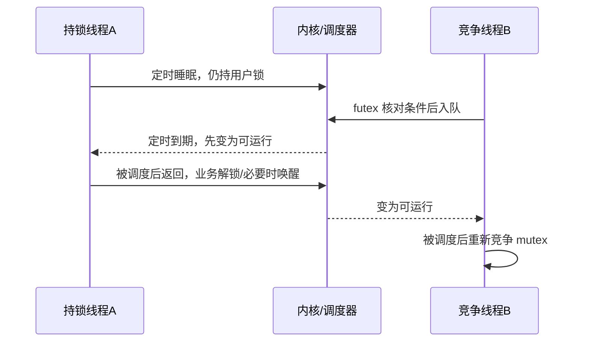

# 内核流程

[[首页]] · [[05-锁与线程调度/00-章节导航|章节导航]] · [[05-锁与线程调度/B-SYNC01-持锁执行慢操作导致线程串行等待/00-案例导航|本例导航]] · [[案例索引]] · [[工具索引]]


## 5.16 内核源码精读与关键分支

读 [waitwake.c](https://github.com/linux-bsp/linux-7.0/blob/1c04c52c72b0e67ad4b5deca464ea70bc6ebb718/kernel/futex/waitwake.c) 的 `futex_wait_setup`：
先获取关联 key 和 hash bucket 保护，再读取用户态值并核对预期。值已改变时返回
EWOULDBLOCK；应用/libc 重新检查，而不是无条件睡眠。

如果先在用户态检查值、再无保护地排队，唤醒者可能在这两步之间修改值并完成唤醒，
随后等待者才入睡，造成 lost wakeup。关键是正确的状态与队列同步，不是简单的
“加个 sleep 等待对方”。继续读 `futex_do_wait` 与 wake 的队列操作，区分：

| 时刻 | 能观察到什么 | 尚不能推出什么 |
| --- | --- | --- |
| 应用拿不到锁 | libc 栈/源行 | 不一定已经进入内核等待 |
| futex 睡眠 | 系统调用、内核等待点 | 不能只据此确定哪个业务对象有错 |
| sched_wakeup | 变为可运行 | 不代表已经获得 CPU 或 mutex |
| sched_switch 到该线程 | 真正开始运行 | 仍可能需要再次竞争锁 |

锁案例的根因在应用持锁范围。修复应维持临界区数据契约；futex 是协助证明等待机制
的下一层，不是看到它出现就修改调度器。


## 5.17 详细内核流程：睡眠、futex 等待、唤醒与切换

### 5.17.1 两个线程进入内核的理由不同

锁持有者通过 libc 的睡眠包装进入 clock_nanosleep/nanosleep 相关路径；竞争者在
libc 快路径无法得到 mutex 后可能进入 futex。一次快路径加锁甚至不需要系统调用，
所以“没看到 futex”不能证明没有加锁，也不能证明没有数据竞争。

源码流程示意：沿定时睡眠、线程变为可运行、重新获得 CPU 和用户锁依次理解等待。

```text
持有者的定时等待：
  sleep 包装 → clock_nanosleep 的时钟实现
  → hrtimer_nanosleep → do_nanosleep
    设置睡眠状态、启动 hrtimer → schedule
  （另一个中断/定时器上下文）hrtimer_wakeup → wake_up_process
  （之后被调度）原等待函数继续返回用户态

竞争者的普通 futex 等待：
  futex 系统调用 → do_futex → futex_wait → __futex_wait
  → futex_wait_setup：取得 key/桶，受保护地核对用户值、设置状态并入队
  → futex_do_wait：尚未被移除/超时时才 schedule
```

等待与定时器回调不处于一条连续调用栈。睡眠线程不会在原函数里忙等每一毫秒；
别的任务可在它让出的 CPU 上运行，但用户 mutex 的所有权不会因此自动释放。

### 5.17.2 防止丢失唤醒需要状态、队列和内存顺序共同成立

| 时序点 | 当前源码中的动作 | 为什么不能省略 |
| --- | --- | --- |
| 入睡前核对 | futex_wait_setup 在桶保护下读取用户值 | 已变化则返回 EWOULDBLOCK，避免按旧条件睡 |
| 宣布等待 | 设置任务状态并放入 futex 队列 | 唤醒方需要能找到并正确改变它的状态 |
| 交出保护 | futex_queue 完成入队并释放桶锁 | 不能持有这把桶锁让任务长期睡眠 |
| 真正等待 | futex_do_wait 再检查队列和定时状态 | 入睡前已经被唤醒时可跳过 schedule |
| 唤醒选择 | futex_wake 找到匹配 key 与等待项 | 普通 futex 不自动理解全部业务 mutex 语义 |
| 排队执行 | futex_wake_mark、wake_up_q、try_to_wake_up 等协作 | 变为可运行不代表立即获得 CPU 或用户锁 |

内存屏障与锁保护防止双方各自看到过期状态而错过唤醒，既不是“多加一次 sleep”，
也不只是维护一个等待链表。源码见 [waitwake.c](https://github.com/linux-bsp/linux-7.0/blob/1c04c52c72b0e67ad4b5deca464ea70bc6ebb718/kernel/futex/waitwake.c)
及 [futex.h](https://github.com/linux-bsp/linux-7.0/blob/1c04c52c72b0e67ad4b5deca464ea70bc6ebb718/kernel/futex/futex.h)。PI futex、requeue、超时和信号
另有分支，本章不能作为所有 futex 操作的完整状态机。

### 5.17.3 调度究竟切换了什么

对普通阻塞路径，可以沿 `schedule → __schedule → pick_next_task → context_switch`
理解选择下一任务，再读 ARM64 的 switch_to/`__switch_to` 与 `cpu_switch_to`。
调度类、抢占模式和特殊路径会影响细节，不把这条缩略路线当成所有切换的唯一栈。

`cpu_switch_to` 在两份 task 的 CPU context 间保存/恢复被调用者保存寄存器、内核 SP、
LR 等。恢复下一任务的栈和返回位置后，CPU 可以继续它以前暂停的位置；不是把下一
任务从 main 重头运行。用户全寄存器现场则由异常入口/返回等机制管理，与这组内核
上下文不是同一份保存区。

调度时序图：观察定时唤醒、运行、解锁、futex 唤醒和竞争线程运行之间的先后关系。



图只表达依赖关系，不表示中断、状态转换和真正运行都发生在同一瞬间。完整调度源码
位于 [sched/core.c](https://github.com/linux-bsp/linux-7.0/blob/1c04c52c72b0e67ad4b5deca464ea70bc6ebb718/kernel/sched/core.c)，底层保存与恢复位于
[entry.S](https://github.com/linux-bsp/linux-7.0/blob/1c04c52c72b0e67ad4b5deca464ea70bc6ebb718/arch/arm64/kernel/entry.S)。

## 本例其他笔记

[[05-锁与线程调度/B-SYNC01-持锁执行慢操作导致线程串行等待/01-现场与原理|现场与原理]] · [[05-锁与线程调度/B-SYNC01-持锁执行慢操作导致线程串行等待/02-练习任务|练习任务]] · [[05-锁与线程调度/B-SYNC01-持锁执行慢操作导致线程串行等待/03-工具参数|工具参数]] · [[05-锁与线程调度/B-SYNC01-持锁执行慢操作导致线程串行等待/04-定位分析|定位分析]] · [[05-锁与线程调度/B-SYNC01-持锁执行慢操作导致线程串行等待/06-汇编与反汇编|汇编与反汇编]] · [[05-锁与线程调度/B-SYNC01-持锁执行慢操作导致线程串行等待/07-修复与验收|修复与验收]] · [[05-锁与线程调度/B-SYNC01-持锁执行慢操作导致线程串行等待/08-实机证据与反例|实机证据与反例]]
