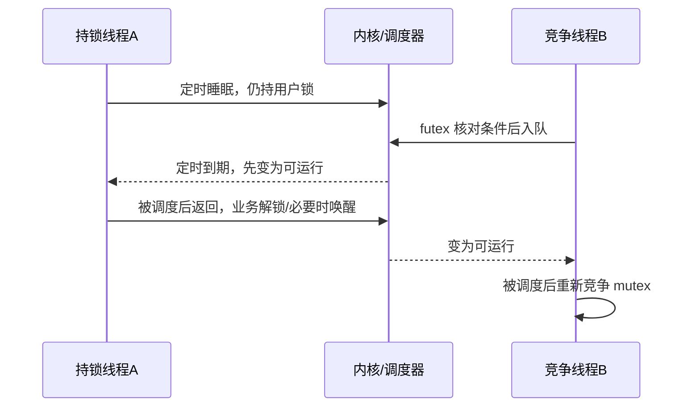

[[首页]] · [[案例索引]] · [[工具索引]] · [[05-锁与线程调度/00-章节导航|章节导航]]

先按现象提出假设并完成练习，再核对定位、内核机制和参考修复。`verify` 验证镜像提供的参考实现。

[[05-锁与线程调度/B-SYNC01-持锁执行慢操作导致线程串行等待/B-SYNC01：持锁等待与线程调度#现象与原理|现象与原理]] · [[05-锁与线程调度/B-SYNC01-持锁执行慢操作导致线程串行等待/B-SYNC01：持锁等待与线程调度#练习任务|练习任务]] · [[05-锁与线程调度/B-SYNC01-持锁执行慢操作导致线程串行等待/B-SYNC01：持锁等待与线程调度#使用工具|使用工具]] · [[05-锁与线程调度/B-SYNC01-持锁执行慢操作导致线程串行等待/B-SYNC01：持锁等待与线程调度#定位方法|定位方法]] · [[05-锁与线程调度/B-SYNC01-持锁执行慢操作导致线程串行等待/B-SYNC01：持锁等待与线程调度#内核流程与汇编|内核流程与汇编]] · [[05-锁与线程调度/B-SYNC01-持锁执行慢操作导致线程串行等待/B-SYNC01：持锁等待与线程调度#修复与验收|修复与验收]] · [[05-锁与线程调度/B-SYNC01-持锁执行慢操作导致线程串行等待/B-SYNC01：持锁等待与线程调度#实机证据与反例|实机证据与反例]]

## 现象与原理

### 5.1 问题现场与目标

难度：中级。程序没有崩溃，CPU 不忙，两个线程却没有预期的并行效果。
目标是区分 CPU 计算、I/O 睡眠、锁竞争和死锁，找到锁的保护范围，并保证修复无数据竞争。
源码：[lock.c](https://github.com/linux-bsp/sadboard-external/blob/93c81e82acfdf5d54155d1b9bb750e78645d384f/package/sadboard-labs/src/lock.c)。

设备端：运行“持锁执行慢操作导致线程串行等待”故障现场，记录输出中的实际结果目录与异常证据。

```sh
sadboard run lock
```

设备端：执行“持锁执行慢操作导致线程串行等待”的参考修复验收，核对终端结论及保存的结果契约。

```sh
sadboard verify lock
```

两个工作线程各处理 20 次，每次等待 50 ms 后计数。故障版把等待也放在互斥区内，
理论等待总和接近 2 秒；参考版把等待移出锁，只保护计数，两线程可重叠等待，接近
1 秒。实际有调度开销，不能用严格等于 2.000 秒当验收标准。两版都必须 completed=40。

### 5.3 并发基础：线程状态、mutex 和 futex

mutex 保护共享状态的访问契约。用户态无竞争的加解锁通常能用原子操作完成；竞争时
libc 可用 futex 协助等待和唤醒。futex 本身不了解“这是哪项业务”，同类调用也用于
条件变量、线程 join 等，因此看到 futex 不能直接认定业务 mutex 出错。

区分四个时刻：尝试获得锁、进入睡眠、被唤醒变为可运行、真正调度执行。被唤醒不等于
立即拿到 CPU，更不等于拿到锁。调度时间线能分开这些时段；全线程 GDB 栈说明每个
线程停在哪条业务路径。主线程停在 join 可能完全正常，必须继续查看工作线程。

本例在持锁期间模拟 I/O，另一线程无法并行等待；修复将独立等待移出临界区，再对共享
完成数加锁更新。一般项目不能照搬：若等待操作依赖锁保护的对象生存期，解锁可能引入
use-after-free 或状态竞态，必须重新设计所有权和状态机。

### 5.4 用时间线理解为什么两个线程反而串行

先暂时忽略几微秒的计数和调度开销，设每次独立等待 D、每线程 N 次。

线程时序示意：比较持锁等待与锁外等待，观察临界区长度如何影响并行执行。

```text
故障版某次迭代：
线程 A：拿锁 ── 等待 D ── 更新 ── 解锁
线程 B：    尝试拿锁 ───── 阻塞 ─── 拿锁 ── 等待 D ── 更新 ── 解锁

参考版某次迭代：
线程 A：独立等待 D ── 拿锁/更新/解锁
线程 B：独立等待 D ──── 拿锁/更新/解锁
```

故障版总等待近似 2ND，参考版等待可重叠，墙钟下界近似 ND；两个线程都完成 N 次。
这里并行的是等待区间，而不是让 completed++ 无锁执行。默认 D=0.05 秒、N=20，
所以直观上约为 2 秒与 1 秒。实际调度可能有波动，不保证每次恰好二倍。

为什么 CPU 很低？nanosleep 和 futex 阻塞时线程通常让出 CPU，所以 CPU 时间并不
随墙钟同步增长。睡眠线程持有用户锁不代表内核把它保持在 CPU 上；锁所有权与是否
被调度是两个不同状态。正因为它睡着仍持锁，其他线程才无法执行相同临界区。

### 5.5 不同“卡住”有不同的可证伪特征

| 候选原因 | 预计证据 | 本例应如何区分 |
| --- | --- | --- |
| CPU 忙循环 | CPU 持续执行同一用户路径 | 比较 CPU/墙钟及 perf 样本 |
| 正常有限等待 | 有明确超时/唤醒，最终完成 | 检查已完成次数及同输入时长 |
| 锁竞争 | 一个线程持有，其他线程等待同一资源 | 全线程栈及临界区源码 |
| 死锁 | 存在无法解除的等待依赖 | 画资源等待图，不能只凭一次 futex |
| 可运行但没上 CPU | wakeup 到 switch-in 延迟 | sched 时间线及系统负载 |

本案例会继续推进，不是死锁。某个采样时刻两个工作线程都不在运行，也可能是正常
睡眠交替；必须将栈、状态和一段时间中的进度连起来，而不是只截一次 ps。

### 5.6 pthread mutex 与 futex 的分层

pthread mutex 是 libc 的用户态同步对象。无竞争时通常通过原子指令完成加锁，不需要
每次进入内核；有竞争时 libc 可先自旋，再用 futex 等待。Linux futex 基于用户地址及
条件值组织等待队列，内核不会替应用理解“这把锁保护哪个对象”。

本例持有者在 nanosleep 中睡眠，却仍持有 mutex；另一个线程进入 futex 等待。
程序会继续前进，所以不是循环等待式死锁。简单删除锁虽然变快，却会让 completed++
出现数据竞争，不能算正确修复。

源码整理的两条关键路径：

源码流程示意：把锁竞争者的 futex 等待与锁持有者的定时睡眠分别分析。

```text
竞争者：pthread_mutex_lock → libc futex 包装
  futex 系统调用 → do_futex → futex_wait → __futex_wait
  futex_wait_setup → futex_do_wait → schedule

持有者：nanosleep / clock_nanosleep → 定时睡眠
  返回用户态 → 修改计数 → pthread_mutex_unlock
  必要时 futex_wake → 唤醒等待者 → 等待者重新竞争 mutex
```

这里 libc 的具体函数名可能是 `__lll_lock_wait` 等；不能把它们写成 Linux 内核函数。
内核阅读：[syscalls.c](https://github.com/linux-bsp/linux-7.0/blob/master/kernel/futex/syscalls.c)、
[waitwake.c](https://github.com/linux-bsp/linux-7.0/blob/master/kernel/futex/waitwake.c) 的 `futex_wait_setup/futex_do_wait`，
[hrtimer.c](https://github.com/linux-bsp/linux-7.0/blob/master/kernel/time/hrtimer.c)、
[sched/core.c](https://github.com/linux-bsp/linux-7.0/blob/master/kernel/sched/core.c)。重点理解 futex 等待前的值检查、
队列与唤醒顺序如何避免 lost wakeup，而不是只背函数名。

## 练习任务

### 5.2 独立练习任务与分级提示

**现场入口**：`sadboard verify lock 20 50000`，另用 strace/GDB 获取独立观测。

**任务**：区分睡眠、互斥等待、被唤醒后等待 CPU 和真正死锁；画出两线程各一次迭代
的时间线，标出拿锁、等待、更新和解锁。

**必须提交**：每线程迭代数、completed=40、CPU/墙钟时间、全部线程栈、按 TID 解读
的 futex/clock_nanosleep，以及两版为何都没有丢失更新。

<details><summary>L1 提示：看全部线程</summary>

main 的 join 等待本身可能正常。看工作线程：谁睡眠时仍持锁，谁在 mutex 路径等待。
结合源码的锁范围，而不是把所有 futex 都归为业务锁。

</details>
<details><summary>L2 提示：等待队列也要处理竞争</summary>

futex 返回 EAGAIN 可能表示入睡前条件已变，应重新检查。调度 trace 中 wakeup 和
switch-in 是两个时刻，两者差值与持锁时间不是同一概念。

</details>

**L3 对照**：比较 `lock 4 1000` 与默认量；如果“优化”把 completed 改成 20，或者
不再进行等待，还能接受它更快吗？checker 会拒绝少工作和跳过最低等待预算的结果。
参考：[[05-锁与线程调度/00-章节导航|锁等待案例]]。

## 使用工具

通用原理、参数和使用边界见工具手册；具体命令与证据判断见本例定位方法。

[[工具手册/sadboard|sadboard]] · [[工具手册/GDB|GDB]] · [[工具手册/gdbserver|gdbserver]] · [[工具手册/strace|strace]] · [[工具手册/ftrace|ftrace]] · [[工具手册/trace-cmd|trace-cmd]] · [[工具手册/ps|ps]]

## 定位方法

### 5.7 第一步：先分清忙与等

程序输出 CPU 和墙钟时间。若墙钟约 2 秒、CPU 远小于 2 秒，首先考虑等待或调度。
用 `ps -L`、`/proc/<PID>/task/<TID>/wchan` 和线程栈辅助观察；wchan 是内核等待点，
不是应用锁名字。权限或符号限制可能使其返回 0，不能据此认为没有等待。

扩展练习用较长但仍有界的参数 `/usr/libexec/sadboard/lock-bug 40 100000`，
方便在另一终端观察；工作预算限制总等待不超过约 10 秒。

### 5.8 第二步：strace 看等待的位置与时间

设备端：将本次 NFS/SD 模式的实际结果根目录保存为当前终端变量，供后续命令复用。

```sh
SADBOARD_RESULTS=$(sadboard results)
```

设备端：创建本次 lock 手工取证目录；确认成功后再写入跟踪文件。

```sh
mkdir -p ${SADBOARD_RESULTS}/manual-lock
```

设备端：跟踪锁案例的 futex 和定时睡眠，按线程比较等待位置与耗时。

```sh
strace -f -T -tt -e trace=futex,clock_nanosleep \
  -o ${SADBOARD_RESULTS}/manual-lock/waits.txt \
  /usr/libexec/sadboard/lock-bug 20 50000
```

参数说明统一见 [[工具手册/strace#常用参数|strace 手册]]。本例先按 TID 分组：谁反复睡眠、
谁在 FUTEX_WAIT，唤醒如何交替。`<unfinished ...>` 和 `<... resumed>` 属于同一个
跨线程输出被打断的调用，需要合并理解。

futex 返回 `EAGAIN` 可能只是等待前发现条件已经变化，不是锁故障；SIGCHLD、
线程 join 等也可产生 futex，不能把所有 futex 时间都归为业务锁。
strace 会扰动时序，最终耗时应另跑无跟踪版本测量。

### 5.9 第三步：GDB 把等待点映射回应用

设备端：用一次性 gdbserver 启动有界锁负载，等待主机连接并观测线程栈。

```sh
gdbserver --once :22345 /usr/libexec/sadboard/lock-bug 40 100000
```

主机加载匹配 `images/debug/labs/lock-bug`，按 [[工具手册/GDB#常用命令与参数|工具手册]] 设置
sysroot 和 source substitute-path 后连接。示例在前两次睡眠后停住：

主机 GDB：连接锁案例的 gdbserver，确认已停在可调试的位置。

```gdb
target remote 192.168.10.211:22345
```

主机 GDB：在 lab_sleep_us 设置断点，确认断点解析成功后再设置忽略次数。

```gdb
break lab_sleep_us
```

主机 GDB：忽略第一个断点的前两次命中，让观测落到后续睡眠阶段。

```gdb
ignore 1 2
```

主机 GDB：继续到目标断点，核对停止线程与调用位置。

```gdb
continue
```

主机 GDB：列出所有线程及当前停止位置，找到持锁者、竞争者和主线程。

```gdb
info threads
```

主机 GDB：打印全部线程的调用栈，对照睡眠、mutex 等待与 join。

```gdb
thread apply all bt
```

预期一个工作线程位于持锁区的 `lab_sleep_us/worker`，另一个在 libc 的 mutex 等待
路径，main 在 pthread_join。根据实际线程号选择 `thread N`，再用 `frame` 查看
应用调用点和局部变量。断点过早时另一个线程可能尚未创建，要换观察时机，不能假造
一个“所有线程都阻塞”的栈。

### 5.10 第四步：需要时追踪调度

设备端：将本次 NFS/SD 模式的实际结果根目录保存为当前终端变量，供后续命令复用。

```sh
SADBOARD_RESULTS=$(sadboard results)
```

设备端：采集锁负载的切换与唤醒事件，把线程等待映射到调度时间线。

```sh
trace-cmd record -o ${SADBOARD_RESULTS}/manual-lock/sched.dat \
  -e sched:sched_switch -e sched:sched_wakeup -- \
  /usr/libexec/sadboard/lock-bug 20 50000
```

设备端：解码锁案例的调度数据，按 TID 关联唤醒、运行和重新等待。

```sh
trace-cmd report -i ${SADBOARD_RESULTS}/manual-lock/sched.dat
```

这是扩展练习。按本次 TID 过滤，区分“已唤醒但尚未上 CPU”和“仍在睡眠”。
仅看线程不运行不能推出调度器有问题。tracefs 是系统级资源，先确认没有别人正在跟踪，
结束本次采集后再运行其他 trace 实验；不修改全系统调度策略来掩盖锁范围问题。

## 内核流程与汇编

### 5.16 内核源码精读与关键分支

读 [waitwake.c](https://github.com/linux-bsp/linux-7.0/blob/master/kernel/futex/waitwake.c) 的 `futex_wait_setup`：
先获取关联 key 和 hash bucket 保护，再读取用户态值并核对预期。值已改变时返回
EWOULDBLOCK；应用/libc 重新检查，而不是无条件睡眠。

如果先在用户态检查值、再无保护地排队，唤醒者可能在这两步之间修改值并完成唤醒，
随后等待者才入睡，造成 lost wakeup。关键是正确的状态与队列同步，不是简单的
“加个 sleep 等待对方”。继续读 `futex_do_wait` 与 wake 的队列操作，区分：

| 时刻 | 能观察到什么 | 尚不能推出什么 |
| --- | --- | --- |
| 应用拿不到锁 | libc 栈/源行 | 不一定已经进入内核等待 |
| futex 睡眠 | 系统调用、内核等待点 | 不能只据此确定哪个业务对象有错 |
| sched_wakeup | 变为可运行 | 不代表已经获得 CPU 或 mutex |
| sched_switch 到该线程 | 真正开始运行 | 仍可能需要再次竞争锁 |

锁案例的根因在应用持锁范围。修复应维持临界区数据契约；futex 是协助证明等待机制
的下一层，不是看到它出现就修改调度器。

### 5.17 详细内核流程：睡眠、futex 等待、唤醒与切换

#### 5.17.1 两个线程进入内核的理由不同

锁持有者通过 libc 的睡眠包装进入 clock_nanosleep/nanosleep 相关路径；竞争者在
libc 快路径无法得到 mutex 后可能进入 futex。一次快路径加锁甚至不需要系统调用，
所以“没看到 futex”不能证明没有加锁，也不能证明没有数据竞争。

源码流程示意：沿定时睡眠、线程变为可运行、重新获得 CPU 和用户锁依次理解等待。

```text
持有者的定时等待：
  sleep 包装 → clock_nanosleep 的时钟实现
  → hrtimer_nanosleep → do_nanosleep
    设置睡眠状态、启动 hrtimer → schedule
  （另一个中断/定时器上下文）hrtimer_wakeup → wake_up_process
  （之后被调度）原等待函数继续返回用户态

竞争者的普通 futex 等待：
  futex 系统调用 → do_futex → futex_wait → __futex_wait
  → futex_wait_setup：取得 key/桶，受保护地核对用户值、设置状态并入队
  → futex_do_wait：尚未被移除/超时时才 schedule
```

等待与定时器回调不处于一条连续调用栈。睡眠线程不会在原函数里忙等每一毫秒；
别的任务可在它让出的 CPU 上运行，但用户 mutex 的所有权不会因此自动释放。

#### 5.17.2 防止丢失唤醒需要状态、队列和内存顺序共同成立

| 时序点 | 当前源码中的动作 | 为什么不能省略 |
| --- | --- | --- |
| 入睡前核对 | futex_wait_setup 在桶保护下读取用户值 | 已变化则返回 EWOULDBLOCK，避免按旧条件睡 |
| 宣布等待 | 设置任务状态并放入 futex 队列 | 唤醒方需要能找到并正确改变它的状态 |
| 交出保护 | futex_queue 完成入队并释放桶锁 | 不能持有这把桶锁让任务长期睡眠 |
| 真正等待 | futex_do_wait 再检查队列和定时状态 | 入睡前已经被唤醒时可跳过 schedule |
| 唤醒选择 | futex_wake 找到匹配 key 与等待项 | 普通 futex 不自动理解全部业务 mutex 语义 |
| 排队执行 | futex_wake_mark、wake_up_q、try_to_wake_up 等协作 | 变为可运行不代表立即获得 CPU 或用户锁 |

内存屏障与锁保护防止双方各自看到过期状态而错过唤醒，既不是“多加一次 sleep”，
也不只是维护一个等待链表。源码见 [waitwake.c](https://github.com/linux-bsp/linux-7.0/blob/master/kernel/futex/waitwake.c)
及 [futex.h](https://github.com/linux-bsp/linux-7.0/blob/master/kernel/futex/futex.h)。PI futex、requeue、超时和信号
另有分支，本章不能作为所有 futex 操作的完整状态机。

#### 5.17.3 调度究竟切换了什么

对普通阻塞路径，可以沿 `schedule → __schedule → pick_next_task → context_switch`
理解选择下一任务，再读 ARM64 的 switch_to/`__switch_to` 与 `cpu_switch_to`。
调度类、抢占模式和特殊路径会影响细节，不把这条缩略路线当成所有切换的唯一栈。

`cpu_switch_to` 在两份 task 的 CPU context 间保存/恢复被调用者保存寄存器、内核 SP、
LR 等。恢复下一任务的栈和返回位置后，CPU 可以继续它以前暂停的位置；不是把下一
任务从 main 重头运行。用户全寄存器现场则由异常入口/返回等机制管理，与这组内核
上下文不是同一份保存区。

调度时序图：观察定时唤醒、运行、解锁、futex 唤醒和竞争线程运行之间的先后关系。



图只表达依赖关系，不表示中断、状态转换和真正运行都发生在同一瞬间。完整调度源码
位于 [sched/core.c](https://github.com/linux-bsp/linux-7.0/blob/master/kernel/sched/core.c)，底层保存与恢复位于
[entry.S](https://github.com/linux-bsp/linux-7.0/blob/master/arch/arm64/kernel/entry.S)。

### 5.18 汇编实战：从 BL 顺序判断锁保护范围

真实 worker 的关键调用如下，省略 checked、地址形成和循环控制。这里的上下顺序是
直线段中的实际指令顺序，不是将两个不相关线程的栈拼接在一起。

两版真实反汇编对照：根据 lock、sleep 与 unlock 的调用顺序判断慢操作是否位于锁内。

```asm
/* 故障版：同一次迭代 */
 f98: 97fffee6  bl b30 <pthread_mutex_lock@plt>
 fac: 97ffffa7  bl e48 <lab_sleep_us>
 fb8: b9400000  ldr w0, [x0]
 fbc: 11000401  add w1, w0, #0x1
 fc8: b9000001  str w1, [x0]
 fd4: 97fffedb  bl b40 <pthread_mutex_unlock@plt>

/* 参考版：先独立等待，再进入同样的计数临界区 */
 f9c: 97ffffab  bl e48 <lab_sleep_us>
 fa8: 97fffee2  bl b30 <pthread_mutex_lock@plt>
 fb8: b9400000  ldr w0, [x0]
 fbc: 11000401  add w1, w0, #0x1
 fc8: b9000001  str w1, [x0]
 fd4: 97fffedb  bl b40 <pthread_mutex_unlock@plt>
```

completed++ 确实展开成读、加、写，不是一个普通不可打断的“C 语句”。两版都让它位于
加解锁之间；区别在等待是否也占用用户锁。只删掉 lock/unlock 可能减少 BL 数量，却
丢失正确同步；这说明反汇编用于理解语义，不能单纯把指令变少当作优化。

继续深入 libc 时，先确认该镜像实际的 mutex 类型、原子实现及 CPU 能力。看到某条
独占/原子指令不代表整个用户锁只需这一条；竞争状态、内存顺序和唤醒协议仍然必要。
练习：为图中的睡眠、就绪、真正运行分别选择 strace 或 sched 证据，解释为什么不能
拿 GDB 停住所有线程时测得的墙钟时间作为正常调度性能。

## 修复与验收

### 5.11 修复与验收

把独立等待放到锁外，计数仍在 mutex 保护下。相同线程数、迭代数和等待时间，多次比较
墙钟中位数，同时检查 completed=40、CPU 占比仍低、关键服务健康。真实 I/O 若依赖锁
保护的对象，需要增加引用、复制状态或重新校验，不能机械地挪动函数调用。

练习：解释死锁、活锁、锁竞争、优先级反转及正常等待的差异；分析为什么本案例的
用户态 mutex 不应直接用 `perf lock` 当唯一诊断器。保存线程栈、strace 和参数，结束
自己的 GDB/trace 进程；保留证据后只清理对应实验目录。

### 5.12 证据验收与分级练习

`check` 核对每线程迭代数、总完成数及最低等待预算；只完成一半业务或删除模拟 I/O
不能作为优化通过。单次墙钟比没有自动性能判定，多次测量才用于说明改进幅度。
这仍不是一般程序的并发正确性证明，数据共享变化后须重新分析同步契约。
按 [[05-锁与线程调度/B-SYNC01-持锁执行慢操作导致线程串行等待/B-SYNC01：持锁等待与线程调度#5.2 独立练习任务与分级提示|练习册]] 解释全部线程及 futex 分支，
使用 [[附录A-实验报告/00-章节导航|报告模板]] 保存时间线。

## 实机证据与反例

### 5.13 如何解读一次 futex 返回与唤醒

FUTEX_WAIT 类操作要检查用户值是否仍等于预期值；如果它在真正入睡前已经改变，
EAGAIN/EWOULDBLOCK 可以是正常竞争结果。它的意义是“现在不该按旧条件睡下去”，
并不自动说明锁损坏。被唤醒的线程仍需由 libc 重新检查状态，可能再次竞争甚至再次睡眠。

FUTEX_WAKE 返回唤醒数量，不是“多少线程已拿锁”或“已在 CPU 执行”的数量。真正开始
执行应看 sched_switch，业务继续则应回到线程的用户态路径。不要把 wake 时间、运行
时间和拿到业务锁的时间混作同一指标。

GDB 停住所有线程会改变调度和定时，所以它适合解释结构与状态，不适合据暂停后的
墙钟精确估算竞争损耗。strace 同样会改变交错顺序；最终修复对比另跑不带这类跟踪的
完整负载。若真实对象在等待期间可能被销毁，先建立引用/状态契约，再讨论移动锁范围。

### 5.14 本轮实机数据如何判读

2026-11-09，`v0.0.1 / 668ad82f`，每线程 20 次、每次 50000 微秒：

| 版本 | completed | cpu_ns | wall_ns |
| --- | --- | --- | --- |
| 故障版 | 40 | 2699610 | 2004381190 |
| 参考版 | 40 | 1776200 | 1002262490 |

故障版 CPU 约 2.70 毫秒、墙钟约 2.004 秒，说明时间大部分不在 CPU 执行；不能把
2 秒都归为“mutex 的 CPU 开销”。两版 completed 都是 40，参考墙钟约 1.002 秒，
与两线程独立等待重叠的模型一致。这只是一次对照；具体谁等锁、谁睡眠仍要由线程栈、
strace 与源码锁范围交叉解释，不能仅靠二倍比值推断所有锁问题。

[[附录A-实验报告/00-章节导航|实验报告与复盘]] · [[00-实验准备与通用方法/01-构建与启动部署#源码与实机证据|匹配源码、固件与实测证据]]

[[05-锁与线程调度/B-SYNC02-ABBA锁顺序造成互相等待/B-SYNC02：ABBA 锁顺序造成互相等待|下一例 B-SYNC02]]
