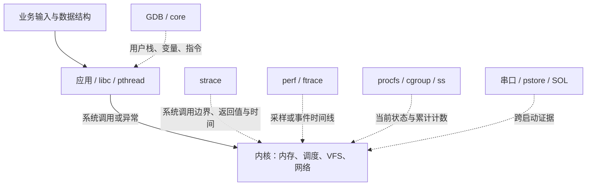

# SadBoard 嵌入式 Linux 故障定位与分析教材

本教材面向 AM6254 调试环境，按七个问题现场组织学习。每章集中讲解现象、先修概念、
根因假设、工具参数、逐步取证、内核源码、参考修复、实测数据及分级练习。
先提出判断并保存证据，再读参考分析；`verify` 验证镜像提供的参考版，不替代独立定位。

当前固件版本为 **v0.0.1**，不同内容以完整 SHA256 区分，日志通常显示前八位。
七个用例已在 AM625 完成实机验收，随机多故障与通用自动评分尚未实现。
完整固件 ID、阶段结果和附件位置集中记录在 [实机验收档案](am625-debug-validation.md)。
本文中的拓展命令没有被自动视为已执行，具体实测范围以该档案为准。

## 目录

- [实验准备与通用定位方法](#preparation)
- [第 1 章：缺失记录导致应用崩溃](#case-crash)
- [第 2 章：文件描述符泄漏与耗尽](#case-fd)
- [第 3 章：内存泄漏与 cgroup OOM](#case-oom)
- [第 4 章：CPU 热点、perf 与火焰图](#case-cpu)
- [第 5 章：持锁等待与线程调度](#case-lock)
- [第 6 章：网络延迟、丢包与吞吐](#case-network)
- [第 7 章：内核 panic、启动日志与恢复](#case-panic)
- [附录 A：实验报告模板](#report)
- [附录 B：构建扩展与官方实验迁移](#build-extensions)
- [附录 C：Bootlin 课程参考与署名](#bootlin)
- [附录 D：历史板级排错用例——i.MX6ULL SPI DMA](#legacy-spi-dma)

| 用例章节 | 练习任务 | 工具参数 | 源码精读 |
| --- | --- | --- | --- |
| [应用崩溃](#case-crash) | [分级练习](#case-crash-exercise) | [参数速查](#case-crash-tools) | [关键分支](#case-crash-kernel-reading) |
| [FD 耗尽](#case-fd) | [分级练习](#case-fd-exercise) | [参数速查](#case-fd-tools) | [关键分支](#case-fd-kernel-reading) |
| [内存与 OOM](#case-oom) | [分级练习](#case-oom-exercise) | [参数速查](#case-oom-tools) | [关键分支](#case-oom-kernel-reading) |
| [CPU 热点](#case-cpu) | [分级练习](#case-cpu-exercise) | [参数速查](#case-cpu-tools) | [关键分支](#case-cpu-kernel-reading) |
| [锁与调度](#case-lock) | [分级练习](#case-lock-exercise) | [参数速查](#case-lock-tools) | [关键分支](#case-lock-kernel-reading) |
| [网络延迟与丢包](#case-network) | [分级练习](#case-network-exercise) | [章内步骤](#case-network) | [关键分支](#case-network-kernel-reading) |
| [panic 与恢复](#case-panic) | [分级练习](#case-panic-exercise) | [章内步骤](#case-panic) | [关键分支](#case-panic-kernel-reading) |

<a id="preparation"></a>

## 实验准备与通用定位方法

基础要求：能读简单 C 指针、循环和函数，熟悉基本 shell 和进程概念。
首次学习建议依次完成崩溃、FD、OOM、CPU、锁、网络，最后在指定启动窗口完成 panic。
工具参数放在各用例中：GDB 在第 1 章、strace/ltrace 在第 2 章、Valgrind 在第 3 章、
perf 在第 4 章、ftrace/trace-cmd 在第 5 章，网络工具在第 6 章。

内核源码基于 `linux/linux-7.0` 的固定提交
`1c04c52c72b0e67ad4b5deca464ea70bc6ebb718`。源码箭头是省略包装和条件分支后的逻辑
路径，不冒充实机完整调用栈；实际地址、源行应使用对应固件的 `images/debug/` 解释。
实验源码位于 `sadboard-external/package/sadboard-labs/src/`，板端副本为
`/usr/src/sadboard/src/`。GDB 用户栈不会自动包含内核栈。

记录时标清“源码推导”“实机栈”“实机采样”或“示意输出”。每次都保留环境、输入、
完整身份、原始证据、可被推翻的假设、同输入修复对照与清理结果。

<a id="build"></a>

### 0.1 构建与产物

新克隆工作区：

```sh
git submodule update --init --recursive
cd buildroot
BR2_EXTERNAL="../bsp-base-external ../sadboard-external" \
  make sadboard_am625_debug_defconfig && make all
```

默认产物在 `buildroot/output/images/`。本机用共享 SDK 加速，采用独立目录：

```sh
python3 sadboard-external/scripts/configure-am625.py \
  --output output/am625-debug-systemd \
  --toolchain ../toolchain/aarch64-buildroot-linux-gnu_sdk-buildroot \
  --dl-dir ../dl
make -C output/am625-debug-systemd all
```

输出已有配置时继续执行 `make all`。修改实验包源码后，需要显式重建本地包：

```sh
make -C output/am625-debug-systemd sadboard-labs-dirclean
make -C output/am625-debug-systemd all
```

不能把内部/外部工具链混入同一个输出目录。

| 产物 | 用途 |
| --- | --- |
| `images/release/{release,kernel,rootfs}.itb` | OTA 升级包，只更新 kernel/rootfs |
| `images/debug/vmlinux`、`System.map`、`kernel.config` | 与设备内核匹配的分析资料 |
| `images/debug/labs/`、`images/debug/source/` | 实验程序及源码 |
| `images/debug/build-info.json` | 固件 ID 与调试资料 SHA256 |
| `staging/` | 远程 GDB 的匹配 sysroot |
| `images/rootfs.tar` | rootfs 归档，供单独的 NFS 实验使用 |

保留现有分区和板上启动链。通过 Device Manager 上传并发布三个 ITB 的 tar.gz，
待设备上报 success 后再触发实验。`sdcard.img` 是工厂镜像，不用于覆盖当前实验板。

构建后先核对符号归属、SHA256、ELF 调试段和关键内核能力：

```sh
python3 sadboard-external/scripts/verify-debug.py output/am625-debug-systemd/images
```

<a id="environment"></a>

### 0.2 检查环境

通过串口或 SOL 在板端执行：

```sh
fwctl version
systemctl --failed --no-pager
sadboard-debug-check
sadboard list
perf stat -e task-clock -- sleep 1
cat /sys/kernel/tracing/available_tracers
```

检查脚本只检查能力；`perf stat` 进一步检验事件实际可用性。基本服务和 OTA 健康
确认完成后，再启动故障案例。内存、perf 与 trace 数据写 `/data/sadboard/`。

<a id="ssh"></a>

### 0.3 SSH 登录

当前调试配置允许 root 空密码登录，端口为 22：

```sh
ssh root@192.168.10.211
```

SadBoard 从 `/data/ssh/host/` 恢复主机密钥；私钥只在设备生成和保存，不进入 Git 或固件包。
需要 scp 传文件时使用 `scp -O`，本镜像没有配置 SFTP 服务。串口/SOL 入口仍保留。

<a id="symbols"></a>

### 0.4 构建、符号和证据准备

在主机运行 `python3 sadboard-external/scripts/verify-debug.py output/am625-debug-systemd/images`，
确认配套文件 SHA256、固件 ID 和 DWARF。实验前在设备记录：

```sh
fwctl version
fwctl ota-status
uname -a
cat /proc/sys/kernel/random/boot_id
date '+%Y-%m-%dT%H:%M:%S%z'
df -k /data
sadboard-debug-check
```

`fwctl version` 的日志使用短 ID；公共机器接口 `ota-status` 的 FWOTA2 记录含完整 ID，
适合保留到原始证据，不能从短 ID 反推全值。保存精确命令、输入、stdout/stderr、
退出码，性能原始文件和对应 ELF。目标时区为 UTC+8；时间未同步时另记 boot ID 和 uptime。
`images/debug/build-info.json` 将源码、ELF、内核和 BusyBox 配置与固件关联起来。
嵌入式命令的选项常被裁剪；必要时查导出的配置及工具源码，不能只凭同名命令存在
就套用主机用法。例如小数秒 sleep/ping 还依赖 BusyBox 的 FLOAT_DURATION。

不要把 `vmlinux`、压缩 Image.gz、kernel.itb 混为同一用途：vmlinux 是带符号的 ELF，
Image.gz 是启动内核载荷，ITB 是包含内核、initramfs、DTB 等的 FIT 容器。

<a id="hypotheses"></a>

### 0.5 把“系统有问题”转换成可验证的问题

<a id="hypotheses-11-现象直接原因和根因"></a>

#### 0.5.1 现象、直接原因和根因

假设设备上一个服务消失了。此时“程序崩溃”仍然是假设，不是事实。它可能主动退出，
被管理员停止，被 systemd 超时结束，被 OOM 杀死，或者访问非法地址后被信号终止。
第一步要记录服务名、PID、出现时间、输入和退出结果，再选择深入的方向。

把结论拆成三层：

| 层次 | 崩溃例子 | OOM 例子 |
| --- | --- | --- |
| 现象 | 请求编号 42 后进程消失 | 处理若干数据块后进程消失 |
| 直接原因 | 指令访问无效地址，引发 SIGSEGV | memcg OOM 处置向进程发 SIGKILL |
| 根因 | 查询失败返回 NULL，调用者未检查 | 循环丢失分配地址，没有释放所有权 |

只定位到信号不足以修复业务；只看到 malloc 也不足以证明这一次退出由 OOM 导致。
完整解释需要把输入、错误状态、内核处置和可见结果串起来。

<a id="hypotheses-12-让每条命令对应一个假设"></a>

#### 0.5.2 让每条命令对应一个假设

排查前写出两个候选原因及它们的不同预测。例如慢请求可能由计算多，也可能由等待多：
前者预计 task-clock 接近墙钟，后者预计墙钟明显大于 CPU 时间。先比较这两类时间，
再决定使用 CPU 采样还是调度/锁分析，避免在等待程序上盲目生成 CPU 火焰图。

不要把“没有看到”直接写成“不存在”。没抓到系统调用可能是开始太晚，没看到函数名
可能是符号不匹配，没出现 OOM 可能是杀进程的日志已被覆盖。记录观测窗口与采集限制，
必要时使用能够推翻假设的对照实验。

<a id="layers"></a>

### 0.6 先理解用户态、内核态和工具的位置

应用执行普通加法、查表时通常停留在用户态；open、读写、等待、映射等操作通过系统
调用进入内核。用户态访存还可能因缺页异常进入内核，这不要求源代码显式调用某个函数。
中断和调度也能打断用户程序，因此“源代码没有调用内核”不等于运行没有内核参与。



工具观察的是不同切面。GDB 用户栈不能自动提供内核栈；strace 看不到普通用户态循环
里的每一次查表；perf 的 CPU 采样不能完整记录线程睡眠期间的时间；日志可能记录错误
处置，却没有记录更早的业务状态。组合工具的目的，是用相互独立的观测补足因果链。

<a id="triage"></a>

### 0.7 第一层分类：退出、忙、等、断、重启

<a id="triage-31-退出状态不是故障类别"></a>

#### 0.7.1 退出状态不是故障类别

交互式 shell 的 `$?` 只保存上一条命令的状态，必须紧接实验读取。通常 shell 用
128 加信号编号表示信号退出，因此本环境 139 常对应 SIGSEGV，137 常对应 SIGKILL。
但程序也可以主动 `return 137`，外层 timeout/systemd 还可能转换结果，所以还要读
监督记录、信号、core 或 OOM 计数，不能只凭一个数字归类。

```sh
sadboard run crash
rc=$?
printf 'exit=%s\n' "$rc"
```

上面故意不启用 `set -e`，否则非零退出可能在保存 rc 前让脚本结束。管道中的 `$?`
通常是最后一个命令的状态；把实验接到 tee 后，需要明确 shell 的管道状态规则。
统一入口把结果写入 `result`，其中场景码、监督器原始码和取消标志分别保存。

<a id="triage-32-用资源方向选择工具"></a>

#### 0.7.2 用资源方向选择工具

| 观测 | 优先提出的问题 | 后续证据 |
| --- | --- | --- |
| CPU 接近一核满载 | 算法、忙轮询、重复工作在哪里？ | perf stat/record、业务工作量 |
| 墙钟长、CPU 少 | 在睡眠、锁、I/O 还是等待 CPU？ | 全线程栈、strace、sched trace |
| 内存增长后进程消失 | 谁在计费，是否触及该组上限？ | limits/events、分配栈、内核日志 |
| ping 正常、TCP 慢 | 小包连通和业务吞吐为何不同？ | iperf 字节、RTT、ss、抓包、队列 |
| 设备重启 | 谁决定重启，哪次启动没有完成？ | 意图、复位原因、panic/pstore、startup ID |

这些是选择方向的线索，不是判定表。一个程序可同时 CPU 高且锁竞争严重；一次网络
超时也可能由进程调度或对端应用阻塞造成。用证据逐步细分，而不是给现象贴标签后停止。

<a id="lifecycle-usage"></a>

### 0.8 使用方法

```sh
sadboard list
sadboard run crash
sadboard run cpu 4096 500000 42
sadboard run lock 20 50000
sadboard run oom
sadboard run fd
sadboard verify crash
sadboard verify oom
sadboard verify fd 128 20
sadboard verify cpu 4096 500000 42
sadboard verify lock 20 50000
```

CPU 的三个参数为记录数、查询数、种子；锁案例两个参数为每线程迭代数、每次等待微秒。
crash 可选非负记录编号，默认 42；OOM 使用固定预算，不接受扩大内存限制的参数。
未填写参数时使用文档默认值，记录中保存实际使用值。程序对工作量和数值范围继续做
检查；传入非数字、缺参数等应返回 64，不能解释为成功触发故障。

| 案例 | 可选参数与上限 |
| --- | --- |
| crash | KEY 为 0..2147483647，1 是存在的记录，其他编号触发故障版缺失路径 |
| cpu | ITEMS=1..16384、QUERIES=1..2000000、SEED=0..4294967295，且 ITEMS×QUERIES≤4000000000 |
| lock | ITERATIONS=1..200、DELAY_US=1..100000，且两线程累计等待预算≤10000000 微秒 |
| fd | REQUESTS=1..4096、DELAY_MS=0..50，乘积≤10000 ms；进程 NOFILE 固定为 64 |
| oom | 统一入口固定 64 次、每次 1 MiB、间隔 50 ms，32 MiB 组限制 |

入口要求本次启动已通过健康确认、没有待启动固件、data 健康且至少有 64 MiB 可用空间。
这是为了保留 core/日志空间，而不是替用户删除旧现场。未满足前提返回 75，不触发案例。

唯一不同的是 [panic 启动恢复实验](#case-panic)：固件版本必须已在上一次启动
确认正常，再额外 reboot，利用本次尚未封存的采集窗口手动触发；并不允许在 OTA
试启动的新固件上跳过确认。它没有 verify 子命令，恢复后通过 check 取证。

<a id="lifecycle-records"></a>

### 0.9 现场格式

每次创建私有目录 `/data/sadboard/<案例>-<本地时间戳>-<随机后缀>/`，UTC+8 时间戳便于
查找，随机后缀避免同秒重复。实际开始时间附时区，boot ID 负责区分时钟回拨前后启动。

| 文件 | 作用 |
| --- | --- |
| run.info | SADBOARD1 键值格式：案例、操作、完整固件 ID、tag、boot ID、内核、命令、实际参数及独立 unit 名 |
| firmware-status.txt | 公共 `fwctl ota-status` 的原始 FWOTA2 记录，用于追溯固件与部署状态 |
| stdout.log / stderr.log | 案例标准输出与错误输出 |
| supervisor.log | systemd-run 启动及监督信息 |
| result | 原子写入场景退出码、监督器原始退出码、是否取消、完成时间；缺失表示没有完成记录 |
| core.* / memory-*.events / memory-*.limits 等 | 各案例特有证据；limits 从实际 cgroup 读回，详细解释见对应手册 |

键值记录只作为数据读取，不要用 `source run.info` 执行。短 ID 用于普通日志，完整 ID
用于证据匹配。必须保留镜像对应的 images/debug 才能分析具体源行。

<a id="lifecycle-check"></a>

### 0.10 status、check 与 reset

复制入口打印的实际目录替换下面的 RUN：

```sh
sadboard status /data/sadboard/RUN
sadboard check /data/sadboard/RUN
sadboard reset /data/sadboard/RUN
```

`status` 显示元数据与结束记录；缺结束记录明确显示 incomplete，不报告通过。
`check` 通过私有工具 `check-result` 核对实际输入与证据；不依赖 Python，也不执行记录中的代码。
数值 JSON 必须完整、字段唯一、类型及范围正确，拒绝空文件、重复字段和截断内容。

| 案例 | 具体检查 |
| --- | --- |
| crash | 缺失记录退出 139，core 是本架构 ELF64 ET_CORE，段边界完整且有 CORE/NT_PRSTATUS；正常输入及参考修复输出符合契约 |
| oom | 退出 137，实际限制为 32 MiB、禁用 swap、组终止，oom 和 oom_kill 均为正；参考版完成 64 次、checksum=532480、没有被 OOM 杀死 |
| fd | 实际限制、初始占用、请求/完成数、峰值/最终占用与退出相符；小输入仍检查泄漏，参考版回到初始占用 |
| cpu | 两版参数与记录一致，根据查询序列独立重算 checksum，检查非零墙钟时间 |
| lock | 每线程次数一致、完成总量为两倍次数，墙钟时间符合该版最低等待预算 |
| network | pcap 结构及实验端点的 ICMP/TCP，延迟与 qdisc 一致；verify 还核对基线、100% 丢包和恢复 |

core 检查只是结构与线程 note 的最低要求，具体崩溃信号、地址、线程栈仍需 GDB。
网络自动检查未完整解析 iperf 的嵌套 JSON，传输字节与错误字段须另行核对。
CPU/锁只打印单次时间比值并标记 `performance_verdict=manual`，不设置通用提升倍数。
历史现场应配合其固件的工具与文档读取；旧现场缺少新证据时不会被补成“通过”。
**故障复现检查通过与问题已修复是两个概念**，性能提升仍需读采样及同输入时序数据。

`reset` 只停止该目录所属、本次 boot 的实验 unit，并保留证据；不会重置系统服务、
清除其他日志或删除现场。其他目录、符号链接、伪造的 unit 名会被拒绝。跨启动的现场
可读、可分析，但不会使用旧记录去停止本次启动的进程。

<a id="lifecycle-boundaries"></a>

### 0.11 执行与异常边界

每次使用独立 transient service，30 秒运行上限、5 秒停止期限、16 个任务、128 MiB
监督组内存预算、32 MiB core 上限；结束后自动回收 unit。OOM 负载另受专用 32 MiB
叶子 cgroup 限制，其监督脚本保留在组外，退出时保存计数并清理。

停止请求有记录；Ctrl-C/TERM/HUP 会尝试停止本实验。控制端被强杀或设备重启时可能
没有 result，此时按不完整现场处理。systemd 的运行上限和程序本身有限工作预算仍然
生效，不能因控制端退出就把这次实验记为成功。

取消统一返回 130，同时保留 `supervisor_exit_code`。这是必要的区分：实测正常停止
unit 时 systemd-run 可以返回 0，但这并不代表业务完整执行；`cancelled=1` 的现场
始终无法通过 check。

这些边界只用于明确的手动教学负载，不改变 OTA、SOL 或 PDM 的生产服务策略；
随机组合及面向任意修复方案的自动评分仍未实现。

调试固件较大，当前 SadBoard OTA 缓存只保留一个已完成包。data 空间不足时先归档
自己的现场，不通过取消日志空间阈值、格式化或改变分区来继续实验。普通案例复位不需要
重启；完成取证后只删除自己创建的目录。

<a id="evidence"></a>

### 0.12 可复现证据的最小集合

每次保留完整固件 ID、源码/配置/ELF 清单、boot ID、时区、输入和原始附件。八位 ID
方便人读，完整 ID 才用于内容匹配。保留错误命令、丢样和失败结果，不能只留下漂亮截图。

| 证据 | 推荐保留方式 | 容易遗漏的条件 |
| --- | --- | --- |
| 用户崩溃 | core、ELF、匹配 rootfs/sysroot、GDB 输出 | PIE、动态库、core 上限及过滤策略 |
| CPU/等待 | 程序 JSON、perf.data、trace/strace、配置 | 同输入、采样时间窗、工具开销 |
| OOM | 实际 limits、events、peak、内核日志 | 组名、PID、层级、时间 |
| 网络 | namespace 配置、pcap、iperf JSON、qdisc、RTT | 方向、字节、管理网口未被修改 |
| 启动恢复 | 原始串口、pstore、失败/恢复阶段日志 | boot/startup ID、重启意图、上传确认 |

`check` 的作用是拒绝明显不完整或不符合案例契约的现场，不是证明任意程序完全正确，
也不防御操作者恶意伪造全部文件。最后用 [报告模板](#report) 写清楚：
哪条原始证据支持哪条结论，以及还不能解释什么。

<a id="tool-selection"></a>

### 0.13 工具选择与练习验收

| 问题 | 首选证据 | 深入工具 |
| --- | --- | --- |
| 程序崩溃 | 信号、core、配套 ELF | GDB 寄存器/调用链、反汇编、Valgrind |
| 无法再打开资源 | errno、/proc/PID/limits 和 fd | strace openat/close、资源所有权源码 |
| 进程被杀 | cgroup events、内核 OOM 记录、退出信号 | 内存趋势、Valgrind、分配源码 |
| CPU 忙 | 同输入 CPU/墙钟、perf stat | perf record/report、火焰图、算法分析 |
| CPU 闲却慢 | 线程状态、墙钟/CPU 比、strace | GDB 全线程栈、调度事件时间线 |

独立完成“现象 → 假设 → 证据 → 源码机制 → 修复 → 同输入验收”，并记录一个能推翻
原假设的结果。不要用没有错误日志、进程提前退出或某个单独命令返回 0 代替完整验收。

<a id="levels"></a>

### 0.14 三个学习层次

| 层次 | 给你的信息 | 完成标准 |
| --- | --- | --- |
| L1 复现与取证 | 案例类型、输入、工具入口 | 保存完整现场，正确解释退出状态和关键指标 |
| L2 独立定位 | 现象与业务契约 | 自选工具，提出至少两个假设，用证据排除其中一个 |
| L3 机制与迁移 | 改变输入或加入容易混淆的对照 | 解释内核条件分支，识别证据不充分的情形，给出同输入修复验证 |

普通案例先等本次健康确认，确认 data 可用；panic 按自己的启动窗口流程执行。
`check` 通过表示保存的证据符合本案例契约；`verify` 对照的是随镜像提供的参考修复。
一次计时和一个校验和不能证明任意业务代码完全正确，性能结论还要做重复测量。

<a id="case-crash"></a>

## 第 1 章：缺失记录导致应用崩溃

对应命令：`sadboard run crash`。先完成环境与健康确认，再手动复现。

<a id="case-crash-symptoms"></a>

### 1.1 问题现场与目标

难度：入门到进阶。程序按编号查询记录，正常编号输出结果；某些输入直接退出。
任务是从退出信号找到出错指令，恢复调用者与输入，并验证错误处理没有破坏正常路径。
入口 `sadboard run crash` 固定输入 42，故障函数为 `process_request()`。
源码：[crash.c](../sadboard-external/package/sadboard-labs/src/crash.c)。

```sh
fwctl version
cat /proc/sys/kernel/random/boot_id
sadboard run crash
echo "$?"
```

启动器打印现场目录。预期 shell 返回 139，即常见 shell 表示的 `128 + SIGSEGV(11)`。
这提示可能是信号终止，还需信号/core 证据，也不能直接证明是空指针。退出码 137 是 SIGKILL 的常见表示，
不能混为本案例；没有 core 也不能据此判定没有崩溃。

<a id="case-crash-exercise"></a>

### 1.2 独立练习任务与分级提示

**现场入口**：`sadboard run crash 42`；对照 `sadboard run crash 1`。

**任务**：不用改代码，说明退出是程序主动返回还是信号终止；找到出错指令的访存地址、
调用者与原始输入。保存在线栈和离线 core 各一份，并说明它们为何能解释同一类故障。

**必须提交**：完整固件 ID、退出码、core 结构检查、匹配 ELF/sysroot、`bt full`、
出错指令及有关寄存器；最后给出缺失记录与正常记录的修复对照。

<details><summary>L1 提示：先区分退出结果</summary>

用 `echo $?` 保存上一条命令结果，再读现场 result；不要运行其他命令后才取退出码。
139 是此 shell 对 SIGSEGV 的常见表示，仍需要 GDB 中的信号与指令证据。
`sadboard check RUN` 检查 ELF core 及线程状态 note，而不是只检查文件名存在。

</details>
<details><summary>L2 提示：从现场值往上游追</summary>

先看 `frame 0 / info locals / x/i $pc`，再沿调用者追查询失败如何被处理。
`si_addr=0x4` 并不排除 NULL 基址，它可能是读取结构体字段产生的偏移。

</details>

**L3 对照**：传入字符串、负数和未知编号，区分参数拒绝与业务故障；用错误固件的
符号尝试解释旧 core 时，应如何识别不可信结论？不要为“看起来有函数名”就接受它。
参考：[应用崩溃](#case-crash)、[内核阅读笔记](#case-crash-kernel-reading)。

<a id="case-crash-section-1"></a>

### 1.3 先修概念：指针值、对象与字段地址

`struct record` 有 key 和 value 两个 int。查询得到的是对象地址，读取 `record->value`
需要以该地址为基址，再加上 value 的成员偏移。有效指针不是“任何非零整数”，它还要
指向生存期内、允许访问的对象；非 NULL 的悬空指针同样会错。

本构建中可以在 GDB 用 `ptype struct record`、`print sizeof(struct record)` 和
`print &((struct record *)0)->value` 理解布局；最后一条仅用于调试器求成员偏移的观察，
不要把 NULL 成员访问写进业务代码当成可移植 C 技巧。也可用标准 `offsetof` 在源码中
计算成员偏移。实际大小与对齐要以目标 ABI 为准，不能把主机布局无条件用于板端。

当查询 42 返回 0 时，读取 value 的有效地址可表现为 0x4。故障发生时 PC 是**执行
访存指令的位置**，si_addr 是**访问失败的地址**，两者概念不同。一个是代码地址，一个
是数据地址；不能用 si_addr 作为崩溃函数地址去符号化。

<a id="case-crash-section-2"></a>

### 1.4 把定位过程拆成四个问题

| 要回答的问题 | GDB 观测 | 仍需继续追什么 |
| --- | --- | --- |
| 怎样终止？ | 停止信号、`$_siginfo` | 不能只看 shell 139 |
| 哪条指令出错？ | PC、`x/i $pc`、寄存器 | 指令的基址与偏移 |
| 哪个业务状态错误？ | frame 0 的 record、调用者 key | record 为何没有对象 |
| 谁应该处理错误？ | 查找返回值与调用者分支 | 缺失是否正常业务输入 |

单步时 `next` 通常越过函数调用，`step` 尝试进入；`continue` 让程序继续直到断点或信号。
`frame N` 只切换查看的栈帧，不倒放程序。`bt full` 提供各帧已能恢复的参数/局部量，
但优化可能使值显示 optimized out，内存破坏也可能让栈展开不完整；这些情况应保留原始
指令和寄存器，不能凭空补出变量值。

<a id="case-crash-section-3"></a>

### 1.5 从 C 指针到 ARM64 异常

查找函数对不存在的编号返回 NULL，调用者没有检查，就读取记录字段。这是 C 的未定义
行为；本镜像使用保留调试信息的特定构建，在实机上表现为 SIGSEGV。访问字段的有效地址
可能是 `NULL + 字段偏移`，因此 `si_addr` 不一定恰好为零。

CPU 在 EL0 执行载入指令，MMU 发现该虚拟地址没有合法映射，进入同步 Data Abort。
这与正常按需分配缺页的入口相同，但内核找不到可接受的 VMA，不能建立映射，最终产生
SIGSEGV；它不是“用户程序把内核打崩”。进程尚有有效的内核栈，内核能够正常处置信号。

以下是**源码整理路径**，分两段理解，不是一个连续现场栈：

```text
EL0 访存异常
  el0t_64_sync_handler → el0_da → do_mem_abort → do_page_fault
  地址无有效 VMA / 权限不符 → arm64_force_sig_fault(SIGSEGV, ...)

返回用户态前的信号处理
  get_signal → 默认致命信号处理 → vfs_coredump
  do_coredump → coredump_write → ELF 的 elf_core_dump → 退出线程组
```

阅读入口：[entry-common.c](../linux/linux-7.0/arch/arm64/kernel/entry-common.c)、
[fault.c](../linux/linux-7.0/arch/arm64/mm/fault.c) 的 `do_page_fault/bad_area`、
[signal.c](../linux/linux-7.0/kernel/signal.c) 的 `get_signal`、
[coredump.c](../linux/linux-7.0/fs/coredump.c) 及
[binfmt_elf.c](../linux/linux-7.0/fs/binfmt_elf.c) 的 `elf_core_dump`。
检查 `SEGV_MAPERR` 与 `SEGV_ACCERR` 两个分支，理解“无映射”和“权限错误”的差异。

<a id="case-crash-section-4"></a>

### 1.6 定位流程一：在线 GDB

设备终端先运行：

```sh
gdbserver --once :22345 /usr/libexec/sadboard/crash-bug 42
```

服务器另一个终端，从 SadBoard 根目录运行：

```sh
output/am625-debug-systemd/host/bin/aarch64-buildroot-linux-gnu-gdb \
  output/am625-debug-systemd/images/debug/labs/crash-bug
```

GDB 中按当前机器的绝对路径替换 `/path/to/SadBoard`：

```gdb
set pagination off
set sysroot /path/to/SadBoard/output/am625-debug-systemd/staging
set substitute-path /usr/src/sadboard /path/to/SadBoard/output/am625-debug-systemd/images/debug/source
target remote 192.168.10.211:22345
continue
bt full
frame 0
info args
info locals
print record
print $_siginfo
list
info registers pc sp x0 x1
disassemble /s process_request
x/i $pc
```

先看信号与 PC，再看 frame 0 中的 `record`，然后向上追溯参数 42 的来源。把反汇编
中的访存基址、偏移与 C 字段对应起来；优化后寄存器含义应按指令判断，不能一律把 x0
当成当前函数参数。`record == 0x0`、具体访存指令及缺失记录的控制流共同构成根因证据。
GDB 参数含义见 [工具手册](#case-crash-tools)。

扩展练习：在 `process_request` 设置断点，用 `next` 越过查找，再检查返回值；用
`step` 进入查找函数。不要只在崩溃行反复设置断点而忽略上游失败原因。

<a id="case-crash-section-5"></a>

### 1.7 定位流程二：离线 core

`sadboard run crash` 在私有现场目录生成 `core.crash-bug.<PID>`。记录文件 SHA256，
复制到主机；本设备没有 SFTP 服务，使用 SCP 的传统协议：

```sh
scp -O root@192.168.10.211:/data/sadboard/crash-XXXXXXXX/core.crash-bug.PID ./core
```

加载匹配程序，设置完整 sysroot 后执行 `core-file /absolute/path/core`，再执行上述
`bt full / info locals / disassemble`。当前构建树可用 `output/am625-debug-systemd/target`
作为完整 sysroot；分析历史版本，应从当时保留的 `rootfs.squashfs` 提取副本。
需要目标程序在 sysroot 中保持原来的 `/usr/libexec/sadboard/crash-bug` 路径。
[GDB 文件规则](https://sourceware.org/gdb/current/onlinedocs/gdb.html/Files.html) 说明
sysroot 的目录结构应对应目标文件系统。

core 是部分地址空间和寄存器的快照，不是整个 Linux 内存。ELF notes 描述线程寄存器、
信号和文件映射，PT_LOAD 保存选定内存。ASLR/PIE 使运行地址与 ELF 链接地址不同，
不能直接把运行 PC 交给普通 addr2line 而忽略装载偏移。

<a id="case-crash-section-6"></a>

### 1.8 core 缺失或 GDB 出现问号时

按顺序检查：`ulimit -c`、`kernel.core_pattern`、目录可写性、可用空间、
`/proc/self/coredump_filter`、ELF 是否 strip、程序与库是否匹配。SadBoard 把 pattern
设置为 `core.%e.%p`，仅在实验子进程设置 32 MiB core 上限；BusyBox ash 的此项单位为
512 字节，所用值为 65536。当前 ELF headers 配置对应新进程 filter 为 `0x33`。
实机曾因 PIE core 缺 ELF header 且 sysroot 不完整出现 `??`，修复过程见
[PIE core 取证](#case-crash-pie)，不要将这类符号问题误报为栈损坏。

<a id="case-crash-section-7"></a>

### 1.9 修复、验收与迁移练习

参考修复在解引用前检查 NULL，缺失记录返回 2；正常编号 1 仍输出 `value=64`。
`sadboard verify crash` 检查这两个契约。真实修复还应明确错误向上传递、日志和调用者
的重试行为，而不是把 NULL 随意改成某个地址。

练习：分别比较越界、释放后使用、栈溢出与本案例会产生哪些不同证据；说明为什么
某些越界不立即触发缺页异常。清理时先结束自己启动的 gdbserver，确认进程退出，
保留必要 core 后只删除对应现场目录。

<a id="case-crash-section-8"></a>

### 1.10 证据验收与分级练习

`check` 要求 core 为本架构 ELF64 ET_CORE，段数据未截断，并包含线程状态 note；空文件
或改名的普通可执行文件不能通过。此检查不替代 GDB：仍应确认信号、访存地址和变量。
参考修复另外保存有效输入输出、缺失输入 stderr 与退出码 2。
按 [练习册](#case-crash-exercise) 完成 L1～L3，使用
[报告模板](#report) 记录错误符号、缺失 core 等反例。

<a id="case-crash-section-9"></a>

### 1.11 反例与进一步推理

为什么有的越界没有立刻崩溃？MMU 以页及权限检查映射，不知道 C 数组边界；越界地址
若仍落在允许访问的页，指令可能继续执行并破坏其他对象。因而“没有 SIGSEGV”不能证明
内存安全；检测这类问题可能需要编译插桩、分配器检查或 Valgrind，而不是只等 core。
这些是扩展机制，当前例子没有因此自动获得 KASAN/ASan 覆盖。

为什么改为 `if (!record) return 0` 不够？它掩盖了缺失请求，调用者可能把没有处理完成
当成成功。参考版返回 2，是为了明确区分存在、缺失和参数错误；真实接口还应设计稳定
的业务错误码并向上层传播。修复验收同时跑输入 1 与 42，保证正常能力和错误契约。

为什么 core 能离线看栈，却不能执行 `next`？它是某个时刻保存的数据，不是运行进程。
GDB 可借寄存器、内存段、映射与匹配 ELF 解释状态，但不能从静态快照继续产生真实业务
执行。在线调试可继续，代价是暂停会改变线程与外部设备的时序。

<a id="case-crash-section-10"></a>

### 1.12 本轮实机 core 的逐项解读

2026-11-09，`v0.0.1 / 668ad82f`，用本固件配套 ELF 和完整 sysroot 分析新 core，
摘取以下真实输出，省略无关行：

```text
Program terminated with signal SIGSEGV, Segmentation fault.
#0  0x0000aaaaaaf89a34 in process_request (key=42) at src/crash.c:27
        record = 0x0
#1  0x0000aaaaaaf89b68 in main (...) at src/crash.c:44
=> 0xaaaaaaf89a34 <process_request+28>: ldr w0, [x0, #4]
x0  0x0
```

相同现场的 siginfo 为 si_signo=11、si_code=1、`_sigfault.si_addr=0x4`。
解读顺序如下：

1. SIGSEGV 证明实际信号，排除只依赖 shell 返回码的歧义。
2. 当前函数收到 key=42，查询得到的 record 为 NULL。
3. `ldr w0, [x0,#4]` 从 x0+4 取 32 位值；x0 为 0，有效地址因此为 0x4。
4. si_addr 与计算一致，si_code 对应本平台的映射错误；结合源码可定位到 value 字段。
5. 向上追 main 的输入和 lookup 的缺失分支，明确应在解引用前处理查找失败。

siginfo 是包含联合体的结构；GDB 一次打印可能把同一批字节解释成 `_kill`、`_timer`
等多个视图。分析本次内存异常应选择 `_sigfault`，不能把重叠显示的 `_kill.si_pid=4`
误读为“PID 4 发来了信号”。PC、栈地址受 ASLR 影响，不要求下一次数值完全相同；
稳定的是输入、错误状态、指令语义与故障地址之间的关系。

<a id="case-crash-tools"></a>

### 1.13 工具参数与使用边界

设备用 `gdbserver --once :22345 PROGRAM ARGS` 启动待调程序；主机使用本构建的
`host/bin/aarch64-buildroot-linux-gnu-gdb ELF`。`--once` 在连接结束后退出，
`:22345` 是调试监听端口；它不同于 SSH，运行期间不要让其他客户端抢占连接。

| 命令/参数 | 用途与使用时机 |
| --- | --- |
| `set sysroot ROOT` | 在 ROOT 下按目标的绝对路径查找库/程序；在线可用 staging，离线 PIE 分析优先使用完整目标根目录 |
| `set substitute-path OLD NEW` | 将 DWARF 中的编译源码前缀映射到本机源码副本，不替代 sysroot |
| `target remote IP:PORT` | 连接 gdbserver；已启动程序用 continue，而非另起 run |
| `break FUNC` / `break FILE:LINE` | 在函数或具体源行停住，缩小故障时间窗 |
| `ignore N COUNT` | 忽略编号 N 的断点前 COUNT 次命中 |
| `continue` / `next` / `step` | 继续执行、源码层越过函数、源码层进入函数 |
| `finish` / `return` | 前者执行到当前函数返回；后者强行返回，会修改行为，取证时慎用 |
| `bt full` / `frame N` | 看调用链及局部变量，再选择具体帧 |
| `info args` / `info locals` | 检查输入与当前帧的局部状态 |
| `print EXPR` / `print /x EXPR` | 按类型或十六进制读变量；不要随意解引用可疑指针 |
| `info registers` / `x/i $pc` | 将现场寄存器与出错机器指令对应 |
| `disassemble /s FUNC` | 混合源行与反汇编；优化构建可能不能逐行对应 |
| `info threads` / `thread N` | 选择线程；GDB 线程编号不同于 Linux TID |
| `thread apply all bt` | 同时查看线程的等待关系 |
| `core-file PATH` | 载入离线 core；不能在 core 上 continue |
| `set pagination off` / `--batch -ex CMD` | 关闭分页、自动化取证并保存输出 |

先看 frame 0，再看调用者如何产生错误状态。`<optimized out>` 可能来自编译优化；
`??` 可能来自缺符号或地址重定位失败；两者都不直接说明栈损坏。
GDB 的帧含义与回溯选项参见 [官方回溯说明](https://sourceware.org/gdb/current/onlinedocs/gdb.html/Backtrace.html)。

<a id="case-crash-kernel-reading"></a>

### 1.14 内核源码精读与关键分支

读 [fault.c](../linux/linux-7.0/arch/arm64/mm/fault.c) 的 `do_page_fault`：

1. 识别 EL0/EL1、读/写/取指，决定需要什么 VMA 权限。
2. 根据地址查找有效 VMA；没有 VMA 与权限不符是不同的错误分支。
3. 合法 VMA 进入 `handle_mm_fault`，可能建立页表或处理写时复制，恢复后重试原指令。
4. 无法合法恢复才转入信号或内核异常处置；`VM_FAULT_OOM` 还有自己的处理分支。

再读 [memory.c](../linux/linux-7.0/mm/memory.c) 的 `handle_mm_fault`、
`do_anonymous_page`：合法首次写触可以分配匿名 folio、做 memcg 计费、建立 PTE。
因此“缺页数增加”“malloc 返回地址”“RSS 增加”是不同事件，不能混用。

对照实验：正常内存程序大量写触也会发生缺页，但应继续运行；crash 案例访问无效
记录，内核无法为它建立合法 VMA。用 GDB 的地址、指令和变量证明是哪一类。
SIGSEGV 还需区分 MAPERR/ACCERR，不能把所有访存异常都归为 NULL。

<a id="case-crash-pie"></a>

### 1.15 实战补充：在线正常、离线 core 却没有符号

<a id="case-crash-pie-现象"></a>

#### 1.15.1 现象

AM625 的 `crash-bug 42` 在 gdbserver 下能显示 `process_request`、源码行号和
`record = 0x0`。对同次构建的程序加载 core 时，却出现：

```text
Can't open file /usr/libexec/sadboard/crash-bug during file-backed mapping note processing
#0  0x0000aaaadd829a34 in ?? ()
Backtrace stopped: previous frame identical to this frame (corrupt stack?)
```

程序确实有空指针缺陷，但这段离线输出不能作为“栈被覆盖”的证据。

<a id="case-crash-pie-定位过程"></a>

#### 1.15.2 定位过程

1. 核对设备程序、主机符号、core 文件 SHA256，排除传输损坏和符号混用。
2. 检查 `readelf -h`，确认程序为 PIE；检查 `.debug_info`，确认符号未剥离。
3. 设备 `/proc/self/coredump_filter` 为 `00000023`，ELF 头部对应的 bit 4 未启用。
4. 原 BSP 关闭 `CONFIG_CORE_DUMP_DEFAULT_ELF_HEADERS`。core 没有保存映射的 ELF
   头部，而 staging sysroot 只有开发库，没有目标路径下的实验程序，GDB 未能自动
   恢复 PIE 加载基址。
5. 使用匹配的完整 rootfs 作为 sysroot，原 core 能正确回溯；在子进程中将过滤器
   设为 `0x33` 后生成的新 core，使用 staging sysroot 也能正确回溯。

这两个对照证明问题在离线分析所需的映射资料，不需要据此推断真实栈损坏。

<a id="case-crash-pie-处理方式"></a>

#### 1.15.3 处理方式

SadBoard 调试内核启用：

```text
CONFIG_COREDUMP=y
CONFIG_CORE_DUMP_DEFAULT_ELF_HEADERS=y
```

对于已启用 core 文件保存的系统，也可在实验子进程中临时设置：

```sh
cd /data/sadboard/自己的现场目录
sh -c 'echo 0x33 > /proc/self/coredump_filter; ulimit -c 65536; exec /usr/libexec/sadboard/crash-bug 42'
```

BusyBox ash 的 core 上限单位为 512 字节，上述上限为 32 MiB。该命令会触发教学
程序的 SIGSEGV，需要在完成启动健康确认后手动执行。旧 core 可以配合对应固件的
完整 rootfs 分析，重新编译内核不会补回旧 core 缺少的字节。

主机仍须使用匹配的可执行文件、sysroot 和源码映射。`verify-debug.py` 同时检查
符号 SHA256 与关键内核配置；符号文件存在不代表 GDB 已正确恢复加载地址。

过滤器定义见内核源码的
[proc 文档](../linux/linux-7.0/Documentation/filesystems/proc.rst)，
实际初版现场和对照输出保存在 `output/validation/stage1-debug/`。

<a id="case-fd"></a>

## 第 2 章：文件描述符泄漏与耗尽

对应命令：`sadboard run fd`。先完成环境与健康确认，再手动复现。

<a id="case-fd-symptoms"></a>

### 2.1 先观察现象，不急着增加限制

难度：入门到进阶。服务按请求打开一个资源，开始正常，处理一段时间后报告
`Too many open files`。内存没有明显耗尽，系统没有重启，其他服务仍能运行。
你的任务是解释：哪一种资源耗尽了、限制作用于谁、为什么请求数越多越容易失败，
以及为什么增加上限只能推迟本案例的问题。

源码是 [fd.c](../sadboard-external/package/sadboard-labs/src/fd.c)。程序用 `/dev/null`
代表每次请求需要打开的资源；故障版漏掉 close，参考版每次处理后关闭。它不是模拟
磁盘装不下，也不向管理网口注入故障。实验进程自己将 NOFILE 软硬限制降至 64，
不改全局 file-max、不改 SSH 或其他服务的限制；延迟总预算不超过十秒。

<a id="case-fd-symptoms-11-复现前提与命令"></a>

#### 2.1.1 复现前提与命令

先等固件健康确认，确认 `/data` 持久化且至少有 64 MiB 空间。板端执行：

```sh
sadboard list
sadboard run fd
rc=$?
printf 'exit=%s\n' "$rc"
```

默认 128 次请求、每次等待 20 ms，预期退出 24，表示**本程序主动把 EMFILE 错误值
作为返回码**；它不是 `128 + 信号`。复制输出中的实际现场目录，检查：

```sh
sadboard status /data/sadboard/实际现场目录
sadboard check /data/sadboard/实际现场目录
cat /data/sadboard/实际现场目录/fd-bug.out
cat /data/sadboard/实际现场目录/stderr.log
```

不要把其他 shell 中相同的退出数字自动解释为 EMFILE；系统调用返回值和程序逻辑
才是本例的依据。没有 SIGKILL、没有组 OOM 计数，是区分 OOM 的线索，仍应保留证据。

<a id="case-fd-exercise"></a>

### 2.2 独立练习任务与分级提示

**入口**：`sadboard run fd`，对照 `sadboard run fd 4 0`，再运行 `sadboard verify fd`。

**任务**：区分 FD 耗尽、全局文件对象不足、内存不足和路径错误。解释为什么同一个
/dev/null 路径会占用多个槽，为什么小输入没有报错却仍存在泄漏。

**必须提交**：实际 NOFILE、baseline、完成/请求数、两次 FD 快照、openat/close
配对、EMFILE 返回和参考修复的完整 128 次处理。说明全局限制和其他服务未被更改。

<details><summary>L1 提示：先确认谁返回了错误</summary>

本例退出 24 是程序主动返回 EMFILE，不是信号。看 strace 的系统调用返回值；
limits 是该进程的约束，父 shell 的 ulimit 不会因子进程降限制而自动改变。

</details>
<details><summary>L2 提示：把对象生命期画出来</summary>

分别画局部整数 fd、fdtable 槽、struct file 和底层路径。C 变量被覆盖不等于内核
引用被关闭；CLOEXEC 也不等于请求结束自动 close。查错误和提前返回路径的所有权。

</details>

**L3 对照**：增加一个继承 FD，解释为什么不能把失败请求数写死为 61；解释 dup、
fork、exec 对引用的不同作用，以及 TIME_WAIT 为什么不等于进程仍持有 socket FD。
参考：[描述符章节](#case-fd)。

<a id="case-fd-section-1"></a>

### 2.3 FD 到底是什么

<a id="case-fd-section-1-21-三层对象不能混为一个文件"></a>

#### 2.3.1 三层对象，不能混为一个“文件”

FD 是进程描述符表中的非负整数索引。打开普通文件、socket、管道、eventfd 等，
都可能消耗 FD；因此“我没有打开很多磁盘文件”不能排除描述符泄漏。

```text
进程 files_struct / fdtable
  fd 0 ──> 标准输入的 struct file
  fd 1 ──> 标准输出的 struct file
  fd 2 ──> 标准错误的 struct file
  fd 3 ──> 一次 open 的 struct file ──> 路径 / inode / 设备操作
  fd 4 ──> 另一次 open 的 struct file ──> 可以仍然是同一个 /dev/null
```

FD 表项、打开文件描述对象和文件系统 inode 是三个层次。重复 open 同一路径通常创建
不同打开对象；dup 则可用另一个 FD 引用同一打开对象，共享相应偏移等状态。关闭一个
FD 不表示所有引用都消失，unlink 路径也不等于关闭已打开的引用。
接口定义见 [open(2)](https://man7.org/linux/man-pages/man2/open.2.html)。

<a id="case-fd-section-1-22-为什么-devnull-也能耗尽资源"></a>

#### 2.3.2 为什么 `/dev/null` 也能耗尽资源

/dev/null 不需要保存业务数据，但每次成功 open 仍要占用当前描述符范围内的槽位。
本例不断覆盖局部变量 fd，旧的整数值被遗忘；内核不会因为 C 变量离开作用域就自动
调用 close。直到进程退出，内核才统一释放它还持有的描述符。

因此重启服务会短暂恢复，但不修复泄漏。设备持续运行的时间越长，请求越多，越可能
再次撞上限制；本案例把限制缩小，是为了在几秒内稳定复现这个关系。

<a id="case-fd-section-2"></a>

### 2.4 理解资源上限，再读错误信息

<a id="case-fd-section-2-31-softhard-与实际可分配范围"></a>

#### 2.4.1 soft、hard 与实际可分配范围

RLIMIT_NOFILE 的软限制控制本进程可分配的描述符编号范围，硬限制约束软限制可提升的
范围。此处限制为 64，新的 FD 应落在 0..63；已占用槽位会减少剩余容量。
一个通常有 0、1、2 三个描述符的进程，大致还能打开 61 个，但不能把这个数写死：
服务管理器、父进程继承或调试环境都可能使初始状态不同。
限制规则见 [getrlimit(2)](https://man7.org/linux/man-pages/man2/getrlimit.2.html)。

本程序记录实际 baseline，验收采用 `完成量 + baseline = 64`，而不是永远要求 61。
它不主动提高继承上限；若父环境给的软/硬限制不足 64，返回 75 表示前提不满足。
程序内部降限制只影响它自己，不会反向修改启动它的 shell。

<a id="case-fd-section-2-32-这些错误看起来相近但处置不同"></a>

#### 2.4.2 这些错误看起来相近，但处置不同

| 观测 | 主要含义 | 应补充的证据 |
| --- | --- | --- |
| open 返回 EMFILE | 本进程可分配 FD 范围耗尽 | 进程 limits、fd 表、open/close 配对 |
| open 返回 ENFILE | 系统打开文件对象资源限制相关失败 | file-nr/file-max、全局日志及权限条件 |
| open 返回 ENOENT | 路径或组件不存在 | 路径、挂载、namespace、名称 |
| open 返回 EACCES | 访问检查拒绝 | 权限、凭据、目录搜索权限等 |
| malloc 返回 NULL/ENOMEM | 某种内存或地址空间申请失败 | 分配上下文、限制、内存状态 |
| 进程被 SIGKILL | 终止方式，不能单独说明谁发送 | OOM、超时、管理员或监督器记录 |

错误名要从实际系统调用读出。不要为了验证 ENFILE 去降低整机 file-max 或耗尽全机
资源；本案例只用进程限制构造 EMFILE。内核全局打开对象限制对特权进程还有特例，
也不能简单认为 root 的每次失败都由同一限制引起。

<a id="case-fd-section-3"></a>

### 2.5 第一步取证：描述符是否持续增长

统一入口结束后目标进程已退出，`/proc/PID/fd` 不再存在；这时应读保存的 JSON 和
strace。为了观察增长，可以单独运行稍慢的同一负载。以下操作不会生成统一 run.info，
操作者应自行保存固件 ID、输入和结果；进程仍受内部 64 FD 与十秒预算约束。

```sh
mkdir -p /data/sadboard/manual-fd
/usr/libexec/sadboard/fd-bug 128 50 \
  > /data/sadboard/manual-fd/bug.json \
  2> /data/sadboard/manual-fd/bug.err &
pid=$!
cat /proc/$pid/limits
ls -l /proc/$pid/fd
sleep 1
ls -l /proc/$pid/fd
wait "$pid"
printf 'exit=%s\n' "$?"
```

`$!` 是后台负载 PID；`wait` 取得其退出结果。某次读取如果提示目录不存在，可能是
进程已结束，不能把空观测当作没有泄漏。刚启动时的第一次快照也可能早于 setrlimit，
应与 stderr 中的准备信息及后续快照核对。
`/proc/PID/fd` 的条目含义见 [proc_pid_fd(5)](https://man7.org/linux/man-pages/man5/proc_pid_fd.5.html)。

观察应集中于同一 PID、同一时间窗中 `/dev/null` 引用数量增长。不要只统计系统全部
进程 FD 的总和；那无法确定是谁泄漏。列目录的观察命令运行在另一个进程，不占用被
观察进程的 FD；而在目标内部调用 opendir 自查则需要额外槽位，耗尽后可能也失败。
程序为避免这个问题，用 fcntl(F_GETFD) 检查 0..63，不通过新开目录统计。

<a id="case-fd-section-4"></a>

### 2.6 第二步取证：用 strace 找到未配对的生命周期

```sh
strace -f -tt -T -e trace=openat,close,prlimit64 \
  -o /data/sadboard/manual-fd/bug.strace \
  /usr/libexec/sadboard/fd-bug 128 0 \
  > /data/sadboard/manual-fd/traced-bug.json
```

| 参数 | 作用 | 使用理由 |
| --- | --- | --- |
| -f | 跟踪后续子进程/线程 | 本例单进程；养成识别 PID 的习惯 |
| -tt | 显示细化的时刻 | 关联请求顺序；不是单调时钟的替代 |
| -T | 显示系统调用耗时 | 区分立即失败与长时间阻塞 |
| -e trace=... | 仅输出指定调用 | 排除动态加载及无关噪声，聚焦资源生命周期 |
| -o | 保存到文件 | 避免终端滚屏丢证据，保留原始顺序 |

注意 glibc 的 open 接口在本环境可通过 openat 系统调用实现。只过滤 open 可能漏掉
真正发生的调用。开头动态加载器会打开并关闭库文件，不要将它们与业务循环混为一谈。
关注 `/dev/null` 路径及其返回的 FD，然后寻找匹配的 close。

下面是**说明格式的示意，不是某次实机原文**：

```text
openat(AT_FDCWD, "/dev/null", O_RDONLY|O_CLOEXEC) = 3
openat(AT_FDCWD, "/dev/null", O_RDONLY|O_CLOEXEC) = 4
...
openat(AT_FDCWD, "/dev/null", O_RDONLY|O_CLOEXEC) = 63
openat(AT_FDCWD, "/dev/null", O_RDONLY|O_CLOEXEC) = -1 EMFILE (...)
```

这里没有相应 close，FD 编号持续占用，最后分配失败。`O_CLOEXEC` 只在成功 exec 时
关闭带标志的 FD；本业务循环没有 exec，所以它不能替代每次请求结束后的 close。
strace 会改变时序，故本步骤用于证明调用关系，不能用它的总耗时作为无干扰性能值。

<a id="case-fd-section-5"></a>

### 2.7 从系统调用读到内核源码

对应固定内核提交见 [案例索引](#preparation)。以下是**源码关键路径**，不是用户 GDB
能够直接打印的完整内核栈，也不是从其他旧内核照抄的函数列表：

```text
用户 open / libc 包装
  openat 系统调用
  fs/open.c: do_sys_open → do_sys_openat2
  build_open_flags 检查参数
  FD_ADD（include/linux/file.h 中的组合资源管理宏）
    get_unused_fd_flags → __get_unused_fd_flags → alloc_fd
      在 current->files 中寻找空槽
      若候选 fd >= RLIMIT_NOFILE，则返回 -EMFILE
    只有 FD 分配成功才求值 do_file_open，建立打开文件对象
    成功后 fd_publish → fd_install，把 struct file 发布到 fd 表
```

阅读 [open.c](../linux/linux-7.0/fs/open.c) 的 `do_sys_openat2`，再转到
[file.h](../linux/linux-7.0/include/linux/file.h) 的 `__FD_PREPARE_INIT`、`FD_ADD`，
最后读 [file.c](../linux/linux-7.0/fs/file.c) 的 `alloc_fd`。当前版本通过宏和清理
guard 表达先保留 FD、失败自动归还等规则；旧文章里直接写在 open.c 中的步骤不一定
仍以同样形式存在。不要把宏名字误认为一定会在实机栈中出现的普通函数。

`alloc_fd` 用 file_lock 保护表操作，检查 next_fd、位图和可扩展范围；达到 end 便
返回 -EMFILE。这个错误发生在描述符槽位分配阶段，不是 `/dev/null` 读写失败。
文件对象全局限制则读 [file_table.c](../linux/linux-7.0/fs/file_table.c) 的
`alloc_empty_file`：它检查资源条件，也可能有 ENOMEM 等不同失败；ENFILE 是另一条
资源分支，不应与进程 FD 范围混为一谈。

<a id="case-fd-section-5-61-close-为什么不只是把整数改成零"></a>

#### 2.7.1 close 为什么不只是把整数改成零

close 通过 `close_fd` 在表中摘除引用，归还 FD 号，再进入 `filp_close` 等引用释放
路径。文件对象若仍被 dup、fork 后的其他进程或其他内核引用持有，并不会立刻销毁。
最后引用的清理涉及 `fput/__fput`，某些上下文会延后处理，因此不要把表项移除、
引用计数归零和底层设备 release 当成同一时刻。

还有一个常见 bug：业务保存着旧 FD 整数，另一线程关闭后该编号被重用，再使用旧整数
可能访问另一个对象。因而修复不只是“某处加 close”，还要明确谁拥有描述符、谁能
借用、何时失效。不要在不分析多线程编号重用的情况下盲目重试失败的 close。

<a id="case-fd-section-6"></a>

### 2.8 参考修复与可验收结果

```sh
sadboard verify fd
sadboard verify fd 4 0
```

默认对照应表现为故障版在容量用尽时退出 EMFILE，参考版完成全部 128 次且最终 FD
数量回到 baseline。小输入 4 次时故障版可能退出 0，但 final_open 仍增加 4，说明
**未触及上限不等于没有泄漏**；这正是第二个对照的学习价值。

| JSON 字段 | 含义 | 应如何使用 |
| --- | --- | --- |
| limit | 本例 NOFILE=64 | 与进程真实限制/trace 核对 |
| requested / delay_ms | 业务量与每次延迟 | 与 run.info 参数一致 |
| baseline | 开始时 0..63 内已打开数量 | 不硬编码为 3 |
| completed | 成功打开并处理的请求数 | 默认修复版应为 128 |
| peak_open | 观察范围内的峰值 | 故障达到 64，修复至多 baseline+1 |
| final_open | 进程退出前的数量 | 修复回到 baseline，故障仍保留引用 |
| error | 最后一次操作错误 | 0 或本例 EMFILE=24，与 trace/退出匹配 |

`check` 严格核对参数、容量关系、完成量、峰值、最终值和各子进程退出码。JSON 是
业务证据，strace 与 `/proc` 是独立观测；不能只靠程序自报值就推断任意代码没有泄漏。
一个充分的修复还应覆盖成功、错误、提前返回、取消和对象移交路径的资源所有权。

<a id="case-fd-section-7"></a>

### 2.9 容易混淆的情况与迁移

- 合理保留一个有上限的连接池，不等于泄漏；看规模是否有界、空闲回收和所有权。
- TCP TIME_WAIT 是协议连接状态，不等同于某个进程仍持有一个 socket FD。
- 日志轮转后显示 deleted 的文件仍可能由服务持有；unlink 不是 close，磁盘空间
  也可能因此尚未回收，需要检查对应 FD，而不是反复删除同一路径。
- 提高 NOFILE 可满足合理并发需求，但本例每请求泄漏一个，容量提高只延后失败。
- select 的可用范围与进程 NOFILE 不是同一个约束；不能提升限制后假设所有 API
  自动支持更多编号。真实服务要结合它使用的 I/O 模型单独分析。

扩展练习仅作源码与小规模观察，不要求耗尽系统资源：为错误返回路径增加一次未关闭
的 open；思考 socket/accept 和 fopen/fclose 应如何遵守相同所有权；解释 fork/exec
对描述符的不同影响。完成 [报告模板](#report)，写出两条相近原因
如何被证据排除。

<a id="case-fd-section-8"></a>

### 2.10 参数、复位与证据边界

统一入口默认 128/20，允许 `REQUESTS=1..4096`、`DELAY_MS=0..50`，乘积不超过
10000 ms；超预算/非法参数返回 64，继承限制不足返回 75，不能记作预期故障通过。
数字 24 只在本 Linux 案例约定下作为主动退出码使用。

进程退出即释放自身 FD；`sadboard reset RUN` 只停止所属实验并保留证据。无需重启板，
无需调整其他服务。保留 JSON、strace、limits 与两次 fd 快照后再删除自己的现场。
实测范围及真实值见 [验证记录](am625-debug-validation.md)，本章示意输出和进阶题
不代表全部逐条实机执行结果。

<a id="case-fd-section-9"></a>

### 2.11 一次实机证据的完整判读

2026-11-09，AM625、固件 `v0.0.1 / 668ad82f`，默认统一入口故障版输出：

```json
{"limit":64,"requested":128,"delay_ms":20,"baseline":3,"completed":61,"peak_open":64,"final_open":64,"error":24}
```

先核对输入 128/20，再计算可分配容量 `64-3=61`，恰好等于 completed。最终占用
64 且 error=24，支持容量耗尽；仍需检查是否真的是业务 open 失败而不是程序自造错误。
另一次相同二进制的小延迟 strace 实机摘录为：

```text
926   16:12:45.518412 prlimit64(0, RLIMIT_NOFILE, {rlim_cur=64, rlim_max=64}, NULL) = 0 <0.000029>
926   16:12:45.522128 openat(AT_FDCWD, "/dev/null", O_RDONLY|O_CLOEXEC) = 3 <0.000104>
926   16:12:45.741985 openat(AT_FDCWD, "/dev/null", O_RDONLY|O_CLOEXEC) = 63 <0.000063>
926   16:12:45.745692 openat(AT_FDCWD, "/dev/null", O_RDONLY|O_CLOEXEC) = -1 EMFILE (Too many open files) <0.000032>
```

中间重复调用省略；这是 trace 的实际 PID/时间，不是要求每次都出现的常量。
该 trace 中业务成功 open 61 次，业务开始后没有 close。另一组在线观察中，对同一
存活 PID 两次读取 `/proc/PID/fd`，指向 /dev/null 的条目从 3 增至 24；这个计数包括
已有相同目标的引用，所以不把它当作“新泄漏请求数”，只用来证明增长趋势。

参考版同参数的 JSON 为：

```json
{"limit":64,"requested":128,"delay_ms":20,"baseline":3,"completed":128,"peak_open":4,"final_open":3,"error":0}
```

strace 独立确认业务 open 和 close 各 128 次；最终回到 baseline，且请求量没有减少。
对照 `run fd 4 0`，故障版 completed=4、final_open=7、error=0，证明错误是否出现取决于
是否撞到容量，而泄漏在更早就已经存在。最后核对父 shell 限制、全局 file-max 和管理
网口不变，以及设备健康确认仍正常，完成从现象到机制、修复和复位的证据链。

trace 开头还出现 `/etc/ld.so.cache` 的 ENOENT，随后 libc 正常打开并加载。这说明
“日志里有一个失败调用”不等于它就是根因：加载器可以有正常回退路径。要看失败后
是否恢复，以及业务真正终止处的错误。进程退出时内核自动释放剩余 FD，不要求 strace
出现每个资源的显式 close 调用；本例比较的是请求生命周期内是否主动归还。

<a id="case-fd-tools"></a>

### 2.12 工具参数与使用边界

strace 观察系统调用、信号和进程状态边界，适合回答“程序在等什么”“哪个文件打开失败”；
ltrace 观察可见的动态库调用，适合追踪 libc API。内联、静态链接或不经过可跟踪跳板的
调用可能不出现在 ltrace 中；不能把“没看到”当作“没调用”。

```sh
strace -f -tt -T -s 128 -e trace=openat,read,write,futex \
  -o /data/sadboard/syscalls.txt /usr/libexec/sadboard/lock-bug 20 50000
ltrace -o /data/sadboard/libcalls.txt /usr/libexec/sadboard/crash-fixed 1
```

| 参数 | 含义 |
| --- | --- |
| `-f` | 跟踪新建线程/子进程；没有它可能只看到主线程等待 join |
| `-p PID` | 附加已有进程；先确认 PID 与程序，避免跟踪关键守护进程 |
| `-tt` / `-T` | 分别是时间戳与单次系统调用耗时，不是同一指标 |
| `-e trace=...` | 过滤指定调用；可用 `%file`、`%network` 等分类，实际版本以帮助为准 |
| `-s 128` | 字符串最多打印 128 字节，长路径/报文被截断时适当增加 |
| `-o PATH` | 原始证据落盘，避免与业务输出混在一起 |
| `-c` | 统计调用次数、错误与耗时摘要；摘要不能替代调用顺序 |
| `-yy` | 尽可能解析 FD 对应路径/端点，便于识别 socket 和文件 |

优先看实际返回值：`ENOENT`、`EACCES`、`ENOMEM` 含义不同；`EINTR` 可能正常，
`EAGAIN` 对非阻塞 I/O 或 futex 条件竞争也可能正常。ptrace 停顿会影响性能与超时，
不要拿 strace 期间的吞吐量当正式基线。工具原理见 [strace 项目说明](https://strace.io/)。

<a id="case-fd-kernel-reading"></a>

### 2.13 内核源码精读与关键分支

从 [open.c](../linux/linux-7.0/fs/open.c) 的 do_sys_openat2 进入
[file.h](../linux/linux-7.0/include/linux/file.h) 的 FD_ADD。当前内核使用组合清理宏：
先取 FD 槽，成功后才求值文件打开表达式，再发布引用；打开失败则由清理规则归还资源。
宏名不一定成为栈帧，不能照搬旧内核中显式展开的源码来伪造当前调用栈。

读 [file.c](../linux/linux-7.0/fs/file.c) 的 alloc_fd：候选编号达到 end 时返回 EMFILE，
end 来自该进程的 RLIMIT_NOFILE。再读 close_fd 如何在锁保护下摘除表项，转入
filp_close 与文件引用释放。最后读 [file_table.c](../linux/linux-7.0/fs/file_table.c)
的 alloc_empty_file、fput、__fput，区分系统对象预算、FD 槽位、最后引用和延后清理。

本例只降低子进程的预算；进程退出回收不等于业务正确释放。将局部变量覆盖与 fdtable
引用生命周期分别画出来，就能解释为什么相同路径重复 open 也会耗尽描述符。
细节及真实 syscall 证据见 [FD 章节](#case-fd)。

<a id="case-oom"></a>

## 第 3 章：内存泄漏与 cgroup OOM

对应命令：`sadboard run oom`。先完成环境与健康确认，再手动复现。

<a id="case-oom-symptoms"></a>

### 3.1 问题现场与实验边界

难度：中级。程序周期处理数据，内存不断增长，最终没有普通错误返回就被终止。
需要证明终止原因，找到增长来源，再证明同等业务量能在资源预算内完成。
源码：[memory.c](../sadboard-external/package/sadboard-labs/src/memory.c)；
隔离脚本：[run-memory](../sadboard-external/package/sadboard-labs/run-memory)。

```sh
sadboard run oom
echo "$?"
sadboard verify oom
dmesg | tail -80
```

每次申请 1 MiB，写触每个 4 KiB 区间，共 64 次、间隔 50 ms。监督脚本留在 cgroup 外，
仅将实验子进程移入独立叶子组，限制 32 MiB、禁止 swap、20 秒兜底超时。
不要取消限制来“更真实地”压满设备；32 MiB 是实验预算，不是整机内存容量。

<a id="case-oom-exercise"></a>

### 3.2 独立练习任务与分级提示

**现场入口**：`sadboard run oom`，读取现场 `memory-bug.*`；然后 `sadboard verify oom`。

**任务**：区分人工 SIGKILL、超时、全局 OOM 和组内 OOM；找出资源增长的所有权问题。
先证明“为何被杀”，再用小输入证明“何处分配后没有释放”。

**必须提交**：实际 memory.max/swap.max/oom.group、oom 与 oom_kill、峰值、退出码、
内核记录、Valgrind 分配栈；修复版应完成 64 次处理、checksum=532480。

<details><summary>L1 提示：看两层资源</summary>

全局 `/proc/meminfo` 不能代替该组的计费。32 MiB 是实验组限制，整机有空闲页也能
发生组 OOM。新记录的 `.limits` 保存实际读回的限制，不靠日志中写死的数字推断。

</details>
<details><summary>L2 提示：不要把所有计数都叫进程数</summary>

当前内核启用组终止时，对一个 PID 的处理可使 oom_kill=2；应结合 oom、日志和限制。
仅有正 oom_kill 不能证明是该组触及上限，全局 OOM 也可能杀死属于它的进程。

</details>

**L3 对照**：解释为何 malloc 可能先成功、写触时才触发压力；为什么 free 后 RSS
不立即回落不能单独证明泄漏？为什么 Valgrind 不应直接放进这个 32 MiB 组？
参考：[OOM 案例](#case-oom)。

<a id="case-oom-foundations"></a>

### 3.3 内存基础：地址、物理页、分配器和资源组

<a id="case-oom-foundations-41-malloc虚拟地址rss-分别是什么"></a>

#### 3.3.1 malloc、虚拟地址、RSS 分别是什么

malloc 返回可用的虚拟地址范围，底层可能重用已有堆块，也可能扩展映射。首次写触
尚未驻留的合法页面时，内核可以分配物理页并建立页表，之后进程继续执行。因此虚拟
大小增长、RSS 增长、分配成功和物理内存已经实际消耗，不能视为同一时刻。

RSS 表示驻留页的一个观测口径；它不是所有 malloc 的简单总和，包含共享/映射因素，
与 cgroup 总计费也不必相等。free 把块交还给分配器，分配器可能保留页用于后续复用，
所以 free 后 RSS 未立即下降不能单独证明泄漏。要观察同样业务长期运行是否有界，
再结合所有权、分配栈与失去引用的内存块。

<a id="case-oom-foundations-42-合法缺页与-sigsegv"></a>

#### 3.3.2 合法缺页与 SIGSEGV

合法 VMA 的页尚未建立、写时复制等情形可能通过缺页处理恢复；没有对应 VMA 或权限
不允许时，则可能向用户进程发 SIGSEGV。本案例 NULL 字段访问属于后者。
MAPERR 与 ACCERR 用于区分地址映射与访问权限问题，仍需根据具体地址、指令和映射判断。

<a id="case-oom-foundations-43-cgroup-为什么在整机有空闲内存时-oom"></a>

#### 3.3.3 cgroup 为什么在整机有空闲内存时 OOM

cgroup 将一组进程的资源计费和限制组织起来。本案例叶子组 memory.max 为 32 MiB、
swap.max 为 0；它可能达到自己的预算，而整机依然有可用内存。内核先进行允许的回收
和重试，再根据分配标志、余量和竞争状态决定失败或 OOM 处置，不是 max 加一就必杀。

`memory.events` 的 max、oom、oom_kill 是不同事件；组终止还可能出现对同一 PID 的
多次 kill 计数。应同时记录真实限制、计数、退出、时间及对应进程。精读条件分支见
[内核笔记](#case-oom-kernel-reading)。

<a id="case-oom-section-1"></a>

### 3.4 先读负载：哪一步真正消耗内存

一次循环分配 1 MiB，再每隔 4096 字节写一个字节。当前 AM625 配置页大小为 4 KiB，
这些写触使各页实际参与计费；`volatile` 防止这些观察性写入被编译器删除。仅调用
malloc 而不触页，可能难以稳定复现同样的组内压力。

循环第 i 次把值 i+1 写入 256 个位置，参考版完整运行 64 次的业务校验和是
`256 × (1+2+…+64) = 532480`。这解释了为什么验收要看完整次数和 checksum，不能让
“只处理了一块但没有被杀”的程序假装修好了内存问题。该按页解释依赖当前 4 KiB 配置，
迁移到其他页大小时需要重新核对触页方式。

故障版局部变量 block 在下次循环被覆盖，旧分配地址不再被业务保存，也没有 free。
从所有权看是遗失了释放入口；从内核看则仍然是该进程的合法已映射页面。内核不知道
业务已经不需要它，因此不会自动替应用回收这块仍然映射的匿名内存。

<a id="case-oom-section-2"></a>

### 3.5 为什么先查“谁杀的”，再查“谁泄漏的”

1. 退出 137 只提示 SIGKILL 的可能；先查本次 result、时间和监督器是否超时。
2. 对应 memcg 的 oom/oom_kill 和内核日志支持组内 OOM；限制从实际 `.limits` 读取。
3. 这仍不能说明是泄漏，业务确实需要的无界批量数据也可能 OOM。
4. 缩小输入，在不会触及组限制的条件下用分配栈与所有权分析证明 missing free。
5. 同样完整业务在参考版下有界完成，建立修复与资源行为的因果关系。

这条顺序把**终止机制**与**资源增长根因**分开。不要因为 Valgrind 找到某个泄漏，
就自动把设备过去所有进程消失归因于它；还需将具体一次退出与具体组计数关联。

<a id="case-oom-section-3"></a>

### 3.6 原理：申请成功为什么仍然会被杀

glibc 的 malloc 管理用户堆，大申请可能通过 mmap 建立匿名 VMA，小申请可能扩展 brk，
具体阈值由 libc 和分配历史决定。获得虚拟地址不等于物理页已经驻留。写触匿名页时发生
缺页，内核分配 folio、对 memory cgroup 计费并更新页表。实验用 volatile 写操作确保
编译器不能把写触全部消除。

故障版循环结束前没有 free，已经处理的数据持续占据内存。组计费触及 memory.max 后，
内核尝试回收及重试；无法满足分配时进入该组 OOM 选择/终止流程。系统即使仍有大量
可用内存，组也可以 OOM；这正是需要同时看全局和组指标的原因。

以下为**内核源码关键路径**；不同页阶、重试和缓存路径会有变化：

```text
用户态 malloc / 写触匿名地址
  ARM64 do_page_fault → handle_mm_fault → __handle_mm_fault
  do_anonymous_page → alloc_anon_folio → mem_cgroup_charge
  __mem_cgroup_charge → charge_memcg → try_charge_memcg
  page_counter_try_charge 失败 → 回收、重试
  mem_cgroup_oom → mem_cgroup_out_of_memory → out_of_memory
  oom_kill_process → __oom_kill_process → SIGKILL
```

阅读 [memory.c](../linux/linux-7.0/mm/memory.c) 的 `alloc_anon_folio/do_anonymous_page`、
[memcontrol.c](../linux/linux-7.0/mm/memcontrol.c) 的 `try_charge_memcg/mem_cgroup_oom`，
以及 [oom_kill.c](../linux/linux-7.0/mm/oom_kill.c)。这些路径是源码分析，
实际 OOM 的 dmesg 栈以实验归档为准；OOM 受害者也不必总是触发分配的进程。

<a id="case-oom-section-4"></a>

### 3.7 由结果倒推原因

1. 记录退出码；137 只是 SIGKILL 的线索，也可能来自人工 kill 或超时。
2. 检查现场 `memory-bug.events` 的 `oom` 与 `oom_kill`，并匹配内核时间、进程及 cgroup 名；从 `.limits` 核对实际组限制。
3. 对照 `memory-bug.peak` 与 33554432 上限，查看 fixed 对应文件。
4. 在小输入上使用 Valgrind 找分配来源，避免高开销诊断器自己触及 32 MiB 限制。
5. 修复后重跑相同 64 次处理，确认 checksum=532480、退出 0、oom_kill=0。

运行期间可在另一终端对专用组取样。组名含启动器 PID，应先从
`/sys/fs/cgroup/sadboard-oom-*` 查找，不能照抄另一次的名称：

```sh
cat /proc/meminfo
cat /sys/fs/cgroup/sadboard-oom-PID/memory.current
cat /sys/fs/cgroup/sadboard-oom-PID/memory.stat
cat /sys/fs/cgroup/sadboard-oom-PID/memory.events
cat /sys/fs/cgroup/sadboard-oom-PID/memory.pressure
```

短实验可能结束得比人工采样快；此时使用启动器保存的 events/peak，不要凭消失的目录
认定实验没有运行。若需延长观察，应在保持资源上限的前提下调整程序参数。

<a id="case-oom-section-5"></a>

### 3.8 指标如何解释

| 字段 | 含义及判断边界 |
| --- | --- |
| memory.current | 组当前计费，包含的资源不止单进程 RSS |
| memory.peak | 组计费峰值，不保证与限制或进程 RSS 完全相等 |
| memory.stat 中 anon/file | 区分匿名内存和文件缓存；不要把所有缓存增长叫泄漏 |
| memory.events max | 达到硬限制的事件；可能随后回收成功 |
| oom | 发生 OOM 分配处置，不等价于一定杀了进程 |
| oom_kill | OOM kill 计数；结合内核记录解释，不能当作唯一受害 PID 数量 |
| memory.pressure some/full | 因内存回收等压力产生的停顿比例，区别于容量计数 |

本案例是新建的无子组叶子，因此可以直接解释其 events。一般层级环境需要区分
`memory.events` 的层级统计与 `memory.events.local`。接口细节见
[当前内核的 cgroup 文档](../linux/linux-7.0/Documentation/admin-guide/cgroup-v2.rst)。

实机启用 `memory.oom.group=1` 后，日志显示对同一 PID 的初始选择和组终止，
`oom_kill` 为 2、`oom_group_kill` 为 1。判定应结合退出 137、正 oom 与 oom_kill、实际组限制，
不能把计数硬编码成 1，也不能据此声称两个不同程序被杀。

<a id="case-oom-section-6"></a>

### 3.9 用 Valgrind 定位到申请点

```sh
mkdir -p /data/sadboard/manual-oom
valgrind --leak-check=full --show-leak-kinds=all --num-callers=20 \
  --error-exitcode=99 --log-file=/data/sadboard/manual-oom/leak.log \
  /usr/libexec/sadboard/memory-bug 4 0
valgrind --leak-check=full --error-exitcode=99 \
  /usr/libexec/sadboard/memory-fixed 4 0
```

这里处理 4 MiB，不需要触发 OOM。`definitely lost` 表示不再找到指向该块的指针；
`still reachable` 表示仍有引用，不能直接判泄漏。沿分配栈找到循环内 malloc，并检查
所有权及释放路径。SIGKILL 不允许程序执行退出清理，直接对 OOM 后的现场跑泄漏总结
会丢失信息，因此把“证明 OOM”和“定位泄漏”拆成两个互相支持的实验。

<a id="case-oom-section-7"></a>

### 3.10 修复与扩展

参考实现在每块处理后 free，累计处理量不变。RSS 不立即下降不一定意味着 free 无效，
分配器可能缓存内存；用长期有界性、组峰值和分配器工具交叉验证。若工作本来需要保留
全部数据，应改为流式处理或明确容量预算，不能只靠增加 OOM 上限掩盖问题。

练习：区分内存泄漏、无界缓存、页缓存、碎片、memory.high 节流、RLIMIT_AS 限制
及全局 OOM。解释为何 `malloc == NULL`、退出 137、内核 panic 是三种不同结果。
脚本退出后应没有遗留的 `sadboard-oom-*` 组；保留证据后仅删除此次现场目录。

<a id="case-oom-section-8"></a>

### 3.11 证据验收与分级练习

新现场保存 `memory-{bug,fixed}.limits`，从 cgroup 实际读回 memory.max、swap.max
和 oom.group。`check` 要求故障版退出 137 且 oom、oom_kill 均为正；参考版完成全部
64 次及 checksum=532480，未被 OOM 杀死。仅打印“被杀”或伪造一份正 kill 计数不够。
按 [练习册](#case-oom-exercise) 区分信号、组内 OOM 与泄漏根因，
并用 [报告模板](#report) 保存资源限制及分配栈。

<a id="case-oom-section-9"></a>

### 3.12 逐项判断常见观测

| 观测 | 可以支持什么 | 不能单独证明什么 |
| --- | --- | --- |
| VmSize 增长 | 虚拟地址空间规模变化 | 全部页已经驻留 |
| RSS/anon 增长 | 匿名页驻留/计费增加的线索 | 一定是泄漏而非正常工作集 |
| memory.events max 增加 | 有分配触及硬预算路径 | 已经杀了进程 |
| oom 增加、oom_kill 为零 | OOM 处置发生但未形成该计数的 kill | 系统一定正常或一定异常退出 |
| oom 与 oom_kill 正增量 | 结合组/PID/时间支持本次组内终止 | 恰好杀死几个不同进程 |
| free 后 RSS 不降 | 分配器可能保留页 | free 没有执行 |
| 小输入 definitely lost | 有分配块已失去可达引用 | 它一定解释本次 OOM 的全部内存 |

Valgrind 日志先看错误类别和块数量，再沿分配栈回到 malloc 所在循环。工具自身需要
额外内存，不能把它放进原来的 32 MiB 预算后再拿“很快 OOM”比较业务泄漏速率。
结束时仍可达、确定丢失、间接丢失和可能丢失的含义不同，需要结合保存引用的数据结构。

一般工程的修复还要覆盖 malloc 失败后已分配资源如何释放、缓存是否有上限、并发所有权
是否明确。调高 memory.max 可能是容量设计的一部分，但对每次请求都丢失引用的程序，
它只会让故障更晚发生，不改变长期无界增长。

<a id="case-oom-tools"></a>

### 3.13 工具参数与使用边界

```sh
valgrind --tool=memcheck --leak-check=full --show-leak-kinds=all \
  --num-callers=20 --error-exitcode=99 --log-file=/data/sadboard/memcheck.txt \
  /usr/libexec/sadboard/memory-bug 4 0
```

`--tool=memcheck` 选择内存检测器（也是默认工具）；`--leak-check=full` 输出泄漏分配栈；
`--show-leak-kinds=all` 展示所有分类；`--num-callers=20` 保留更深调用链；
`--error-exitcode=99` 使被判为错误的检查结果影响退出码；`--log-file` 单独保存报告。
发现未初始化值时可加 `--track-origins=yes`，通常会更慢。

Memcheck 用地址/有效值的影子信息检测非法访问，并在结束时扫描可达性。先修复最早的
非法写，再看后续错误，避免追逐连锁现象。泄漏分类中 definitely lost 是明确失去引用，
indirectly lost 是依赖已丢对象的分配，possibly lost 常涉及内部指针，still reachable
需要结合所有权判断。它不会替你证明业务算法、所有并发交错或整个内核的正确性。
以 [官方 Memcheck 手册](https://valgrind.org/docs/manual/mc-manual.html) 为分类依据。

<a id="case-oom-kernel-reading"></a>

### 3.14 内核源码精读与关键分支

读 [memcontrol.c](../linux/linux-7.0/mm/memcontrol.c) 的 `try_charge_memcg`：

- 计费是否能通过 page counter，首先决定是否需要慢路径。
- 无法阻塞的分配、特殊 GFP 标志与可回收的普通用户页，走法不同。
- 慢路径尝试组内回收、检查 margin、清空 stock 并重试，不是超过 max 就立即杀进程。
- 允许的重试耗尽后，某些分配可以进入 mem_cgroup_oom；其他路径可能只返回 ENOMEM。
- OOM 锁保证多个竞争者串行检查，取得锁后还会复查余量，不能把函数返回 true 简化成
  “必定新杀了一个进程”。

配合 [oom_kill.c](../linux/linux-7.0/mm/oom_kill.c) 读 victim 选择、组终止与后续回收。
把 `.limits`、oom/max/oom_kill、进程及时间连起来；新 check 要求组 oom 事件和 kill
事件共同存在。即使它通过，泄漏来源仍需分配栈和所有权分析来解释。

<a id="case-cpu"></a>

## 第 4 章：CPU 热点、perf 与火焰图

对应命令：`sadboard run cpu`。先完成环境与健康确认，再手动复现。

<a id="case-cpu-symptoms"></a>

### 4.1 问题现场

难度：中级。查询结果正确，但同样一批数据处理耗时很长。任务是判断时间消耗在计算、
等待还是调度，找到占用 CPU 的具体函数，再验证优化没有偷减工作量。
源码：[cpu.c](../sadboard-external/package/sadboard-labs/src/cpu.c)。

```sh
sadboard run cpu
sadboard verify cpu
```

默认参数为 4096 条记录、500000 次查询、随机种子 42。它是固定种子的伪随机输入，
不是随机触发的多个 bug。两版输出 items/queries/seed/checksum/cpu_ns/wall_ns。
进程 CPU 时间统计实际消耗的 CPU；墙钟时间还含被调度出去的时间。

<a id="case-cpu-exercise"></a>

### 4.2 独立练习任务与分级提示

**现场入口**：`sadboard verify cpu 4096 500000 42`；保留两份 JSON。

**任务**：先回答时间消耗属于计算还是等待，再定位到函数和循环；建立输入规模与
成本的关系。至少重复三次，记录中位数及波动，不只截图一张火焰图。

**必须提交**：items/queries/seed、完整 checksum、CPU/墙钟时间、perf 原始样本、
热点 self/children 的解释及同输入对照。参考修复业务契约与性能结论分开填写。

<details><summary>L1 提示：先用轻量指标缩小范围</summary>

比较 cpu_ns/wall_ns，结合 perf stat 的 task-clock、cycles、instructions。
CPU 样本宽栈表示累计采样权重；横轴不是执行顺序。

</details>
<details><summary>L2 提示：测量也可能没有足够信息</summary>

使用 `--no-inline` 避免当前镜像缺少目标 addr2line 时的展开问题。修复版过短没有样本
并不说明 perf 坏了；可用程序计时及完整工作校验，不能把少工作当优化。

</details>

**L3 对照**：固定 Q/seed，令 N 为 1024、2048、4096；再测试 N=1。
为什么 N=1 不能要求固定提升倍数？为什么一个程序可以每次输出相同但错误的 checksum？
新 checker 会按记录输入重算业务结果；它仍不代替算法适用条件的分析。
参考：[CPU 案例](#case-cpu)。

<a id="case-cpu-foundations"></a>

### 4.3 时间基础：CPU 时间、墙钟、排队与重复测量

<a id="case-cpu-foundations-51-为什么两个时间不相同"></a>

#### 4.3.1 为什么两个时间不相同

墙钟时间是从开始到完成的经过时间，包含计算、阻塞、睡眠和等待调度。进程 CPU 时间
累计其线程实际被 CPU 执行的时段，多线程并行时可以大于墙钟；单线程计算密集时两者
通常接近。CPU 时间很少而墙钟很长，说明需要继续调查等待，不能直接归因于 CPU 慢。

短程序的启动、动态链接、缓存冷暖和计时开销可能比有效工作还显著。工具本身也会
改变时间：strace 的系统调用拦截、GDB 暂停、Valgrind 动态翻译都不是无成本观测。
定位工具的运行结果用于解释机制，最终性能比较应使用一致的测量方式和环境。

<a id="case-cpu-foundations-52-正确对照必须保持工作契约"></a>

#### 4.3.2 正确对照必须保持工作契约

CPU 案例固定 items、queries、seed，比较同一查询序列及 checksum；锁案例两版都要
完成每线程 N 次、总计 2N 次更新，并保留同样的模拟等待。把查询减半、删掉 I/O、提前
返回错误都可能更快，但它们没有完成相同工作，不能当成优化。

至少重复三次并保存每次原始值，观察中位数与分布。需要更严谨比较时增加样本，交替
执行两版并控制频率、温度和背景负载。本项目 `check` 只验收业务/最低证据，单次比值
明确标为人工性能判断；不存在对所有输入适用的固定提速倍数。

<a id="case-cpu-section-1"></a>

### 4.4 原理与可证伪假设

故障版每次通过 `lookup_linear()` 扫描，近似 O(NQ)；参考版利用键连续且与数组下标
一致的契约直接索引，近似 O(Q)。两版初始化、查询序列、次数与校验和相同。
真实产品若允许稀疏键、删除或重复键，就不能盲目套用直接索引，应选哈希或其他索引。

本例主要在用户态执行。CPU 高不意味着内核忙，也不应为了“内核分析”硬把用户态算法
解释成内核缺陷。首先提出假设“线性扫描主导 CPU 时间”，再用采样和输入规模实验检验。

<a id="case-cpu-section-2"></a>

### 4.5 从业务量估算成本，而不是先猜 CPU 参数

令记录数为 N、查询数为 Q。线性查找成功位置分散时，每次平均比较次数近似随 N 增长，
累计约随 N×Q 增长；直接索引每次只做范围检查和一次访问，累计约随 Q 增长。这个模型
省略初始化、计时、分支、缓存和 CPU 频率，不承诺精确耗时，也不意味着所有输入等概率。

本程序把第 i 条记录设为 key=i、value=3i+7。伪随机状态使用 32 位无符号递推：
`state = state × 1664525 + 1013904223`，溢出按 2^32 回绕，查询 key=state%N。
输入种子固定，查询序列就固定；独立累加每次应得的 3×key+7，便能检查两版是否完成
相同业务。checksum 有碰撞可能，不能代替所有业务测试，但比只看两版输出相等更可靠。

改变一个变量建立预测：固定 Q/seed，N 翻倍时线性版成本预计上升，索引版变化较小；
N=1 时线性循环本来就极短，不能要求索引版仍提升很多倍。若实测偏离模型，先记录
编译、频率、温度、缓存和工作量，再提出新的假设，而不是强行修改数据配合结论。

<a id="case-cpu-section-3"></a>

### 4.6 输出中每个数字到底代表什么

| 字段或指标 | 读法 | 常见误判 |
| --- | --- | --- |
| cpu_ns | 程序测量区间内进程 CPU 时间，纳秒 | 不等于从 shell 启动到退出的总墙钟 |
| wall_ns | 同一区间的单调经过时间，纳秒 | 含被调度出去，不全是实际执行 |
| task-clock | perf 的被测任务执行时间口径 | 与内部计时窗口不完全相同 |
| cycles / instructions | 被测范围内的事件计数 | 单一计数不直接等于业务效率 |
| IPC | instructions/cycles | 高 IPC 的冗余循环仍然可能很慢 |
| context-switches | 上下文切换次数 | 次数多不自动证明每次切换很昂贵 |
| page-faults | 缺页事件 | 合法首次写触也会发生，不等于崩溃 |

先检查事件支持、统计范围和计数器是否 multiplex。多个硬件事件竞争有限 PMU 槽位时，
工具可能按时间轮换并缩放；程序相位不均匀会影响可比性。保存原始统计而不只留下 IPC。

<a id="case-cpu-section-4"></a>

### 4.7 第一步：统计成本

```sh
perf stat -r 3 -e task-clock,cycles,instructions,context-switches,page-faults -- \
  /usr/libexec/sadboard/cpu-bug 4096 500000 42
perf stat -r 3 -e task-clock,cycles,instructions,context-switches,page-faults -- \
  /usr/libexec/sadboard/cpu-fixed 4096 500000 42
```

`-r 3` 重复三次，`-e` 指定事件，`--` 之后是被测程序。先逐项确认 `perf list` 有支持，
再组合统计；不支持或 multiplex 比例很低时不要硬比较数值。指令数明显降低通常支持
减少算法工作量的解释，IPC 单独升高不能证明业务变快。

固定版本可能非常短，采样不足很正常；程序自带 CPU 时间和相同 checksum 的多次对照
更适合比较这一端。不要通过减少查询次数得到“修复后更快”的结论。

<a id="case-cpu-section-5"></a>

### 4.8 第二步：从函数占比追到代码

```sh
mkdir -p /data/sadboard/manual-cpu
perf record -F 99 -g -o /data/sadboard/manual-cpu/perf.data -- \
  /usr/libexec/sadboard/cpu-bug 4096 500000 42
perf report --no-inline --stdio -i /data/sadboard/manual-cpu/perf.data
perf script --no-inline -i /data/sadboard/manual-cpu/perf.data > /data/sadboard/manual-cpu/stacks.txt
```

`-F 99` 请求约 99 Hz，实际受 PMU、限流及运行时长影响。`-g` 记录调用链，默认 frame
pointer 方式依赖可展开的栈；源码构建保留 frame pointer 与函数边界。
`report` 的 self 表示叶子本身占比，children 包括后代，不能将累计占比相加当总时间。
热点 `lookup_linear` 应能追溯到 main 的查询循环。

`--no-inline` 关闭内联栈展开。此调试镜像没有目标端 addr2line，实测默认 inline 路径
尝试调用缺失的符号化器并导致 perf script 返回 141。案例本身禁用了内联，因此使用
该选项仍保留需要的函数调用链。真实内联程序如需展开，应先提供可用的符号化后端。

可用 `perf annotate --stdio -s lookup_linear -i ...` 看指令行热点（扩展练习）；缺源码
或符号时，先检查匹配 ELF、build ID、strip 和路径，不能把 `[unknown]` 当作根因。
若 frame pointer 调用链不完整，可尝试 `--call-graph dwarf,8192`，代价是更大的采样
数据和栈拷贝开销。详见 [perf record 参数](https://man7.org/linux/man-pages/man1/perf-record.1.html)。

<a id="case-cpu-section-6"></a>

### 4.9 第三步：生成并正确阅读火焰图

将 stacks.txt 拷到服务器，使用主机上的官方
[FlameGraph](https://github.com/brendangregg/FlameGraph) 脚本：

```sh
FlameGraph/stackcollapse-perf.pl stacks.txt > cpu.folded
FlameGraph/flamegraph.pl --title 'SadBoard CPU lookup' cpu.folded > cpu.svg
```

本次工具来源固定为 `41fee1f99f9276008b7cd112fca19dc3ea84ac32`，放在忽略的
`output/host-tools/FlameGraph/`；不需要安装到设备。图宽表示采样累计权重，纵向表示
调用关系，横轴不表示时间顺序，颜色默认也不是温度或严重程度。先找宽栈，再回到源码
解释循环和数据结构；不要只凭一张图决定替换函数。

<a id="case-cpu-section-7"></a>

### 4.10 采样背后的内核路径

以下是**源码路径**，不是 CPU 程序直接调用的栈：

```text
perf 用户程序 → perf_event_open 系统调用 → 事件分配/PMU 注册
硬件计数器溢出 IRQ
  armpmu_dispatch_irq → armv8pmu_handle_irq → perf_event_overflow
  采样处理 → perf_output_sample → mmap ring buffer → perf.data
```

读 [kernel/events/core.c](../linux/linux-7.0/kernel/events/core.c) 的
`SYSCALL_DEFINE5(perf_event_open)/perf_event_overflow/perf_output_sample`，以及
[arm_pmu.c](../linux/linux-7.0/drivers/perf/arm_pmu.c)、
[arm_pmuv3.c](../linux/linux-7.0/drivers/perf/arm_pmuv3.c)。
`task-clock` 属于软件事件，定时采样可经过 `perf_swevent_hrtimer`，与 PMU IRQ 不同。
PMU 支持、权限、事件数及硬件计数器都是测量前提。

<a id="case-cpu-section-8"></a>

### 4.11 修复验收与迁移

检查同一查询序列的 checksum、完成数、CPU 时间和墙钟中位数；同时确认没有崩溃、
设备关键服务仍健康。记录温度/频率、负载、构建优化级别和 trace 开销，跨版本绝对
耗时不能脱离这些条件。trace-cmd 可解释调度干扰，但更高开销的跟踪应单独运行。

练习：保持 Q 不变把 N 从 1024 增至 4096，分析线性版与索引版扩展规律；分别解释
“单核满、多核空闲”“墙钟增大但 CPU 不变”“指令减少但 IPC 下降”。保留 perf.data、
stacks、SVG、配套 ELF 和输入后清理自己的采样进程及目录。

<a id="case-cpu-section-9"></a>

### 4.12 证据验收与分级练习

`check` 严格解析两版 JSON，核对记录参数，并独立生成同一查询序列重算 checksum；
不会因两版输出了同一个错误值而通过。截断、重复字段、查询数不符均拒绝。
单次时间比只供观察，标记 `samples=1 performance_verdict=manual`；重复实验、固定输入、
记录中位数和波动后才能给出性能结论，不要求所有规模都有固定提升倍数。
任务见 [练习册](#case-cpu-exercise)，结果整理到
[报告模板](#report)。

<a id="case-cpu-section-10"></a>

### 4.13 用一个采样例子理解 self、children 和火焰图

假设共采到 100 个有效样本，其中 80 个栈经过 main→lookup_linear，另 20 个落在其他
路径；这里的数字只是教学示意。lookup 的 self 可以很高，而 main 的 children 也会很高，
因为同一个样本既属于叶子，也属于其祖先累计路径。不能把两者相加得出“消耗 160%”。

一个宽函数只能说明它在所选事件和窗口中权重大。它可能是必要工作，也可能被调用过多，
或者由上游选择了不合适的数据结构。回到源码询问“每个请求做了多少次、为什么需要做”，
通常比机械改写最热的一条指令更有效。火焰图合并相同调用路径，不保存原始先后顺序；
需要时间顺序时应改用事件时间线，而不是从横坐标猜执行顺序。

如果程序墙钟长但 CPU 样本很少，先返回时间分类，考虑等待或调度。把采样频率提得很高
可能增加开销及丢样，不能凭此补出本来不在 CPU 上执行的时段。用锁等待章与本章交叉
对照，理解 on-CPU 证据和 off-CPU 时间各自解释什么。

<a id="case-cpu-section-11"></a>

### 4.14 本轮实机数据如何判读

2026-11-09，`v0.0.1 / 668ad82f`，N=4096、Q=500000、seed=42，一次独立对照：

| 版本 | checksum | cpu_ns | wall_ns |
| --- | --- | --- | --- |
| 故障版 | 3074743472 | 4192871610 | 4215696845 |
| 参考版 | 3074743472 | 8869525 | 8988905 |

先确认相同参数、次数和独立计算的 checksum，再把纳秒换成秒：故障 CPU 约 4.193 秒，
墙钟约 4.216 秒，二者接近，支持主要在计算而非长期睡眠。参考 CPU 约 0.00887 秒，
说明这个输入下工作成本显著减少；本次单次比值约 472.7，**不是通用提速承诺**。
仍需重复测量与热点/源码证据，尤其短版本很容易受计时窗口及缓存状态影响。

<a id="case-cpu-tools"></a>

### 4.15 工具参数与使用边界

stat 统计总量，record 采样并存档，report 聚合，script 展开原始样本。

| 参数/事件 | 用法与限制 |
| --- | --- |
| `-e cycles,instructions` | 硬件 CPU 周期/指令；确认 PMU 支持，关注 multiplex 比例 |
| `-e task-clock` | 任务 CPU 时间的软件事件，帮助区分计算与等待 |
| `-e context-switches,page-faults` | 切换与缺页计数；缺页包含正常按需分配，不能直接判异常 |
| `stat -r 3` | 重复统计，保留每次业务输出并比较一致性 |
| `record -F 99` | 请求采样频率；采样数据少时不能过度解读百分比 |
| `record -g` | 保存调用链，frame pointer 展开依赖构建选项 |
| `--call-graph dwarf,8192` | 捕获用户栈以 DWARF 展开，8192 为每样本栈大小预算 |
| `-p PID` / `-a` | 指定进程或全系统；入门案例优先限定进程 |
| `record -o FILE` / `report -i FILE` | 指定采样输出和分析输入 |
| `report --stdio` | 文本报告，适合无显示器设备及归档 |
| `--no-inline` | report/script 不展开内联帧；当前镜像缺少目标 addr2line，案例禁用内联时使用此项 |
| `script -i FILE` | 展开样本时间/线程/调用链，供火焰图等进一步分析 |

权限错误先检查配置和 `perf_event_paranoid`；PMU 不支持和权限不足是不同问题。
频率变化、热限频、后台负载与测量开销都要记录。火焰图只反映采样权重，不表示时间线。

<a id="case-cpu-kernel-reading"></a>

### 4.16 内核源码精读与关键分支

读 [events/core.c](../linux/linux-7.0/kernel/events/core.c) 的 perf_event_open、
perf_event_overflow、perf_output_sample，以及 [ARM PMU](../linux/linux-7.0/drivers/perf/arm_pmuv3.c)。
配置事件、处理中断、展开/保存调用链属于测量机制；被采样的 lookup_linear 属于
业务工作。报告里两者可能同时出现，需要结合 self/children、事件类型和采样上下文。

采样频率、过滤范围、是否含内核、栈展开方式、缓冲大小、调试符号都会影响可见性。
没有样本不等于没有执行，unknown 不等于未知 bug，极短程序也不适合拿少量样本做精细比例。
使用程序自带计时和完整工作量作交叉证据；新 check 打印的一次比值仍需重复测量。

<a id="case-lock"></a>

## 第 5 章：持锁等待与线程调度

对应命令：`sadboard run lock`。先完成环境与健康确认，再手动复现。

<a id="case-lock-symptoms"></a>

### 5.1 问题现场与目标

难度：中级。程序没有崩溃，CPU 不忙，两个线程却没有预期的并行效果。
目标是区分 CPU 计算、I/O 睡眠、锁竞争和死锁，找到锁的保护范围，并保证修复无数据竞争。
源码：[lock.c](../sadboard-external/package/sadboard-labs/src/lock.c)。

```sh
sadboard run lock
sadboard verify lock
```

两个工作线程各处理 20 次，每次等待 50 ms 后计数。故障版把等待也放在互斥区内，
理论等待总和接近 2 秒；参考版把等待移出锁，只保护计数，两线程可重叠等待，接近
1 秒。实际有调度开销，不能用严格等于 2.000 秒当验收标准。两版都必须 completed=40。

<a id="case-lock-exercise"></a>

### 5.2 独立练习任务与分级提示

**现场入口**：`sadboard verify lock 20 50000`，另用 strace/GDB 获取独立观测。

**任务**：区分睡眠、互斥等待、被唤醒后等待 CPU 和真正死锁；画出两线程各一次迭代
的时间线，标出拿锁、等待、更新和解锁。

**必须提交**：每线程迭代数、completed=40、CPU/墙钟时间、全部线程栈、按 TID 解读
的 futex/clock_nanosleep，以及两版为何都没有丢失更新。

<details><summary>L1 提示：看全部线程</summary>

main 的 join 等待本身可能正常。看工作线程：谁睡眠时仍持锁，谁在 mutex 路径等待。
结合源码的锁范围，而不是把所有 futex 都归为业务锁。

</details>
<details><summary>L2 提示：等待队列也要处理竞争</summary>

futex 返回 EAGAIN 可能表示入睡前条件已变，应重新检查。调度 trace 中 wakeup 和
switch-in 是两个时刻，两者差值与持锁时间不是同一概念。

</details>

**L3 对照**：比较 `lock 4 1000` 与默认量；如果“优化”把 completed 改成 20，或者
不再进行等待，还能接受它更快吗？checker 会拒绝少工作和跳过最低等待预算的结果。
参考：[锁等待案例](#case-lock)。

<a id="case-lock-foundations"></a>

### 5.3 并发基础：线程状态、mutex 和 futex

mutex 保护共享状态的访问契约。用户态无竞争的加解锁通常能用原子操作完成；竞争时
libc 可用 futex 协助等待和唤醒。futex 本身不了解“这是哪项业务”，同类调用也用于
条件变量、线程 join 等，因此看到 futex 不能直接认定业务 mutex 出错。

区分四个时刻：尝试获得锁、进入睡眠、被唤醒变为可运行、真正调度执行。被唤醒不等于
立即拿到 CPU，更不等于拿到锁。调度时间线能分开这些时段；全线程 GDB 栈说明每个
线程停在哪条业务路径。主线程停在 join 可能完全正常，必须继续查看工作线程。

本例在持锁期间模拟 I/O，另一线程无法并行等待；修复将独立等待移出临界区，再对共享
完成数加锁更新。一般项目不能照搬：若等待操作依赖锁保护的对象生存期，解锁可能引入
use-after-free 或状态竞态，必须重新设计所有权和状态机。

<a id="case-lock-section-1"></a>

### 5.4 用时间线理解为什么两个线程反而串行

先暂时忽略几微秒的计数和调度开销，设每次独立等待 D、每线程 N 次。

```text
故障版某次迭代：
线程 A：拿锁 ── 等待 D ── 更新 ── 解锁
线程 B：    尝试拿锁 ───── 阻塞 ─── 拿锁 ── 等待 D ── 更新 ── 解锁

参考版某次迭代：
线程 A：独立等待 D ── 拿锁/更新/解锁
线程 B：独立等待 D ──── 拿锁/更新/解锁
```

故障版总等待近似 2ND，参考版等待可重叠，墙钟下界近似 ND；两个线程都完成 N 次。
这里并行的是等待区间，而不是让 completed++ 无锁执行。默认 D=0.05 秒、N=20，
所以直观上约为 2 秒与 1 秒。实际调度可能有波动，不保证每次恰好二倍。

为什么 CPU 很低？nanosleep 和 futex 阻塞时线程通常让出 CPU，所以 CPU 时间并不
随墙钟同步增长。睡眠线程持有用户锁不代表内核把它保持在 CPU 上；锁所有权与是否
被调度是两个不同状态。正因为它睡着仍持锁，其他线程才无法执行相同临界区。

<a id="case-lock-section-2"></a>

### 5.5 不同“卡住”有不同的可证伪特征

| 候选原因 | 预计证据 | 本例应如何区分 |
| --- | --- | --- |
| CPU 忙循环 | CPU 持续执行同一用户路径 | 比较 CPU/墙钟及 perf 样本 |
| 正常有限等待 | 有明确超时/唤醒，最终完成 | 检查已完成次数及同输入时长 |
| 锁竞争 | 一个线程持有，其他线程等待同一资源 | 全线程栈及临界区源码 |
| 死锁 | 存在无法解除的等待依赖 | 画资源等待图，不能只凭一次 futex |
| 可运行但没上 CPU | wakeup 到 switch-in 延迟 | sched 时间线及系统负载 |

本案例会继续推进，不是死锁。某个采样时刻两个工作线程都不在运行，也可能是正常
睡眠交替；必须将栈、状态和一段时间中的进度连起来，而不是只截一次 ps。

<a id="case-lock-section-3"></a>

### 5.6 pthread mutex 与 futex 的分层

pthread mutex 是 libc 的用户态同步对象。无竞争时通常通过原子指令完成加锁，不需要
每次进入内核；有竞争时 libc 可先自旋，再用 futex 等待。Linux futex 基于用户地址及
条件值组织等待队列，内核不会替应用理解“这把锁保护哪个对象”。

本例持有者在 nanosleep 中睡眠，却仍持有 mutex；另一个线程进入 futex 等待。
程序会继续前进，所以不是循环等待式死锁。简单删除锁虽然变快，却会让 completed++
出现数据竞争，不能算正确修复。

源码整理的两条关键路径：

```text
竞争者：pthread_mutex_lock → libc futex 包装
  futex 系统调用 → do_futex → futex_wait → __futex_wait
  futex_wait_setup → futex_do_wait → schedule

持有者：nanosleep / clock_nanosleep → 定时睡眠
  返回用户态 → 修改计数 → pthread_mutex_unlock
  必要时 futex_wake → 唤醒等待者 → 等待者重新竞争 mutex
```

这里 libc 的具体函数名可能是 `__lll_lock_wait` 等；不能把它们写成 Linux 内核函数。
内核阅读：[syscalls.c](../linux/linux-7.0/kernel/futex/syscalls.c)、
[waitwake.c](../linux/linux-7.0/kernel/futex/waitwake.c) 的 `futex_wait_setup/futex_do_wait`，
[hrtimer.c](../linux/linux-7.0/kernel/time/hrtimer.c)、
[sched/core.c](../linux/linux-7.0/kernel/sched/core.c)。重点理解 futex 等待前的值检查、
队列与唤醒顺序如何避免 lost wakeup，而不是只背函数名。

<a id="case-lock-section-4"></a>

### 5.7 第一步：先分清忙与等

程序输出 CPU 和墙钟时间。若墙钟约 2 秒、CPU 远小于 2 秒，首先考虑等待或调度。
用 `ps -L`、`/proc/<PID>/task/<TID>/wchan` 和线程栈辅助观察；wchan 是内核等待点，
不是应用锁名字。权限或符号限制可能使其返回 0，不能据此认为没有等待。

扩展练习用较长但仍有界的参数 `/usr/libexec/sadboard/lock-bug 40 100000`，
方便在另一终端观察；工作预算限制总等待不超过约 10 秒。

<a id="case-lock-section-5"></a>

### 5.8 第二步：strace 看等待的位置与时间

```sh
mkdir -p /data/sadboard/manual-lock
strace -f -T -tt -e trace=futex,clock_nanosleep \
  -o /data/sadboard/manual-lock/waits.txt \
  /usr/libexec/sadboard/lock-bug 20 50000
```

`-f` 跟踪创建的线程，`-T` 显示系统调用从进入到返回的耗时，`-tt` 增加时分秒及
微秒，`-e trace=` 过滤调用，`-o` 将原始证据存文件。先按 TID 分组：谁反复睡眠、
谁在 FUTEX_WAIT，唤醒如何交替。`<unfinished ...>` 和 `<... resumed>` 属于同一个
跨线程输出被打断的调用，需要合并理解。

futex 返回 `EAGAIN` 可能只是等待前发现条件已经变化，不是锁故障；SIGCHLD、
线程 join 等也可产生 futex，不能把所有 futex 时间都归为业务锁。
strace 会扰动时序，最终耗时应另跑无跟踪版本测量。

<a id="case-lock-section-6"></a>

### 5.9 第三步：GDB 把等待点映射回应用

```sh
gdbserver --once :22345 /usr/libexec/sadboard/lock-bug 40 100000
```

主机加载匹配 `images/debug/labs/lock-bug`，按 [工具手册](#case-crash-tools) 设置
sysroot 和 source substitute-path 后连接。示例在前两次睡眠后停住：

```gdb
target remote 192.168.10.211:22345
break lab_sleep_us
ignore 1 2
continue
info threads
thread apply all bt
```

预期一个工作线程位于持锁区的 `lab_sleep_us/worker`，另一个在 libc 的 mutex 等待
路径，main 在 pthread_join。根据实际线程号选择 `thread N`，再用 `frame` 查看
应用调用点和局部变量。断点过早时另一个线程可能尚未创建，要换观察时机，不能假造
一个“所有线程都阻塞”的栈。

<a id="case-lock-section-7"></a>

### 5.10 第四步：需要时追踪调度

```sh
trace-cmd record -o /data/sadboard/manual-lock/sched.dat \
  -e sched:sched_switch -e sched:sched_wakeup -- \
  /usr/libexec/sadboard/lock-bug 20 50000
trace-cmd report -i /data/sadboard/manual-lock/sched.dat
```

这是扩展练习。按本次 TID 过滤，区分“已唤醒但尚未上 CPU”和“仍在睡眠”。
仅看线程不运行不能推出调度器有问题。tracefs 是系统级资源，先确认没有别人正在跟踪，
结束本次采集后再运行其他 trace 实验；不修改全系统调度策略来掩盖锁范围问题。

<a id="case-lock-section-8"></a>

### 5.11 修复与验收

把独立等待放到锁外，计数仍在 mutex 保护下。相同线程数、迭代数和等待时间，多次比较
墙钟中位数，同时检查 completed=40、CPU 占比仍低、关键服务健康。真实 I/O 若依赖锁
保护的对象，需要增加引用、复制状态或重新校验，不能机械地挪动函数调用。

练习：解释死锁、活锁、锁竞争、优先级反转及正常等待的差异；分析为什么本案例的
用户态 mutex 不应直接用 `perf lock` 当唯一诊断器。保存线程栈、strace 和参数，结束
自己的 GDB/trace 进程；保留证据后只清理对应实验目录。

<a id="case-lock-section-9"></a>

### 5.12 证据验收与分级练习

`check` 核对每线程迭代数、总完成数及最低等待预算；只完成一半业务或删除模拟 I/O
不能作为优化通过。单次墙钟比没有自动性能判定，多次测量才用于说明改进幅度。
这仍不是一般程序的并发正确性证明，数据共享变化后须重新分析同步契约。
按 [练习册](#case-lock-exercise) 解释全部线程及 futex 分支，
使用 [报告模板](#report) 保存时间线。

<a id="case-lock-section-10"></a>

### 5.13 如何解读一次 futex 返回与唤醒

FUTEX_WAIT 类操作要检查用户值是否仍等于预期值；如果它在真正入睡前已经改变，
EAGAIN/EWOULDBLOCK 可以是正常竞争结果。它的意义是“现在不该按旧条件睡下去”，
并不自动说明锁损坏。被唤醒的线程仍需由 libc 重新检查状态，可能再次竞争甚至再次睡眠。

FUTEX_WAKE 返回唤醒数量，不是“多少线程已拿锁”或“已在 CPU 执行”的数量。真正开始
执行应看 sched_switch，业务继续则应回到线程的用户态路径。不要把 wake 时间、运行
时间和拿到业务锁的时间混作同一指标。

GDB 停住所有线程会改变调度和定时，所以它适合解释结构与状态，不适合据暂停后的
墙钟精确估算竞争损耗。strace 同样会改变交错顺序；最终修复对比另跑不带这类跟踪的
完整负载。若真实对象在等待期间可能被销毁，先建立引用/状态契约，再讨论移动锁范围。

<a id="case-lock-section-11"></a>

### 5.14 本轮实机数据如何判读

2026-11-09，`v0.0.1 / 668ad82f`，每线程 20 次、每次 50000 微秒：

| 版本 | completed | cpu_ns | wall_ns |
| --- | --- | --- | --- |
| 故障版 | 40 | 2699610 | 2004381190 |
| 参考版 | 40 | 1776200 | 1002262490 |

故障版 CPU 约 2.70 毫秒、墙钟约 2.004 秒，说明时间大部分不在 CPU 执行；不能把
2 秒都归为“mutex 的 CPU 开销”。两版 completed 都是 40，参考墙钟约 1.002 秒，
与两线程独立等待重叠的模型一致。这只是一次对照；具体谁等锁、谁睡眠仍要由线程栈、
strace 与源码锁范围交叉解释，不能仅靠二倍比值推断所有锁问题。

<a id="case-lock-tools"></a>

### 5.15 工具参数与使用边界

ftrace 是内核跟踪框架，tracefs 暴露控制与缓冲区。trace-cmd 负责配置、录制和解码，
不是另一个内核跟踪实现。SadBoard 的准备服务挂载 debugfs/tracefs，不自动开全量跟踪。

```sh
cat /sys/kernel/tracing/available_tracers
cat /sys/kernel/tracing/available_events | head -20
trace-cmd record -o /data/sadboard/sched.dat -e sched:sched_switch -- sleep 1
trace-cmd report -i /data/sadboard/sched.dat
```

`record` 录制，`-e SUBSYSTEM:EVENT` 选择事件，`-o` 保存二进制，`report -i` 解码。
`sched_switch` 说明谁让出/获得 CPU，`sched_wakeup` 说明何时变成可运行；把两者和 TID
联系起来才能区分睡眠与唤醒后的调度延迟。

扩展练习可以读 `current_tracer`、`tracing_on`、`trace`、`trace_pipe`、
`set_ftrace_filter`：前者选择 tracer，tracing_on 控制写缓冲，trace 是快照式读取，
trace_pipe 消费流式记录，filter 限定函数。函数跟踪需先筛选，避免全局高频跟踪冲掉
证据或改变系统行为。写这些文件会影响同一 tracing instance 的其他使用者；
优先使用独立 instance 并恢复自己的配置。接口见
[当前内核 ftrace 文档](../linux/linux-7.0/Documentation/trace/ftrace.rst)。

<a id="case-lock-kernel-reading"></a>

### 5.16 内核源码精读与关键分支

读 [waitwake.c](../linux/linux-7.0/kernel/futex/waitwake.c) 的 `futex_wait_setup`：
先获取关联 key 和 hash bucket 保护，再读取用户态值并核对预期。值已改变时返回
EWOULDBLOCK；应用/libc 重新检查，而不是无条件睡眠。

如果先在用户态检查值、再无保护地排队，唤醒者可能在这两步之间修改值并完成唤醒，
随后等待者才入睡，造成 lost wakeup。关键是正确的状态与队列同步，不是简单的
“加个 sleep 等待对方”。继续读 `futex_do_wait` 与 wake 的队列操作，区分：

| 时刻 | 能观察到什么 | 尚不能推出什么 |
| --- | --- | --- |
| 应用拿不到锁 | libc 栈/源行 | 不一定已经进入内核等待 |
| futex 睡眠 | 系统调用、内核等待点 | 不能只据此确定哪个业务对象有错 |
| sched_wakeup | 变为可运行 | 不代表已经获得 CPU 或 mutex |
| sched_switch 到该线程 | 真正开始运行 | 仍可能需要再次竞争锁 |

锁案例的根因在应用持锁范围。修复应维持临界区数据契约；futex 是协助证明等待机制
的下一层，不是看到它出现就修改调度器。

<a id="case-network"></a>

## 第 6 章：网络延迟、丢包与吞吐

对应命令：`sadboard run network`。先完成环境与健康确认，再手动复现。

<a id="case-network-symptoms"></a>

### 6.1 问题现场与拓扑

难度：中级。接口看起来正常、能连通，但请求明显变慢；另一个现场则全部丢包。
任务是区分链路未通、路由错误、排队延迟、丢包和 TCP 自身行为，找出故障所在的方向。
源码：[run-network](../sadboard-external/package/sadboard-labs/run-network)。

```text
实验左命名空间                        实验右命名空间
198.18.0.1/30 ── veth（左侧 netem）── 198.18.0.2/30
  ping / iperf3 client / tcpdump          iperf3 server :5207
```

两个端点都在专用 namespace 内，没有默认路由到业务网络。这个测试测量 Linux 网络栈
和故障模型，不代表 CPSW、PHY、交换机、网线或真实板间链路的极限吞吐。
实验不修改主机 namespace 的 eth0、地址、路由或 qdisc。

<a id="case-network-exercise"></a>

### 6.2 独立练习任务与分级提示

**现场入口**：`sadboard run network` 或 `sadboard verify network`。

**任务**：确定故障方向，解释单向 100 ms 为何通常增加约 100 ms RTT，而非必然
200 ms。对比 ICMP 连通、TCP 完成字节、qdisc、抓包四类证据。

**必须提交**：network.info、三组 RTT、丢包对照、iperf JSON、pcap、host eth0
地址/路由未改变和 namespace 已清理的证明。

<details><summary>L1 提示：命令在哪个 namespace 中执行</summary>

先确认 network.info 的实际名字，再在该 namespace 内运行 tc/ss。不要在业务 eth0
注入故障。仅一个网卡 up 不能证明 ARP、路由、协议和应用都可用。

</details>
<details><summary>L2 提示：不同工具测量的是不同层</summary>

本地出口抓到报文的时间不一定是 netem 真正出队时间；短 TCP 流还含控制开销。
pcap 文件头非空也可能没有任何业务包，checker 会检查包记录边界和实验端点的 ICMP/TCP。
完整传输字节仍应从 iperf JSON 中核对。

</details>

**L3 对照**：解释“ping 正常、TCP 慢”“单流慢、多流汇总快”“抓包显示大包/校验和异常”
各需要哪些额外证据；指出本机 veth 的结果不能证明物理 PHY 极限吞吐。
参考：[网络案例](#case-network)。

<a id="case-network-foundations"></a>

### 6.3 网络基础：连通、时延、吞吐和队列

ping 证明特定 ICMP 探测的往返情况，不证明某 TCP 端口开放、应用处理及时或大流量
吞吐足够。iperf 的测试时长、字节预算、并发数、协议和方向都改变测量含义。
本例固定 1 MiB，比较的首先是同字节传输能否完成及耗时，不能当物理网口极限吞吐。

RTT 是去程和回程的合计；只对一侧出口加 100 ms，通常只让其中一程增加约 100 ms。
qdisc 决定出口排队，tcpdump 的抓包点未必在实际出队之后，所以本机时间戳差值不能
直接等于线上的发送间隔。还要考虑协议处理、调度、拥塞控制和重传。

本项目把 netem 放进专用 namespace，veth 连接两个实验端点，eth0 保持管理通道。
namespace 有独立网络对象，但仍共享同一内核、CPU 和内存，不能用本实验代表独立物理
设备。结束必须回收进程及 namespace 引用；仅杀掉 iperf 并不保证网络对象都消失。

<a id="case-network-section-1"></a>

### 6.4 先建立分层模型：哪里正常，哪里仍未知

一次 TCP 请求大致涉及本地应用、socket、路由、邻居解析、出口队列、链路、对端协议
和对端应用。接口 UP 只能说明某一层状态；有 IP 不保证路由正确，路由正确不保证对端
端口监听，握手成功也不保证业务及时完成。把“网络不通”分成这些可验证的问题，才知道
下一条命令需要在哪个端点和哪个 namespace 执行。

本例两端在同一内核的隔离网络空间：每个空间有自己的接口、地址、路由和协议状态，
但共享物理 CPU/内存。veth 是虚拟配对链路，故这里可以稳定展示队列与协议行为，却不
覆盖 PHY 信号、CPSW DMA、外部交换机端口或网线质量。将来迁移到物理网络要补这些层。

| 问题 | 优先工具 | 观测成功后仍不能排除 |
| --- | --- | --- |
| 接口与地址是否正确？ | ip link / ip addr | 路由、端口、应用异常 |
| 去向与下一跳是什么？ | ip route / 邻居表 | 对端拒绝或丢弃 |
| ICMP 是否往返？ | ping | TCP/UDP 特定端口失败 |
| TCP 是否完成同样字节？ | iperf JSON | 实际业务应用慢 |
| 排队配置与计数？ | tc -s qdisc | 下游其他队列或主机负载 |
| 连接的协议状态？ | ss -ti | 所有历史报文的先后过程 |
| 报文实际经过抓包点？ | tcpdump / pcap | 另一个抓包点上的时刻与状态 |

<a id="case-network-section-2"></a>

### 6.5 两个数量关系：RTT 与在途数据

RTT 近似是去程各段延迟、对端处理和回程各段延迟的合计。只对左端出口加 D，通常只有
去程经过该延迟队列；不能因为名称叫“往返”就机械乘二。若 RTT 出乎预测，画出请求
与回复分别经过的接口及 qdisc，检查是否同时对两侧加了规则。

稳态下，为充分利用速率 B 的链路，常需要能容纳约 B×RTT 的在途数据。单位必须统一：
bit/s 与 byte、毫秒与秒不能混用。例如假设 100 Mbit/s、100 ms，乘积约 10 Mbit，
即 1.25 MB；这只是帮助理解的假设值，不是本机 veth 的实测带宽或调参建议。

实际吞吐还受拥塞窗口、接收窗口、拥塞算法、重传、应用发送与 CPU 限制。窗口/RTT
只提供某类约束的直觉，不是任何场景都精确等于它。尤其本例 1 MiB 短流包含建连、
启动与收尾，不能据此直接推算持续业务的长期性能。

<a id="case-network-section-3"></a>

### 6.6 复现与结果文件

```sh
sadboard run network
sadboard verify network
sadboard check /data/sadboard/实际现场目录
```

run 在左侧出口增加 100 ms 延迟，记录 ping、固定 1 MiB TCP 传输、ss 和 pcap，
再留八秒供另一终端观察。verify 依次执行无故障基线、100 ms 延迟、100% 丢包、
删除 qdisc 后恢复连通。每次由独立 unit 限时，最后清理自己的 namespace。

| 文件 | 关注的证据 |
| --- | --- |
| network.info | 本次 namespace 和接口的实际名字，不能照抄另一次的名字 |
| baseline/delayed/restored.ping | 发收数量、丢包比例、min/avg/max RTT |
| baseline/delayed.iperf.json | error、发收字节、耗时、接收速率、重传等 |
| delayed/lost.qdisc | 实际 netem 参数、发送/丢弃计数及 backlog |
| baseline/delayed.sockets | 采样时刻的 TCP 状态、RTT/cwnd 等；短流可能已完成 |
| lost.ping / network.pcap | 完全丢包的对照，以及可离线重放的报文 |

<a id="case-network-section-4"></a>

### 6.7 机制：RTT、方向与 TCP

veth 将一侧发送的报文交给另一侧虚拟网卡。netem 排队规则位于左侧出口，在报文离开
该接口时施加延迟或丢弃，不会把整个系统所有流量都延迟。只有左侧加 100 ms 时，
ping 的往返增加量通常接近 100 ms，而不是必然 200 ms；反向也加才近似累加。

TCP 需要连接握手、ACK 和拥塞窗口推进。链路时延增大后，同样的在途窗口可能限制速率，
粗略关系是吞吐受 `窗口 / RTT` 约束；真实结果还受拥塞控制、接收窗口、CPU 和数据量
影响。1 MiB 短流包含握手和慢启动成本，不能直接外推为长连接带宽。
丢包可能引起重传和拥塞窗口变化，但 ping 不丢包不意味着 TCP 从不重传。

以下是**源码整理的关键路径**，省略 TCP/路由的分支；不是实机完整栈：

```text
TCP connect → tcp_v4_connect → 建立控制流与路由
发送数据 → TCP/IP 输出 → __dev_queue_xmit
  qdisc 入队 → netem_enqueue → 等待计划发送时间
  netem_dequeue → veth 发送 → 对端接收 → IP/TCP/ICMP 处理
```

阅读 [tcp_ipv4.c](../linux/linux-7.0/net/ipv4/tcp_ipv4.c)、
[dev.c](../linux/linux-7.0/net/core/dev.c)、
[sch_netem.c](../linux/linux-7.0/net/sched/sch_netem.c)、
[veth.c](../linux/linux-7.0/drivers/net/veth.c)。重点看 netem 的 enqueue/dequeue、
定时唤醒与丢弃分支。softirq、NAPI、GRO 等路径会随配置及报文类型变化，不能假定每个
报文都有同一条调用栈；本案例不把软件 veth 路径写成物理网卡中断路径。

<a id="case-network-section-5"></a>

### 6.8 定位流程

1. 先看 network.info，再在指定 namespace 内查看 `ip addr`、`ip route`、链路状态。
2. 对比基线与异常 RTT、丢包。RTT 高且稳定，先查出口排队和对端等待，不立即改 TCP 参数。
3. 查看双向 `tc -s qdisc`，确认实际规则和丢弃计数，定位注入的方向。
4. 使用同样数据量的 iperf3，对比完成时间与接收字节；同时看 ss 的 RTT、重传和窗口。
5. 通过 pcap 确认握手、ICMP 请求/应答、TCP 序列号与 ACK 的关系。
6. 只移除实验规则，再复测；如果没有恢复，原假设就不完整，继续查剩余路径。

假设 network.info 给出的名字为 LEFT 和 IFACE，手工替换它们：

```sh
ip -n LEFT addr
ip -n LEFT route
ip netns exec LEFT tc -s qdisc show dev IFACE
ip netns exec LEFT ss -ti
```

`ip -n` 选择 namespace，`ip netns exec` 让其他工具在该 namespace 内运行。
不要把命令改成 `tc ... dev eth0` 在主 namespace 执行。
netem 参数及模型限制参见 [tc-netem 手册](https://man7.org/linux/man-pages/man8/tc-netem.8.html)。

<a id="case-network-section-6"></a>

### 6.9 iperf3 参数与测量契约

```sh
ip netns exec RIGHT iperf3 -s -1 -p 5207
ip netns exec LEFT iperf3 -c 198.18.0.2 -p 5207 -n 1M -J
```

| 参数 | 含义 |
| --- | --- |
| `-s` / `-c ADDRESS` | 服务端与客户端；两边端口必须一致 |
| `-1` | 服务端处理一次测试后退出，避免留下长期监听进程 |
| `-p 5207` | 本实验端口，位于隔离 namespace 内 |
| `-n 1M` | 按固定字节量测试；与按秒跑的 `-t` 不同 |
| `-J` | 输出 JSON，保留字节量、时间及 error 等原始字段 |
| `-R` | 反向传输，用于检查方向不对称（扩展练习） |
| `-P N` | 多并行流；可以改变总吞吐，不能当作单流问题已解决 |
| `-u -b RATE` | UDP 和发送速率预算，适合独立研究丢包/抖动；不具有 TCP 的可靠重传语义 |

本案例实测命令使用 TCP、固定量、单流。其他选项是扩展练习，不要同时开启所有优化
后只比较一个汇总带宽。参数以设备 `iperf3 --help` 及
[iperf3 官方手册](https://software.es.net/iperf/invoking.html) 为准。

<a id="case-network-section-7"></a>

### 6.10 嵌入式工具裁剪和资源生命周期

实机初轮发现 BusyBox 即使 `FEATURE_FANCY_SLEEP/FANCY_PING=y`，在
`CONFIG_FLOAT_DURATION=n` 时仍拒绝 `sleep 0.1`、小数 ping 间隔。不能仅凭命令存在
或 fancy 选项开启就认为完整兼容主机用法。SadBoard 增加独立 BusyBox 片段启用浮点
时间，基础 BSP 保持原配置，并将最终 busybox.config 一并导出到调试符号清单。

另外，非交互 shell 启动的后台任务可能继承忽略 SIGINT；exec 不会把忽略的信号自动
改回默认，所以只对后台抓包进程发送 INT 可能无法结束它。本实现改为 TERM 并 wait，
先让 pcap 正常收尾，再删除 namespace。systemd 回收进程不等于 `ip netns` 的 bind
mount 自动删除；命名 namespace 还需要显式清理，这是 reset 要管理的另一类资源。

namespace 负责网络对象的隔离，cgroup 负责资源预算，二者不互相替代。本案例的
父监督器、业务进程、netns 绑定引用和 veth 是不同的生命周期对象。

<a id="case-network-section-8"></a>

### 6.11 tcpdump 与 ss 的证据解读

脚本用 `tcpdump -U -n -i IFACE -w FILE`：`-U` 及时写包、`-n` 禁用名称解析、
`-i` 指定实验接口、`-w` 保存原始 pcap。完成后可以离线读：

```sh
tcpdump -nn -tttt -r /data/sadboard/RUN/network.pcap
```

`-nn` 同时避免地址和端口名称替换，`-tttt` 显示可读时间戳，`-r` 读文件而非实时抓包。
同一侧抓包时间与 netem 出队/对端接收时刻不等价，不能仅凭本地两个包的间隔就认定
线路传播延迟。需要定位单向时延时，应两端抓包并确认时钟误差。
GSO/GRO 与校验和卸载可能影响看到的分段和校验和，不能直接把抓到的“大包”判为协议违规。

`ss -ti` 中 RTT、rttvar、cwnd、retrans 等属于 TCP 状态观察值，不是全链路根因结论。
若短流已结束，快照为空是可能的；pcap 和完整 iperf JSON 仍应保留。

<a id="case-network-section-9"></a>

### 6.12 修复、复位与练习

参考修复删除本实验的 netem，恢复同网段连通性；校验传输字节未减少，RTT 回落，
完全丢包阶段出现 100% loss，结束后两个 namespace 和 veth 均已清理。
`sadboard reset RUN` 停止本实验并删除按该 RUN 命名的残留 namespace，保留证据。

练习：比较 50/100 ms、单向/双向延迟、固定丢包/随机丢包；解释为何随机丢包要多次
重复而 100% 丢包适合做确定性验收。再分析如何把此流程迁移到真实 AM625 网口，
分别检查协商速率、MTU、驱动计数、IRQ/CPU 和交换机，但先保留可恢复的管理链路。

<a id="case-network-section-10"></a>

### 6.13 证据验收与分级练习

`check` 检查 pcap 文件头、完整包记录和实验 IP 对的 ICMP/TCP；只保存空文件头、
截断包体或无关流量不能通过。延迟要与 qdisc 和 RTT 一致，verify 还检查基线、
100% 丢包及恢复后的 5/5 回复。它不完整解析 iperf JSON，仍需手动核对 error、
sum_sent/sum_received 字节及耗时，不能把非空 JSON 当作成功传输。
任务见 [练习册](#case-network-exercise)，用
[报告模板](#report) 关联命令所在 namespace 与抓包点。

<a id="case-network-section-11"></a>

### 6.14 从输出得出结论的顺序

先核对 JSON 没有 error，再比较发送/接收总字节和结束时间。发送快不等于接收已经
完成，TCP 发送端的缓存接收与对端应用读取也不是同一个事件。保存 sum_sent 与
sum_received，说明自己引用哪个速率口径，不能只截其中最大的数。

再把 ping 的发/收数与 qdisc 参数对应：完全丢包对照应有 3 发 0 收；恢复阶段应回到
5 发 5 收，RTT 接近基线。只有 RTT 回落而 TCP 没有完成时，不能宣布所有问题解决。
最后检查抓包完整且确有本例端点流量，并确认 namespace 清理、管理链路没有被修改。

某个包在本机看见、对端没看见，可以缩小故障范围，但必须保证两边抓包方向、过滤条件、
时间窗和丢包统计可比。抓包工具自己丢包、网卡卸载和时钟不同步，都可能制造表面矛盾。
证据冲突时先校验观测方法，不能选择性删除“不符合预期”的附件。

<a id="case-network-kernel-reading"></a>

### 6.15 内核源码精读与关键分支

读 [sch_netem.c](../linux/linux-7.0/net/sched/sch_netem.c) 的入队、计划发送时间和出队，
再回到 [dev.c](../linux/linux-7.0/net/core/dev.c) 理解 qdisc 进入发送路径的位置。
抓包点不必等于出队点，不能把本机某接口的时间戳直接当作远端到达时间。

命名 namespace 被 bind mount 引用后，即使测试进程已结束仍可能存在；veth 也可能
随对应 namespace 引用保留。systemd 的 cgroup 回收进程，不能替代删除这些网络对象。
这也是网络案例同时检查 unit、namespace、pcap 与 host eth0 的原因。

<a id="case-panic"></a>

## 第 7 章：内核 panic、启动日志与恢复

对应命令：`sadboard run panic`。本章会引起重启，先阅读启动窗口与健康确认条件。

<a id="case-panic-symptoms"></a>

### 7.1 学习目标与边界

难度：进阶。这是手动、确定性的 panic，用来学习内核终止路径、调用栈、持久化证据、
跨启动关联和自动恢复。它不伪装成未知的内存破坏，也不声称一次实验能覆盖所有卡死。
源码：[run-panic](../sadboard-external/package/sadboard-labs/run-panic)、
[check-panic](../sadboard-external/package/sadboard-labs/check-panic)。

必须先让本固件完成 OTA 和健康确认。实验再进行一次普通重启，在新启动约 13～49 秒
之间、SSH 已就绪而本次日志尚未封存时执行 `sadboard run panic`。入口仍检查持久 data、
完整固件 ID、元数据 good/confirmed 且无 pending，拒绝在新固件试启动期间执行。
已封存的正常启动也会被拒绝，避免拿晚期运行崩溃冒充启动失败日志验证。

<a id="case-panic-exercise"></a>

### 7.2 独立练习任务与分级提示

**入口和窗口**：严格按 [panic 案例](#case-panic) 操作，先确认固件正常，
额外重启后在未封存窗口手动触发；不放进自动批量练习。

**任务**：证明发生了 panic、故障属于哪一次 Linux boot、SPL/U-Boot 日志属于哪个
startup，以及恢复后是否仍是原固件。不要用“设备又能 ping”代替恢复验收。

**必须提交**：原始串口、配套 vmlinux 解码、operator 意图、pstore、失败/恢复四段
SOL、boot ID/startup ID 的关联、完整固件 ID 和恢复健康证明。

<details><summary>L1 提示：分清三种标识</summary>

固件 ID 标识内容，Linux boot ID 标识一次内核启动，startup ID 标识启动日志缓冲。
同一固件可以有多次 boot；失败与恢复缓冲也不是同一个 UUID。

</details>
<details><summary>L2 提示：不要把检测入口当成根因</summary>

vpanic 是共同终止路径，要向下看调用者。本例 sysrq_handle_crash 及 marker 证明是
主动注入。Tainted O 仅说明加载了树外模块，不能据此归罪 PDM。

</details>

**L3 对照**：为什么停止 fw-confirm 会引入额外 OnFailure，而 SIGSTOP 不改变 unit
生命周期？为什么 pstore 目录已空仍可能有成功归档？为什么暖重启证明不了断电保留？
查代码和已有原始记录即可，不需要为回答问题反复触发 panic。

<a id="case-panic-foundations"></a>

### 7.3 启动故障：一次固件与多次启动

固件内容 ID、Linux boot ID 和启动日志 startup ID 含义不同：相同固件可重启多次，
而 SPL 阶段还没有 Linux boot ID。要把故障启动的 SPL、U-Boot、kernel、rootfs 证据
关联到恢复启动，需要依赖阶段缓冲、持久记录、复位原因和上传确认。

先保存原始串口，再做栈符号化。内核栈里的 vpanic 是共同终止路径，需要追调用者；
`Tainted: O` 只说明加载过树外模块，不能因此判定它是根因。复位标签如 RST 本身
也不能区分 OTA 主动重启与异常重启，必须结合软件意图和上一次健康状态。

暖重启后内存保留的验证不能证明断电仍保留；pstore 导出后目录为空也不等于没有日志，
可能已经被归档消费。检查本地文件、服务端内容与 ACK，而不是只检查目录非空。

<a id="case-panic-section-1"></a>

### 7.4 从最简单的分类开始：进程故障为何有时变成整机故障

普通用户进程被 SIGSEGV 终止时，内核通常还能调度其他任务；它与内核失去可靠执行
环境不是一回事。但 PID 1 承担特殊角色，退出会触发另一条关键失败路径。因此早期
`/init` 缺动态库可能产生如下因果链：

```text
动态加载器找不到必需库
  → /init 的程序入口尚未运行，加载器先退出
  → PID 1 退出
  → 内核触发 Attempted to kill init! panic
  → 按重启策略或 watchdog 进入下一次启动
```

这条说明用于分析曾遇到的 libcrypto 缺失问题，不是本例实际的 SysRq 注入调用栈。
真正根因在 initramfs 依赖闭包/打包，不能因为最终出现 panic 就修改 panic.c。
先找到最早的有效错误，比仅分析最后的共同终止栈更重要。

<a id="case-panic-section-2"></a>

### 7.5 重启不等于回滚，更不等于修复成功

| 结论 | 需要什么证据 | 还缺什么时不能下结论 |
| --- | --- | --- |
| 发生 panic | 原始 panic 文本/栈、时间与 boot 关联 | 只有 reset 标签或 ping 中断 |
| 设备恢复运行 | 新 boot、关键服务/健康确认 | 只有串口重新出现 SPL |
| 回退到旧固件 | 启动部署/槽及完整内容 ID 改变到已知正常版 | 仅看到新一次重启 |
| 新 OTA 成功 | 目标内容实际启动、健康通过且结果上报 | 仅下载、写入或开始 reboot |
| 失败日志已保存 | 对应失败 startup 的内容、持久化和服务端确认 | 只有一个空目录或记录标题 |

本例在原已确认固件上注入一次 panic，下一次仍启动相同内容；不能把它写成“三次
升级失败后完成回滚”。测试目标是启动失败与恢复的日志接力，固件回滚属于另一类测试。

<a id="case-panic-section-3"></a>

### 7.6 执行流程

1. 保存当前 `fwctl version`、`fwctl ota-status`、boot ID，确认 OTA success。
2. 在服务器持续记录 `/dev/ttyACM2`，保留原始字节。
3. 正常 reboot，等待 SSH 可连接，立即执行 `sadboard run panic`。可以使用 SSH
   连接重试脚本，但必须先确认 boot ID 已改变，不能误连到尚未退出的旧启动。
4. 记下输出的现场目录。连接中断是预期现象，不把 SSH 的 255 当成固件安装失败。
5. 等待下一次自动启动、健康确认，再运行 `sadboard check /data/sadboard/RUN`。
6. 核对 SOL 中失败启动和恢复启动的记录，并导出现场附件。

helper 用 SIGSTOP 暂停当次 `fw-confirm.service` 内的进程，确认 `startup-state=collecting`；
它不会 stop/disable/mask 服务，不在持久配置里设置下一次故障。随后写入 operator 意图、记录
boot-state、设置本次 `kernel.panic=3`、同步现场，向 `/proc/sysrq-trigger` 写 c。
如果触发前出错或被停止，退出清理会撤销意图并用 SIGCONT 恢复健康确认；真正 panic 后由下一次正常启动
恢复服务。原有固件版本已确认，因此这不是消耗三次试启动次数的 OTA 回滚测试。

初轮实机曾使用 systemctl stop，但该服务带 OnFailure，串口显示额外的健康失败与
重启请求。因此最终方式保持 unit 生命周期完整，只暂停执行。systemctl freeze 对
仍有启动 job 的 oneshot 会返回 busy，也不适用于这里；这些差异需按真实 unit 状态验证。

<a id="case-panic-section-4"></a>

### 7.7 发生了什么：panic 与 Oops 的差别

panic 表示内核决定不能继续正常运行。Oops 是一次内核异常诊断，有些情况下只终止
当前任务；是否进一步 panic 取决于异常上下文、配置和策略。用户程序 SIGSEGV 通常
只终止进程；PID 1 退出则可能触发 `Attempted to kill init!` panic，不能混为一种故障。

本内核 7.0 的 SysRq c 直接调用 `panic("sysrq triggered crash")`，并非故意解引用 NULL。
因此不能从本实验伪造 Data Abort 的 FAR/ESR 证据。如下为**源码整理路径**：

```text
用户态写 /proc/sysrq-trigger
  write_sysrq_trigger → __handle_sysrq → sysrq_handle_crash → panic
  panic 框架：协调 CPU、输出诊断、调用持久日志 dumper
  kmsg_dump_desc(KMSG_DUMP_PANIC) → pstore_dump → ramoops_pstore_write
  panic_timeout → emergency_restart → 启动链重新执行
```

阅读 [sysrq.c](../linux/linux-7.0/drivers/tty/sysrq.c)、
[panic.c](../linux/linux-7.0/kernel/panic.c)、
[printk.c](../linux/linux-7.0/kernel/printk/printk.c)、
[pstore/platform.c](../linux/linux-7.0/fs/pstore/platform.c)、
[pstore/ram.c](../linux/linux-7.0/fs/pstore/ram.c)。实际版本中 panic 公共实现会经过
内部辅助函数；以实机栈为准，不要求编译优化后每个源码函数都保留一个栈帧。
SysRq 权限及掩码规则见 [内核官方说明](https://www.kernel.org/doc/html/latest/admin-guide/sysrq.html)。

<a id="case-panic-section-5"></a>

### 7.8 第一层证据：原始串口

按时间把以下片段串起来：旧 boot ID/现场 marker、panic 原因、CPU/PID/Comm、
Call trace、重启倒计时、新的 SPL/U-Boot 启动、initramfs 校验、rootfs 和健康确认。
先区分第一个异常与后续连锁输出，不要只截最后一行 `Kernel panic`。

分析未知故障时优先回答：是显式 panic、Oops 后 panic、PID 1 退出、lockup 策略，
还是硬件复位后根本没有 panic 证据？`Reset reason: RST/ESM` 是另一层硬件观察，
不能单凭这个标签断言软件根因。系统上报 `linux-panic-observed` 表示确实找到 panic
文本，也不等价于已经证明是哪个软件缺陷造成的。

<a id="case-panic-section-6"></a>

### 7.9 第二层证据：配套符号与调用栈

先验证该固件的 images/debug 清单，再用其中 vmlinux 解码。主机示例：

```sh
CROSS_COMPILE="$PWD/output/am625-debug-systemd/host/bin/aarch64-buildroot-linux-gnu-" \
  bash linux/linux-7.0/scripts/decode_stacktrace.sh \
  /path/to/saved/images/debug/vmlinux "$PWD/linux/linux-7.0" \
  < /path/to/panic.log > /path/to/panic-decoded.log
```

`CROSS_COMPILE` 选择 ARM64 工具前缀，vmlinux 提供符号和 DWARF，第二个路径帮助
定位源码。不能用下一个固件覆盖后的 vmlinux 解释旧栈。`func+offset/size` 可在符号
范围内定位；KASLR 下的绝对 PC 则需要正确处理运行偏移，不能原样交给普通 addr2line。

也可用交叉 GDB 加载匹配 vmlinux，`info line *FUNCTION+OFFSET`、
`disassemble /s FUNCTION` 检查函数范围和源行。只拿到日志时没有完整内核内存快照，
不能假装能够查看所有局部变量；那需要独立规划 kdump/vmcore 或 KGDB 环境。

<a id="case-panic-section-7"></a>

### 7.10 第三层证据：两套 RAM 机制与持久归档

启动日志接力缓冲保存 SPL、U-Boot 和启动 kernel 的原始输出，用于失败与恢复启动
成对上报；ramoops/pstore 则在预留 RAM 保存 panic/oops 等记录，供下一次 Linux 读取。
它们作用不同，也不同于 ext4 中归档的历史文件。

恢复后 logctld 把 pstore 内容复制、同步到持久 boot 目录，再清理已安全保存的原始记录。
因此 `/sys/fs/pstore` 为空不一定说明没有捕获；还要查 `logctl diagnostic-reason previous`
和导出的归档。预留 RAM 的保留依赖平台重启行为，不能把暖重启验证外推为完全断电
仍保留内存，机制依据见 [ramoops 官方说明](https://www.kernel.org/doc/html/latest/admin-guide/ramoops.html)。

```sh
logctl boot-state
logctl diagnostic-reason previous
logctl status
logctl verify-boot
sadboard check /data/sadboard/RUN
```

check 同时要求：boot ID 改变、前一 Linux boot 与现场相同、找到 Linux panic 证据、
新启动健康确认、当前实际启动固件的完整 ID 与原来相同、无 pending，最后导出
`recovery.tar.gz` 并写 `recovery.result`。只看到“重启过”不足以判定通过。
最初那次 panic 不会正常返回，所以不能要求其具有普通案例的 result；恢复结果要看
新的独立证明，不能用空结果默认成功。

<a id="case-panic-section-8"></a>

### 7.11 实机解码样例

固件 v0.0.1/7788272e 在启动约 14 秒时触发；下列调用链摘自实机串口并用配套
vmlinux 解码，显示路径省略构建目录前缀：

```text
Kernel panic - not syncing: sysrq triggered crash
vpanic              kernel/panic.c:651
panic               kernel/panic.c:787
sysrq_handle_crash   drivers/tty/sysrq.c:154
__handle_sysrq       drivers/tty/sysrq.c:634
write_sysrq_trigger  drivers/tty/sysrq.c:1269
proc_reg_write      fs/proc/inode.c
vfs_write           fs/read_write.c
ksys_write          fs/read_write.c
```

串口中的 `Tainted: O` 表示加载了树外模块；它本身不能证明 PDM 是根因。这里根因
由 SysRq 写入、实验 marker、源码调用链及 panic 文本共同证明。若将来分析树外模块
中的异常，还需保留其配套未 strip 的 .ko，不能只用 vmlinux 解释模块地址。

本轮 SOL 已保存失败与正常两次启动的四段日志；失败 kernel 段 26406 字节并包含
实验 marker 和 panic，恢复 kernel 段 24967 字节。完整数据与 boot ID 见
[实机记录](am625-debug-validation.md)，不能把这里的长度作为其他版本的固定验收值。

<a id="case-panic-section-9"></a>

### 7.12 修复与延伸练习

本案例根因是明确的操作者注入，修复就是不再触发该路径；下一次默认启动没有持续
故障。对真实 panic，定位必须沿第一个出错调用点追根因，不能简单关闭 panic 策略。

练习：对照 SIGSEGV 案例，解释为什么普通应用缺页不会自动进入 panic；再分析
`/init` 缺 libcrypto 导致动态加载器退出、PID 1 退出与内核 panic 的关系。
说明如何用 initramfs 依赖闭包、实际 ARM64 loader 测试和前一正常槽降低这种风险。
最后区分“恢复成功”“回滚成功”“新固件升级成功”，并检查日志证据能否支撑各自结论。

<a id="case-panic-section-10"></a>

### 7.13 持久化为何需要分阶段验收

捕获到 RAM、复制到文件、同步文件、上传服务器、收到 ACK 和清理缓冲是不同步骤。
如果上传前就清理，网络中断会丢失证据；如果始终不清理，则下一次失败可能覆盖或混入
旧记录。排查时按步骤查内容与状态，不把“上传连接建立了”当成“失败日志已归档”。

保留最后一次异常可减少固定缓冲的空间压力，但必须在记录中明确它对应哪次 startup。
同样 UUID 的文件名或一个设备 IP 不能替代内容核验；启动时间未校准时，还需 boot ID、
uptime 和服务端接收时间协助排序。报告中区分设备时间、接收时间与事件发生时间。

若下次 Linux 也无法启动，依赖 Linux 归档/联网的流程就无法完成。本章实测的是暖重启
后有一次正常 Linux 能读取并上报的边界，不宣称能在所有存储损坏、持续硬锁死或断电
条件下保存完整日志。识别这类边界也是恢复分析的一部分。

<a id="case-panic-kernel-reading"></a>

### 7.14 内核源码精读与关键分支

读 [sysrq.c](../linux/linux-7.0/drivers/tty/sysrq.c) 与
[panic.c](../linux/linux-7.0/kernel/panic.c)：本例通过 SysRq 明确进入 panic，
不是演示未知内存踩踏。转到 [pstore](../linux/linux-7.0/fs/pstore/platform.c) 看日志 dump，
再分清内存保留、下次读取、落盘、上传和服务端确认是不同阶段。

只看 vpanic 不能确定根因；只看 reset 标签不能证明发生 panic；只看 SSH 恢复不能
证明启动日志已上传。用失败 boot、恢复 boot、startup 缓冲 ID、原始栈和内容 ID 关联。
最终因果解释必须与实际证据一致，而不是因为有恢复动作就宣称所有故障类型都已覆盖。

<a id="report"></a>

## 附录 A：实验报告模板

复制以下项目到自己的笔记，所有“待填”均须替换为实际证据。

<a id="report-1"></a>

### A.1 环境与现场索引

| 项目 | 实际值 |
| --- | --- |
| 案例/层次/目标 | 待填 |
| 固件 tag / 完整内容 ID | 待填；不只保存八位显示值 |
| Linux boot ID / 内核版本 | 待填 |
| 设备 / 时区 / 校时状态 | 待填；UTC+8，未校时时同时记录 uptime |
| 场景目录与实际参数 | 待填；引用 run.info |
| 配套符号清单及校验结果 | 待填；images/debug/build-info.json |
| 工具版本、构建选项、背景负载 | 待填 |

<a id="report-2"></a>

### A.2 现象与可重复条件

- 观察到什么，预期应是什么？哪些输入正常，哪些异常？
- 精确命令、stdout/stderr、退出码/信号，分别存在哪个文件？
- 重复几次？是否与时间、负载、输入量或重启有关？

<a id="report-3"></a>

### A.3 假设与证据

| 假设 | 可预测的观测 | 实际原始证据 | 支持/排除/信息不足 |
| --- | --- | --- | --- |
| 假设 A | 待填 | 文件名、关键行、字段及单位 | 待填 |
| 假设 B | 待填 | 待填 | 待填 |

描述下一条命令要回答的问题，再写命令与结果。不要在结论出现后把最初错误判断删掉；
它有助于复盘什么证据真正改变了判断。保留测量失败、丢样和无符号等信息。

<a id="report-4"></a>

### A.4 机制与源码

- 直接故障点、上游错误状态、所有权或时序问题分别是什么？
- 使用哪个固定提交、文件、函数、关键判断分支？
- 调用链属于源码推导、实机用户栈、实机内核栈还是 perf 采样？标清类型。
- CPU、虚拟地址/物理页、cgroup、线程等待、网络队列或启动持久状态如何关联？
- 本次证据不能证明什么？仍有哪些未决假设？

<a id="report-5"></a>

### A.5 修复与同输入对照

| 指标 | 故障版原始结果 | 修复版原始结果 | 如何确认仍是同样工作 |
| --- | --- | --- | --- |
| 输入、次数、校验和或字节量 | 待填 | 待填 | 待填 |
| 退出结果与错误计数 | 待填 | 待填 | 待填 |
| CPU/墙钟/峰值/RTT 等 | 值及单位 | 值及单位 | 重复次数、中位数、波动 |

写明 check 验证了哪些契约、哪些仍由人工判读。性能案例不能只写“更快”；
恢复案例不能只写“已重启”；参考修复通过不能直接推断自己改动的程序正确。

<a id="report-6"></a>

### A.6 复位与归档

- 本次 unit、进程、cgroup、namespace 是否已清理？关键服务是否仍健康？
- 哪些文件保留在设备，哪些已通过 SSH/归档导出？记录附件 SHA256。
- panic 另记录失败与恢复 boot/startup ID、服务端收到的四阶段日志及关联方法。
- 下一次准备改变哪一个条件，预期现象是什么？

<a id="review"></a>

### A.7 自检与复盘

能重复命令属于 L1；能解释为何选择该工具并排除相近原因属于 L2；能预测对照实验、
解释内核分支及承认证据边界属于 L3。将每条结论对应到原始文件，不根据“运行成功”
给自己打满分。建议下一次只改变一个条件，再验证预测是否成立。

<a id="build-extensions"></a>

## 附录 B：构建扩展与官方实验迁移

本附录补充配置维护、可选诊断内核和官方实验材料，不改变当前 systemd/RAW A/B 基线。
早期 `output/am625-debug/` 的 SysV/NFS 验证历史归入 [实机验收档案](am625-debug-validation.md#bootlin-build-history)，
不再用它的禁用产品后处理、全局不剥离符号等旧策略构建当前 OTA。

<a id="build-config"></a>

### B.1 配置组成与标准 defconfig 维护

| 层次 | 输入 | 用途 |
| --- | --- | --- |
| 板级基线 | `bsp-base-external/configs/alientek_am62x_defconfig` | AM6254、启动与基础服务 |
| 调试工具 | `sadboard-external/configs/debug-tools.config` | GDB、strace、perf 等工具与调试能力 |
| 调试板配置 | `sadboard-external/board/am625/debug.config` | systemd、overlay 和实验能力 |
| 内核片段 | `sadboard-external/kernel/debug.config` | ftrace、perf、memcg、core 等 |
| 可选诊断片段 | `kernel/kgdb.config`、`kernel/memory.config` | 独立诊断构建，不能混作性能基线 |

标准配置已保存到 `sadboard-external/configs/sadboard_am625_debug_defconfig`。
普通用户从本手册 0.1 的标准入口构建；维护者修改基线/片段后，在新的输出目录重新导出：

```sh
regen_dir=$(mktemp -d)
python3 sadboard-external/scripts/configure-am625.py \
  --output "$regen_dir" --export-defconfig
git -C sadboard-external diff -- configs/sadboard_am625_debug_defconfig
```

核对配置等价和差异后再提交。已有 `.config` 时脚本拒绝覆盖，内部/外部工具链不能
混入同一输出树；外部工具链中原本缺失的 libc 符号不能通过给应用增加 `-g` 补回。
`target/` 是构建中间目录；制作 NFS 根文件系统应从处理权限后的 `rootfs.tar` 解包。

<a id="build-nfs"></a>

### B.2 可选 NFS 部署模板

NFS 供独立调试环境使用，下面是部署模板，并非已在当前 systemd/OTA 基线上实测的命令。
要先确认服务器 NFS 服务、板卡地址、实际 U-Boot 能力和可恢复管理链路。使用空的专用
目录解包，不覆盖服务器其他根目录：

```sh
sudo mkdir -p /srv/nfs/sadboard-am625
sudo tar --numeric-owner -xpf output/am625-debug-systemd/images/rootfs.tar -C /srv/nfs/sadboard-am625
BOARD_IP=192.168.10.211
sudo exportfs -o rw,sync,no_subtree_check,no_root_squash "$BOARD_IP:/srv/nfs/sadboard-am625"
```

临时导出不代表已配置永久服务。按实际设备替换 BOARD_IP 与服务器地址，保留板上
正确的串口、加载地址和设备树设置。根文件系统启动参数模板为：

```text
root=/dev/nfs rw ip=<板IP>::<网关>:<掩码>:sadboard:eth0:off nfsroot=<主机IP>:<导出目录>,vers=3,tcp
```

不直接执行占位符；先临时验证，再决定持久化配置。Image.gz 能否直接启动取决于 U-Boot，
必要时主机解压为 Image。NFS 本身会增加网络流量，网络性能比较应使用本地根文件系统。
使用本手册的 `sadboard` 统一入口仍要求持久 data 与已有健康确认；NFS 模板并不取消前提。

<a id="build-official-labs"></a>

### B.3 获取与编译官方实验

官方实验材料先保存在忽略的 `output/`，不作为 SadBoard 自有代码提交：

```bash
mkdir -p output/bootlin-reference
curl -fL https://bootlin.com/doc/training/debugging/debugging-beagleplay-labs.tar.xz \
  -o output/bootlin-reference/debugging-beagleplay-labs.tar.xz
sha256sum output/bootlin-reference/debugging-beagleplay-labs.tar.xz
tar -xf output/bootlin-reference/debugging-beagleplay-labs.tar.xz -C output/bootlin-reference
export CROSS_COMPILE="$PWD/output/am625-debug-systemd/host/bin/aarch64-buildroot-linux-gnu-"
LABS="$PWD/output/bootlin-reference/debugging-beagleplay-labs/nfsroot/root"
for lab in gdb ltrace valgrind heap_profile system_profiling app_profiling; do
    make -C "$LABS/$lab" CROSS_COMPILE="$CROSS_COMPILE"
done
```

2026-10-30 下载的归档 SHA-256 为 `2681da580f65efd21f3d2887457a87d273c942e28fd317dad386fad540279e2f`。官方 URL 未带版本号，未来内容可能改变，应记录实际哈希并复核差异。遵循各文件原始许可证；例如 `linked_list.c` 标注 GPL-2.0-only，不要统一改成文档许可。

把需要的实验目录复制到板端可写目录或 NFS 根目录中，例如 `/root/bootlin-labs/`。程序包含教学缺陷，需手动启动。

<a id="build-diagnostics"></a>

### B.4 可选 KGDB 与内存诊断配置

为诊断变体使用新的输出目录，不覆盖已验证的常规镜像：

```sh
python3 sadboard-external/scripts/configure-am625.py \
  --output output/am625-kgdb --kernel-extra kgdb
python3 sadboard-external/scripts/configure-am625.py \
  --output output/am625-memory --kernel-extra memory
```

KGDB 需要确认串口所有权和 watchdog：内核被调试器暂停后，依赖 Linux 任务的喂狗也会
停止。memory 片段提供 lockdep、原子上下文检查和 kmemleak 等诊断选项。
片段中 kmemleak 默认关闭，可按该独立诊断配置通过启动参数 `kmemleak=on` 开启；
实际选项以最终配置为准。诊断配置不等于已经完整构建或实机验收，状态见验收档案。

当前教材没有把 Bootlin 的故意破坏 watchdog 补丁、BTF/eBPF、KASAN 或 kdump 捕获
内核视为已集成案例。kdump 需要独立捕获内核、内存预留、保存 vmcore 和匹配符号的验证，
不能仅凭一个配置项宣称完成。

<a id="build-official-execution"></a>

### B.5 Bootlin 官方示例运行参考

以下针对另行下载、按其许可证编译的官方示例，不是 SadBoard 的 `sadboard run` 入口。
按对应实验目录执行，路径、端口、板 IP 与本机实际环境匹配。原初版只完成了这些示例
的交叉编译，不把下列所有扩展命令宣称为已逐条实机验证。

#### B.5.1 GDB 与 core

在板上 `gdb` 实验目录启动：

```sh
gdbserver :2345 ./linked_list
```

主机运行交叉 GDB 打开同一次构建的 `linked_list`，随后设置：

```gdb
set sysroot /绝对路径/workspace/output/am625-debug-systemd/staging
target remote <板IP>:2345
break insert_name
continue
```

core 实验使用子进程的 32 MiB 有界上限；BusyBox ash 中为 `ulimit -c 65536`，并确认 `core_pattern` 保存到可写且空间足够的目录。避免把 OOM 实验的 core、trace 数据写入 `/tmp`：BSP 的 `/tmp` 是 tmpfs，会额外消耗内存。GDB 端需要同版本可执行文件、库和 core。

#### B.5.2 跟踪与网络

```sh
strace -f -o /root/strace.log ./linked_list
LD_LIBRARY_PATH=. ltrace ./authent
trace-cmd record -o /root/trace.dat -e sched:sched_switch sleep 2
perf record -g -o /root/perf.data -- ./crc_random
```

分别在相应实验目录执行；NFS `/root` 可写时可保存结果。原准备记录中，主机在忽略的 `output/host-tools/FlameGraph` 中保存 FlameGraph，版本为 `41fee1f99f9276008b7cd112fca19dc3ea84ac32`，当时未安装 KernelShark。主机工具不作为固件或项目源码的一部分。

本镜像缺少目标端 addr2line，板端可先用 `perf script --no-inline -i /root/perf.data > /root/perf.script` 导出不含内联展开的文本，原理和边界见第 4 章。把文本复制到主机后执行：

```bash
output/host-tools/FlameGraph/stackcollapse-perf.pl output/perf.script > output/perf.folded
output/host-tools/FlameGraph/flamegraph.pl output/perf.folded > output/perf.svg
```

在另一台主机准备同版本工具：

```bash
git clone https://github.com/brendangregg/FlameGraph.git output/host-tools/FlameGraph
git -C output/host-tools/FlameGraph checkout 41fee1f99f9276008b7cd112fca19dc3ea84ac32
```

网络测试用 `iperf3 -s` 与另一端的 `iperf3 -c <板IP>`，同时观察 CPU、IRQ、重传与抓包。NFS 根文件系统本身会产生网络流量；严谨的网络性能对照需要后续使用本地实验根文件系统。

<a id="bootlin"></a>

## 附录 C：Bootlin 课程参考与署名

Bootlin 的 Linux debugging, profiling, tracing and performance analysis 课程，覆盖从用户态崩溃、内存错误和应用性能，到系统跟踪、eBPF、内核 Oops 与崩溃转储的分析流程。对于嵌入式 Linux 故障训练项目，最值得借鉴的是“带缺陷的程序或模块 + 可观察现场 + 分步定位 + 修改验证”的实验组织方式。

整理日期：2026 年 10 月 30 日。课程主题依据官方大纲，实验细节以封面日期为 2026 年 10 月 23 日的 BeaglePlay 实验手册为主，并参考 STM32MP1 版本。本文为中文归纳与学习建议，非官方逐页翻译；后文的项目扩展建议单独列出。

以下是截至原整理日期的课程参考，不代表七个 SadBoard 用例均已集成这些工具。

<a id="bootlin-1"></a>

### C.1 课程定位与学习条件

课程面向需要排查 Linux 应用和系统问题的工程师。线下课程为 3 天、24 小时；线上为 4 个半天、16 小时。线下安排大量动手实验；线上实验主要由讲师演示，有对应硬件的学员可自行复现。所需基础包括 Linux 命令行、C 程序开发，以及内核与用户空间的基本关系。课件、实验手册和实验资料可免费获取。[课程主页](https://bootlin.com/training/debugging/)

官方实验平台提供 STM32MP157 Discovery 和 BeaglePlay 两种版本。课程方法可迁移到其他平台，但板卡启动参数、交叉编译器、串口、硬件性能事件和转储流程需要重新适配。官方这套调试实验不是开箱即用的通用 QEMU 镜像。[BeaglePlay 手册第 5 至 7 页](https://bootlin.com/doc/training/debugging/debugging-beagleplay-labs.pdf#page=5)

<a id="bootlin-2"></a>

### C.2 课程知识结构

课程按以下顺序推进：Linux 运行机制与系统观测 → GDB 应用调试 → 应用调用跟踪 → 内存问题 → 应用性能 → 全系统跟踪 → eBPF 工具开发 → 内核调试。以下主题对应官方大纲，具体案例在下一节展开。[官方课程大纲第 3 至 4 页](https://bootlin.com/doc/training/debugging/debugging-agenda.pdf#page=3)

<a id="bootlin-2-linux-运行机制和基础观测"></a>

#### C.2.1 Linux 运行机制和基础观测

理解进程与线程、ELF、堆栈和共享库映射、虚拟与物理地址、调度与上下文切换，以及内核线程、workqueue、中断和 softirq。使用 GNU 二进制工具，以及 procfs、sysfs、debugfs 和系统状态工具，把资源指标与运行机制联系起来。

<a id="bootlin-2-应用调试和调用跟踪"></a>

#### C.2.2 应用调试和调用跟踪

GDB 覆盖在线调试、远程调试、core 离线分析、编译优化对调试的影响和 Python 扩展。strace 观察系统调用；ltrace 观察动态库调用；LD_PRELOAD 用于替换库函数行为。

<a id="bootlin-2-内存与应用性能"></a>

#### C.2.3 内存与应用性能

分析越界、未初始化内存、泄漏等问题，涉及 Valgrind、vgdb、libefence、Massif 和 heaptrack。性能部分使用 Cachegrind、Callgrind、KCachegrind、perf 和火焰图，从内存访问、调用关系与实际采样三个角度理解成本。

<a id="bootlin-2-系统跟踪和-ebpf"></a>

#### C.2.4 系统跟踪和 eBPF

使用 perf、kprobes、ftrace、KernelShark、LTTng 等机制分析整个系统。eBPF 部分既讲工具和框架，也通过 BCC 与 libbpf 开发定制跟踪程序。

<a id="bootlin-2-内核调试"></a>

#### C.2.5 内核调试

理解 vmlinux、System.map、Oops 行为与崩溃转储；涉及 crash、KGDB、KDB、KASAN、UBSAN、kmemleak、lockdep 和调试配置。大纲中出现的工具不一定都有独立完整实验，实践深度应结合下面的手册案例判断。

<a id="bootlin-3"></a>

### C.3 官方实验逐项详解

以下页码均为 BeaglePlay 实验 PDF 的阅读器页码，从封面算第 1 页。

<a id="bootlin-3-实验准备"></a>

#### C.3.1 实验准备

**目标：构建一套方便交叉编译、部署、调试和回收数据的嵌入式环境。**

使用 Bootlin 的 Buildroot 分支构建工具链、内核、文件系统和调试工具。BeaglePlay 手册使用 debugging-training-beagleplay/2025.02 分支与 beagleplay_debugging_defconfig；STM32MP1 使用对应分支和配置。开发板从 SD 卡启动内核，根文件系统通过 NFS 提供，主机通过串口和 SSH 操作目标。

这一配置让主机编译出的实验程序直接出现在目标文件系统里，也便于在主机分析目标采集的 core、perf.data 和 trace 数据。后续实验还反复使用主机上的 sysroot、带符号的程序、vmlinux 和模块文件。

**学习产出：**能说明主机、目标板、工具链、符号文件和运行镜像分别承担什么角色，避免把目标板上裁剪过的二进制当成完整调试资料。[手册第 5 至 7 页](https://bootlin.com/doc/training/debugging/debugging-beagleplay-labs.pdf#page=5)

<a id="bootlin-3-系统状态观察"></a>

#### C.3.2 系统状态观察

**现场：系统已经运行若干进程，并有 CPU 与 MMC I/O 背景负载。**

实验要求回答具体问题：有多少 CPU；dropbear 映射了哪些内存；PSS 多大；应用可用内存与空闲内存各是多少；是否发生交换；谁消耗 CPU；CPU0 在内核态花了多少时间；MMC 吞吐与发起 I/O 的进程是谁；中断主要落在哪个处理器。

使用 ps、top、procfs、pmap、vmstat、iostat 等工具，形成“先看系统资源，再定位进程或设备”的基本分析路径。

**学习产出：**提交一份有指标支撑的系统状态说明，而不是只给出“负载高”“内存少”。[手册第 8 页](https://bootlin.com/doc/training/debugging/debugging-beagleplay-labs.pdf#page=8)

<a id="bootlin-3-gdb-定位应用崩溃"></a>

#### C.3.3 GDB 定位应用崩溃

**现场：linked_list 程序从文件读取单词、构建链表，本应打印内容，却发生崩溃。**

实验先用 Compiler Explorer 观察 C 代码与优化后汇编的关系，再通过目标板 gdbserver 和主机 GDB 远程调试链表程序。排查涉及断点、单步、条件断点、watchpoint、结构体与链表宏，要求理解数据结构如何在运行中损坏。

随后开启 core dump，重新触发崩溃，在主机加载程序与 core，查看崩溃时的寄存器、内存和变量。core 是事后快照，不能继续执行或单步运行。

最后补全一个 GDB Python 脚本，遍历并格式化输出链表；附加练习将远程调试配置到 VS Code。

**学习产出：**能分别完成在线定位、离线定位和自定义数据结构检查，并正确设置目标 sysroot 与符号路径。[手册第 9 至 12 页](https://bootlin.com/doc/training/debugging/debugging-beagleplay-labs.pdf#page=9)

<a id="bootlin-3-ltrace-和-strace-分析应用行为"></a>

#### C.3.4 ltrace 和 strace 分析应用行为

**现场一：authent 程序报告认证失败。**使用 ltrace 找出失败的库函数，再编写实验用共享库，通过 LD_PRELOAD 替换该函数，观察行为变化。重点是认识动态链接边界和函数替换机制。

**现场二：只有 strace_me 二进制，需要理解其行为。**使用 strace 查出它打开的文件、read 调用次数、失败的 openat，以及系统调用总量。

**学习产出：**能区分库函数和系统调用两种观察层次，并从参数、返回值和调用序列提出可验证的判断。[手册第 13 至 14 页](https://bootlin.com/doc/training/debugging/debugging-beagleplay-labs.pdf#page=13)

<a id="bootlin-3-valgrind-和-vgdb-检测隐蔽内存错误"></a>

#### C.3.5 Valgrind 和 vgdb 检测隐蔽内存错误

**现场：faulty_mem_app 看似可以运行，没有立即出现段错误，但内部存在内存问题。**

Valgrind 检出非法写入、使用未初始化内存与内存泄漏。接着通过 vgdb 连接主机 GDB，在检测到错误时停止，检查当时的程序状态并修复问题。

这个实验的价值在于：可见崩溃可能晚于真正的错误写入，程序没有崩溃也不代表内存访问正确。

**学习产出：**区分不同内存报告，定位错误发生的位置，并在修改后重新运行检查。[手册第 15 至 16 页](https://bootlin.com/doc/training/debugging/debugging-beagleplay-labs.pdf#page=15)

<a id="bootlin-3-massif-分析堆内存分配"></a>

#### C.3.6 Massif 分析堆内存分配

**现场：heap_profile 程序具有不同阶段的内存分配行为。**

用 Massif 采集堆分配数据，通过 ms_print 或 massif-visualizer 查看峰值、分配过程和结束时的内存情况。手册还建议在主机上尝试 heaptrack。

需要特别注意，实验指定了 --time-unit=B，因此图中横轴按累计分配字节推进，不能直接解释为秒。堆使用曲线有助于提出泄漏假设，具体泄漏仍应结合内存检查和对象生命周期判断。

**学习产出：**能解释峰值来自哪里，区分瞬时峰值、持续增长与最终释放情况。[手册第 17 页](https://bootlin.com/doc/training/debugging/debugging-beagleplay-labs.pdf#page=17)

<a id="bootlin-3-cachegrind-和-perf-分析-png-转换性能"></a>

#### C.3.7 Cachegrind 和 perf 分析 PNG 转换性能

**现场：png_convert 执行图像转换，需要分析其内存访问与计算成本。**

先用 Cachegrind 观察缓存访问问题，在 KCachegrind 中找出代价集中的函数，修改循环访问顺序，再次测量。随后用 Callgrind 查看调用关系与成本分布。

接着切换到真实系统上的 perf：用 perf list 检查硬件支持的事件，用 perf stat 比较缓存未命中，再通过 perf record 和 perf report 观察热点，最后增加调用栈采集以分析调用路径。

手册特别展示了 PMU 能力边界：目标处理器未暴露所需的 L1 数据缓存写未命中事件，因此实验改用支持的读未命中事件。不能假设所有处理器都支持同一组 perf 事件。

**学习产出：**能把“修改访问方式”与“缓存指标和运行表现变化”联系起来，并理解模拟分析与实机采样为什么可能不同。[手册第 17 至 19 页](https://bootlin.com/doc/training/debugging/debugging-beagleplay-labs.pdf#page=17)

<a id="bootlin-3-ftrace-和-kernelshark-分析调度干扰"></a>

#### C.3.8 ftrace 和 KernelShark 分析调度干扰

**现场：crc_random 的 CRC 计算间隔不稳定，系统同时运行 mystery_program。**

使用 perf probe 为用户程序添加 uprobe，在 CRC 计算位置采集数据；再通过 trace-cmd 采集并发送到主机，在 KernelShark 中观察时间分布。发现执行间隔异常后，加入 sched_switch 事件，将应用行为与调度切换放到同一条时间线上分析。

附加实验使用 perf 与 FlameGraph 观察系统负载，并建议回到 png_convert 案例生成火焰图，对照之前的热点判断。

**学习产出：**能把“程序什么时候计算”与“线程什么时候得到 CPU”联系起来。火焰图适合聚合调用栈成本，调度时间线适合分析先后关系，两者回答的问题不同。[手册第 20 至 21 页](https://bootlin.com/doc/training/debugging/debugging-beagleplay-labs.pdf#page=20)

<a id="bootlin-3-使用-bcc-开发-ebpf-跟踪工具"></a>

#### C.3.9 使用 BCC 开发 eBPF 跟踪工具

**现场：怀疑系统中有未知程序被启动，希望记录程序执行活动。**

先在开发主机上用 Python 与 BCC 编写原型，把 eBPF 程序挂到 execve 对应的内核入口，输出 PID 与程序名。实验要求找到正确的入口与参数形式，并理解程序加载失败时 verifier 给出的信息。

**学习产出：**能完成一个简单的自定义跟踪工具，理解挂载点、事件字段、输出方式和程序生命周期。[手册第 22 页](https://bootlin.com/doc/training/debugging/debugging-beagleplay-labs.pdf#page=22)

<a id="bootlin-3-使用-libbpf-将跟踪工具部署到开发板"></a>

#### C.3.10 使用 libbpf 将跟踪工具部署到开发板

**现场：BCC 原型依赖 Python、LLVM、Clang 等，直接放到嵌入式目标上不够方便。**

将原型移植到 libbpf：生成 vmlinux.h，编译 BPF 对象，理解 SEC、架构相关参数与 CO-RE，先用 bpftool 加载和检查程序，再生成 skeleton，编写用户态 C 程序管理加载与挂载。

随后将输出改成通过 BPF ring buffer 传给用户态，最后读取 task_struct 中的父进程信息，让工具能说明“哪个进程启动了这个程序”。涉及 BPF_MAP_TYPE_RINGBUF、bpf_ringbuf_output、ring_buffer__poll 和 BPF_CORE_READ 等接口。

**学习产出：**把临时跟踪脚本做成适合目标板部署的小工具，并理解 BTF、内核结构访问与架构依赖。[手册第 23 至 26 页](https://bootlin.com/doc/training/debugging/debugging-beagleplay-labs.pdf#page=23)

<a id="bootlin-3-内核锁和睡眠错误"></a>

#### C.3.11 内核锁和睡眠错误

**现场：加载 locking_test 模块，内核报告锁或睡眠使用问题。**

使用已经启用 CONFIG_PROVE_LOCKING 与 CONFIG_DEBUG_ATOMIC_SLEEP 的内核，阅读 dmesg 中的诊断，理解并修复实验模块。

**学习产出：**识别锁依赖和不允许睡眠的执行上下文，从报告反推代码路径。此类检查会提供违反规则的证据，不必等系统完全失去响应才开始排查。[手册第 27 页](https://bootlin.com/doc/training/debugging/debugging-beagleplay-labs.pdf#page=27)

<a id="bootlin-3-kmemleak-定位内核模块泄漏"></a>

#### C.3.12 kmemleak 定位内核模块泄漏

**现场：kmemleak_test 模块卸载后仍有未正确释放的内存。**

通过启动参数开启 kmemleak，加载并卸载模块，触发扫描、读取结果，再使用模块加载地址与 addr2line 关联到代码。手册提醒，残留引用可能使泄漏不能在第一次扫描时立刻被报告。

**学习产出：**理解内核泄漏报告、符号地址和模块重定位的关系，避免把暂未报告解释为没有泄漏。[手册第 27 至 28 页](https://bootlin.com/doc/training/debugging/debugging-beagleplay-labs.pdf#page=27)

<a id="bootlin-3-oops-分析和-kgdb-在线调试"></a>

#### C.3.13 Oops 分析和 KGDB 在线调试

**现场：在课程特制内核中操作 watchdog，触发内核 Oops。**

先分析 PC、调用栈、函数内偏移，使用匹配的 vmlinux、addr2line、decode_stacktrace.sh 和 GDB 反汇编，将现场关联到源码。

然后通过 KGDB 连接内核，检查变量。由于可疑的数据设置发生在启动早期，实验进一步配置 kgdbwait，在 watchdog_set_drvdata 处设置断点，追踪 driver_data 被错误覆盖的过程。另一个练习用 lx-symbols 加载模块符号，在模块代码中断点调试。

**学习产出：**从“崩溃点”继续追踪到“错误状态产生的位置”。实验中的现场修改可以验证假设，但真正修复仍需修改源码并重新验证。[手册第 29 至 32 页](https://bootlin.com/doc/training/debugging/debugging-beagleplay-labs.pdf#page=29)

<a id="bootlin-3-kexec-和-kdump-事后分析"></a>

#### C.3.14 kexec 和 kdump 事后分析

**现场：系统崩溃后，需要保留内核现场供离线分析。**

构建专门的捕获内核，为其预留 crashkernel 内存，设置 Oops 转为 panic 并加载捕获内核。触发故障后进入第二个内核，导出 /proc/vmcore，再将 vmcore 与对应的 vmlinux 一起交给 GDB 分析。课程大纲另列出 crash 工具，但这份手册的具体收尾步骤使用 GDB。

BeaglePlay 实验还展示了板级限制：崩溃后通过 kexec 进入的新内核，可能无法正确重新初始化部分外围设备，因此使用 SD 卡取回 vmcore，不能想当然地依赖网络导出。

**学习产出：**理解“捕获内核启动成功”“转储文件保存成功”“符号匹配并可分析”是三个分别需要验证的环节。[手册第 33 至 34 页](https://bootlin.com/doc/training/debugging/debugging-beagleplay-labs.pdf#page=33)

<a id="bootlin-4"></a>

### C.4 与你的四个重点方向的对应关系

以下覆盖程度根据官方大纲与实验手册判断，用于安排你的学习和项目范围。

| 方向 | 课程可直接借鉴的部分 | 项目还应补充的内容 |
| --- | --- | --- |
| 内核 panic | Oops 符号化、KGDB、锁检查、kmemleak、kexec 和 kdump | 更多触发机制与故障类型，例如 UAF、越界、soft lockup，以及保存串口现场 |
| OOM | 系统内存观察、用户态泄漏、堆分析、内核泄漏 | 独立设计全局 OOM 与 cgroup OOM，分析内存压力、回收、限制值和被杀进程 |
| 性能分析 | 缓存访问优化、perf、调用栈、火焰图、调度时间线、eBPF | 加入 CPU 限额、锁等待、I/O 延迟、吞吐和尾延迟的完整验证 |
| 网络优化 | 系统资源观测、系统调用、调度与可定制跟踪方法 | 独立设计 iperf3、抓包、丢包与重传、MTU、队列和网卡中断场景 |

**OOM 与网络优化需要专门补课。**在这份大纲与实验手册中，二者没有像 GDB、perf、KGDB 那样形成独立完整实验链。内存泄漏实验可以为 OOM 排查打基础，但不能替代 OOM 机制与现场分析；系统跟踪也不能替代 TCP 和网卡路径的专项训练。[官方大纲](https://bootlin.com/doc/training/debugging/debugging-agenda.pdf) [实验手册](https://bootlin.com/doc/training/debugging/debugging-beagleplay-labs.pdf)

<a id="bootlin-5"></a>

### C.5 面向故障训练项目的学习安排建议

以下是基于你的项目目标提出的安排，不是 Bootlin 官方课程日程。

1. **系统观测与应用崩溃。**先完成系统状态、链表 GDB、core 和 strace 实验。交付两个场景：应用崩溃，以及应用因外部条件失败。

2. **内存与应用性能。**完成 Valgrind、Massif、PNG 转换与 perf 实验。交付隐藏内存错误、内存增长、缓存访问低效三个场景。

3. **调度与系统跟踪。**完成 CRC 间隔异常、KernelShark 和火焰图练习。交付一个只描述“偶发变慢”的盲测场景。

4. **内核故障分析。**依次完成锁检查、kmemleak、Oops、KGDB 和 kdump。每题都保留匹配的源码、配置、vmlinux、模块和现场日志。

5. **专项扩展。**补充 OOM 和网络题，先固定单根因和触发条件，再考虑随机延迟、参数变化与多故障组合。

每个场景建议保存六类内容：症状描述、触发方法、正常基线、关键证据、参考修复、验收条件。这样既能用于引导学习，也能隐藏答案用于盲测。

迁移到 QEMU 时，先移植用户态案例和不依赖具体设备的内核模块。watchdog 驱动案例、PMU 事件、串口 KGDB 与板级 kdump 流程需要替换或适配；缓存和网卡真实性能应在目标硬件上复核。

<a id="bootlin-6"></a>

### C.6 使用资料时的几个技术细节

- **版本和符号必须对应。**按手册实际使用的分支构建，不要把旧实验镜像与另一版本的源码、vmlinux 或共享库混在一起。

- **架构设置要复核。**BeaglePlay 版本以 ARM64 为目标，但部分命令片段仍出现 ARM 或其他板卡串口写法。应以实际工具链、内核架构和设备节点为准。

- **全系统 perf 采样要确认范围。**手册的附加实验描述为全系统采样，但示例命令未显式写出 -a；实施时应按 perf 版本确认采样范围，不能仅凭小节标题判断。

- **区分 BPF ring buffer 与 perf buffer。**libbpf 实验文字有混称，但列出的 BPF_MAP_TYPE_RINGBUF 和 bpf_ringbuf_output 对应 BPF ring buffer。

- **不要把演示步骤直接当成通用部署脚本。**启动参数、内存预留、串口名、模块地址和存储分区均与实验平台有关。

这些事项来自对应实验片段的交叉核对，可在改造成自动化题库时列入适配检查。[性能与跟踪实验](https://bootlin.com/doc/training/debugging/debugging-beagleplay-labs.pdf#page=20) [libbpf 实验](https://bootlin.com/doc/training/debugging/debugging-beagleplay-labs.pdf#page=25) [KGDB 实验](https://bootlin.com/doc/training/debugging/debugging-beagleplay-labs.pdf#page=31)

<a id="bootlin-7"></a>

### C.7 官方资料入口与署名

- [课程主页](https://bootlin.com/training/debugging/)：课程定位、形式、平台和材料入口。

- [线下详细大纲](https://bootlin.com/doc/training/debugging/debugging-agenda.pdf)：三天课程安排。

- [完整讲义](https://bootlin.com/doc/training/debugging/debugging-slides.pdf)：理论学习配套材料。

- [BeaglePlay 实验手册](https://bootlin.com/doc/training/debugging/debugging-beagleplay-labs.pdf)：本文主要实验参考。

- [BeaglePlay 实验资料包](https://bootlin.com/doc/training/debugging/debugging-beagleplay-labs.tar.xz)：实验代码与资料入口。

- [STM32MP1 实验手册](https://bootlin.com/doc/training/debugging/debugging-stm32mp1-labs.pdf)：另一平台的实施步骤。

- [STM32MP1 实验资料包](https://bootlin.com/doc/training/debugging/debugging-stm32mp1-labs.tar.xz)：对应平台实验资料。

- [Bootlin 教学材料源码](https://github.com/bootlin/training-materials)：课程材料维护仓库。

- [Bootlin Buildroot 仓库](https://github.com/bootlin/buildroot)：实验系统构建基础。

实验手册原作者为 Bootlin，版权标注为 © 2004–2026 Bootlin，按 [CC BY-SA 3.0](https://creativecommons.org/licenses/by-sa/3.0/) 发布。本文对实验部分进行了中文归纳、结构重组和解释，相关改编内容沿用该许可；项目扩展建议为新增内容。官方资料会更新，复现实验时应保存所使用的手册、代码版本和配置。

<a id="legacy-spi-dma"></a>

## 附录 D：历史板级排错用例——i.MX6ULL SPI DMA

这是原 BSP 的历史源码排错记录，不是当前七个 AM625 可运行案例之一；不把其中的配置或板卡地址直接用于 AM625。

### 现象

内核启动过程中出现如下报错：

```text
spi_imx 2010000.spi: error -ENODEV: can't get the TX DMA channel!
```

其中 `2010000.spi` 对应 SoC 设备树中的 `ecspi3` 控制器。

### 原因

ATK-DL6Y2C 板级设备树中曾删除了 `ecspi3` 继承自 SoC dtsi 的 DMA 属性：

```dts
&ecspi3 {
	/delete-property/ dmas;
	/delete-property/ dma-names;
};
```

同时裁剪后的内核配置只保留了 `CONFIG_MXS_DMA=y`，没有启用 i.MX 外设 DMA 控制器驱动 `CONFIG_IMX_SDMA`。`spi-imx` 驱动在初始化 ECSPI3 时会通过设备树申请 `rx` 和 `tx` DMA channel；DMA 属性缺失或 SDMA 驱动未编译进内核，都会导致 TX DMA channel 获取失败。

### 修复

本次修复包含两部分：

1. 恢复 `ecspi3` 的 DMA 属性继承。

   删除 `linux/linux-7.0/arch/arm/boot/dts/nxp/imx/imx6ull-atk-dl6y2c.dts` 中对 `dmas` 和 `dma-names` 的删除语句，让 `ecspi3` 继续继承 `imx6ul.dtsi` 中的配置：

   ```dts
   dmas = <&sdma 7 7 1>, <&sdma 8 7 2>;
   dma-names = "rx", "tx";
   ```

2. 在基础和调试内核配置中启用 i.MX SDMA。

   修改文件：

   - `bsp-base-external/board/freescale/imx6ull-evk/linux_defconfig`
   - `bsp-base-external/board/freescale/imx6ull-evk/linux_debug_study_defconfig`

   增加配置：

   ```text
   CONFIG_IMX_SDMA=y
   ```

### 相关提交

- `linux/linux-7.0`: `8d397569a arm: dts: enable atk dl6y2c ecspi dma`
- `bsp-base-external`: `adb1aa2 board: enable imx sdma for spi`
- 主仓库指针更新: `47d5d4b bsp: enable spi sdma support`

### 后续验证

重新生成并启动内核后，确认启动日志中不再出现：

```text
spi_imx 2010000.spi: error -ENODEV: can't get the TX DMA channel!
```

如果仍有 SDMA 相关日志，需要继续检查：

- `/lib/firmware/imx/sdma/sdma-imx6q.bin` 是否存在于根文件系统中。
- Buildroot 配置是否启用了 `BR2_PACKAGE_FIRMWARE_IMX=y`。
- DTS 中 `sdma` 节点的 `fsl,sdma-ram-script-name` 是否仍为 `imx/sdma/sdma-imx6q.bin`。
